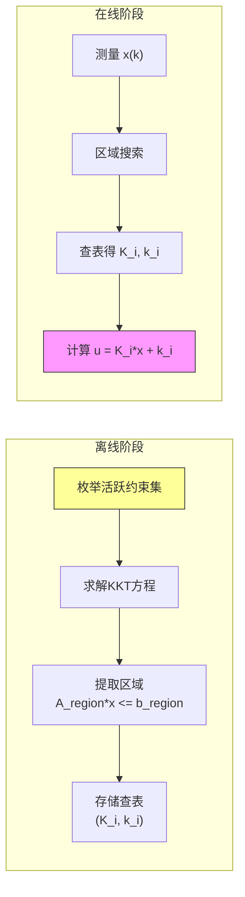

# 显式MPC与实时性

> **目标**：理解显式MPC（Explicit MPC）的核心思想——离线求解、在线查表。掌握多面体分区与分段仿射（PWA）控制律的概念，了解复杂度折中与次优策略，并能在Python中实现一个简单二维系统的显式MPC。为嵌入式MPC部署奠定理论基础。

---

## 一、为什么需要显式MPC？

标准MPC的在线流程是：

```
测量 x(k) -> 构建QP -> 求解QP -> 应用 u*(k)
```

每一步都要求解一个QP。对于状态维数 $n_x$ 较大、预测时域 $N$ 较长的问题，求解时间可能达到毫秒甚至数十毫秒级。这在PC级工控机或dSPACE上没问题，但在以下场景就成问题：

| 平台 | 典型算力 | 可承受的QP求解时间 |
|------|---------|-------------------|
| 高性能工控机 | 多核x86 | 1 ~ 10 ms |
| ARM Cortex-M7 | 480 MHz | 100 μs ~ 1 ms |
| FPGA | 并行硬件 | 1 ~ 10 μs |
| 低成本MCU | 72 MHz | 不可承受 |

如果控制周期要求 $T_s = 1\,\text{ms}$（如电机电流环），在线QP求解可能来不及。

**显式MPC的解决思路**：既然QP的结构是固定的（只有右侧 $b$ 随 $x(k)$ 变化），能不能**离线**把QP的所有可能解都算出来，然后**在线**只需要查表？

答案是：对于线性MPC，可以！

---

## 二、显式MPC的核心思想：多面体分区与PWA控制律



考虑一个无约束或带约束的线性MPC问题。其QP形式为：

$$\min_U \quad \frac{1}{2} U^T H U + f^T(x) U$$
$$\text{s.t.} \quad A_{ineq} U \le b_{ineq}(x)$$

关键观察：对于线性系统，$H$ 是常数矩阵，$f$ 和 $b_{ineq}$ 都是当前状态 $x$ 的**线性函数**。因此，QP的参数完全由 $x$ 决定。

**KKT条件**告诉我们：对于给定的 $x$，最优解 $U^*(x)$ 由活跃约束集决定。如果两个状态 $x_1$ 和 $x_2$ 具有**相同的活跃约束集**，那么它们的KKT方程结构相同，最优解的形式也相同。

更进一步，对于给定的活跃约束集，KKT方程是关于 $x$ 和 $U$ 的线性方程组。解出 $U^*(x)$ 后，只取第一个控制 $u^*(x)$，它是 $x$ 的**线性仿射函数**：

$$u^*(x) = K_i x + k_i, \quad x \in \mathcal{R}_i$$

其中 $\mathcal{R}_i$ 是状态空间中的一个**多面体区域（Polytopic Region）**，$K_i$ 和 $k_i$ 是该区域对应的增益矩阵和偏移向量。

**结论**：显式MPC的控制律是**分段仿射（Piecewise Affine, PWA）**的：状态空间被划分为有限个多面体区域，每个区域内的最优控制是状态的线性函数。

```
状态空间
+-------------------------------------------+
|  Region 1: u = K1*x + k1                  |
|       +--------------------------------+  |
|       | Region 2: u = K2*x + k2      |  |
|       |    +------------------------+  |  |
|       |    | Region 3: u = K3*x+k3|  |  |
|       |    |                      |  |  |
|       |    +------------------------+  |  |
|       +--------------------------------+  |
+-------------------------------------------+
```

> **直觉理解**：可以把显式MPC想象成一张“控制地图”。状态空间是地图的坐标，每个多面体区域是地图上的一个“省份”，每个省份对应一条简单的线性控制律。在线运行时，只需要确定当前状态落在哪个省份，然后套用对应的 $K_i x + k_i$ 即可。不需要任何迭代优化。

---

## 三、显式MPC的离线求解流程

离线阶段（通常在PC上完成，不耗时）：

1. **枚举所有可能的活跃约束集**：从QP的约束中生成所有可能的组合。对于 $m$ 个约束，最坏情况下有 $2^m$ 种组合，但大多数组合在几何上不可行或不可激活。

2. **对每个活跃约束集求解KKT方程**：验证该活跃约束集是否对应一个非空的多面体区域。如果是，计算该区域的 $K_i, k_i$ 和区域描述 $A_{region} x \le b_{region}$。

3. **构建查表结构**：存储所有区域及其对应的控制律参数。

在线阶段（在嵌入式目标上运行）：

1. **测量当前状态 $x(k)$**；
2. **区域搜索**：在分区中查找 $x(k)$ 属于哪个区域。常用方法包括：
   - **线性搜索**：逐个检查区域不等式，$O(N_{regions})$；
   - **树搜索**：构建搜索树（如kd-tree），$O(\log N_{regions})$；
   - **哈希/近似**：最近邻或近似查找，用于超大规模分区。
3. **应用控制律**：$u(k) = K_i x(k) + k_i$。

**MATLAB实现（MPT3工具箱）**：

```matlab
% explicit_mpc_demo.m
% Requires MPT3 Toolbox (Multi-Parametric Toolbox)

% Double integrator system
Ts = 0.1;
A = [1, Ts; 0, 1];
B = [Ts^2/2; Ts];
model = LTISystem('A', A, 'B', B, 'Ts', Ts);

% State and input constraints
model.x.min = [-10; -5];
model.x.max = [10; 5];
model.u.min = -2;
model.u.max = 2;

% Cost function
Q = eye(2);
R = 0.1;
model.x.penalty = QuadFunction(Q);
model.u.penalty = QuadFunction(R);

% Terminal set and terminal penalty (stability)
N = 5;
Tset = model.LQRSet;
Tpenalty = model.LQRPenalty;
model.x.with('terminalSet');
model.x.terminalSet = Tset;
model.x.with('terminalPenalty');
model.x.terminalPenalty = Tpenalty;

% Build MPC controller and compute explicit solution
mpc = MPCController(model, N);
expmpc = mpc.toExplicit();

% Plot the explicit partition
figure; expmpc.partition.plot(); title('Explicit MPC Partition');

% Query control law for a given state
x_test = [2; 0.5];
u = expmpc.evaluate(x_test);
fprintf('At x = [%g; %g], optimal u = %g\n', x_test(1), x_test(2), u);
```

---

## 四、复杂度分析：分区爆炸与工程折中

显式MPC的最大挑战是**分区数量**随问题规模指数增长。

| 参数 | 对分区数的影响 |
|------|---------------|
| 状态维数 $n_x$ | 指数增长。$n_x = 2$ 时通常几十到几百个区域；$n_x = 4$ 时可能数千到数万；$n_x > 6$ 时往往不可行 |
| 预测时域 $N$ | 线性增长。$N$ 每增加1，约束数增加，活跃约束组合增多 |
| 约束数 $m$ | 组合爆炸。最坏 $2^m$ |
| 输入维数 $n_u$ | 影响每个区域的控制律维度，但对区域数影响较小 |

**分区爆炸的直观理解**：状态空间的每个区域对应一种“控制模式”——哪些约束是活跃的。在二维状态空间，每个区域是一个多边形。当约束很多时，这些多边形会把平面切得很碎。

**工程折中策略**：

1. **缩短预测时域 $N$**：显式MPC的 $N$ 通常取 $3 \sim 10$，远小于在线MPC的 $N = 20 \sim 100$；
2. **降低状态维数**：通过降阶模型或输出反馈设计，减少显式MPC的状态维数；
3. **次优显式MPC**：不完全枚举所有区域，而是近似PWA控制律。例如，用神经网络或决策树拟合最优控制律；
4. **局部显式MPC**：只在常用操作点附近显式化，远离时用在线QP或安全备份；
5. **定期重计算**：在PC上每几分钟重新计算一次显式解，适应缓慢变化的模型参数。

---

## 五、Python实现：一个二维系统的显式MPC分区

以下Python代码演示了一个简化的双积分系统显式MPC的核心逻辑。虽然完整的显式MPC实现需要多参数规划库（如pypoman或自定义KKT枚举），这里我们用网格搜索+QP求解来**近似**生成PWA控制律，并可视化分区。

```python
# explicit_mpc_grid.py
import numpy as np
import matplotlib.pyplot as plt
from scipy.linalg import expm

# Discrete double integrator
Ts = 0.1
A = np.array([[1.0, Ts], [0.0, 1.0]])
B = np.array([[Ts**2/2], [Ts]])
Q = np.eye(2)
R = np.array([[0.1]])
N = 4
u_max = 2.0
u_min = -2.0

# Build batch matrices
nx, nu = A.shape[0], B.shape[1]
Sx = np.zeros((N*nx, nx))
Su = np.zeros((N*nx, N*nu))
for i in range(N):
    Sx[i*nx:(i+1)*nx, :] = np.linalg.matrix_power(A, i+1)
    for j in range(i+1):
        Su[i*nx:(i+1)*nx, j*nu:(j+1)*nu] = np.linalg.matrix_power(A, i-j) @ B

Q_bar = np.kron(np.eye(N), Q)
R_bar = np.kron(np.eye(N), R)
H = 2 * (Su.T @ Q_bar @ Su + R_bar)

# Grid over state space
s_grid = np.linspace(-8, 8, 60)
v_grid = np.linspace(-4, 4, 60)
S, V = np.meshgrid(s_grid, v_grid)
U_map = np.zeros_like(S)

for i in range(S.shape[0]):
    for j in range(S.shape[1]):
        x = np.array([[S[i,j]], [V[i,j]]])
        f = 2 * Su.T @ Q_bar @ Sx @ x
        
        # Simple box QP solver (projected gradient for demo)
        # In practice use a real QP solver; here we brute-force with clipping
        U_opt = -np.linalg.solve(H + 0.001*np.eye(N*nu), f)
        U_opt = np.clip(U_opt, u_min, u_max)
        U_map[i, j] = U_opt[0, 0]

fig, ax = plt.subplots(figsize=(8, 6))
contour = ax.contourf(S, V, U_map, levels=20, cmap='RdBu_r')
ax.set_xlabel('Position s [m]')
ax.set_ylabel('Velocity v [m/s]')
ax.set_title('Explicit MPC Approximation: Control Law u*(s, v)')
fig.colorbar(contour, ax=ax, label='u [N]')
plt.tight_layout()
plt.savefig('explicit_mpc_partition.png', dpi=150)
plt.show()
```

**可视化解读**：运行上述代码，你会得到一张彩色等高线图。每个颜色区域对应一个近似的控制律值。在状态空间的某些区域，控制律变化剧烈（接近约束边界），而在其他区域变化平缓。这直观地展示了PWA控制律的特性：状态空间被“划分”成不同的控制策略区域。

---

## 六、常见错误与纠正

### 错误1：在状态维数过高时强行使用显式MPC，导致分区数爆炸、内存不足

**错误表现**：试图为一个6维状态（如六自由度机器人）设计显式MPC，离线计算分区数量超过百万，存储查表需要数十MB内存，远超嵌入式MCU的容量（通常 $< 512\,\text{KB}$ RAM）。

**纠正**：
1. 显式MPC适用于**低维状态**（$n_x \le 4$）和**短预测时域**（$N \le 5$）；
2. 对于高维系统，使用在线QP求解器（如OSQP、qpOASES），或次优近似方法（神经网络拟合PWA）；
3. 如果必须使用查表，先降阶模型或只显式化关键子系统。

### 错误2：区域搜索时只用线性搜索，在高分区数时实时性不达标

**错误表现**：在嵌入式代码中，每次控制周期都从区域0到区域M逐个检查 $A_{region} x \le b_{region}$。当M = 1000时，最坏情况下需要1000次矩阵乘法，耗时过长。

**纠正**：
1. 使用**树搜索**（如二叉搜索树、区域邻接图）将搜索复杂度从 $O(M)$ 降到 $O(\log M)$；
2. 利用**warm-start**：记录上一时刻的区域索引，优先检查该区域的邻接区域；
3. 在FPGA上实现时，可以用并行比较器同时评估多个区域不等式。

---

## 七、自测习题

**习题1**：显式MPC的在线控制律为什么是分段仿射（PWA）的？每个区域的几何形状是什么？

> **答案**：因为MPC的QP问题中，$H$ 是常数，$f$ 和约束右侧都是 $x$ 的线性函数。对于给定的活跃约束集，KKT方程是线性的，解出的最优控制 $u^*(x)$ 是 $x$ 的线性仿射函数。每个活跃约束集对应一个多面体区域（由一组线性不等式定义），在该区域内 $u^*(x) = K_i x + k_i$。因此整个状态空间的控制律是分段仿射的，每个区域是凸多面体。

**习题2**：显式MPC的分区数量主要受哪些参数影响？为什么状态维数 $n_x$ 是最关键的瓶颈？

> **答案**：分区数主要受状态维数 $n_x$、预测时域 $N$、约束数量 $m$ 影响。其中 $n_x$ 最关键，因为状态空间的体积随维度指数增长（维度灾难），而每个区域的“体积”有限。为了覆盖整个状态空间，需要的区域数量也随维度指数增长。例如，$n_x = 2$ 时通常几十到几百个区域；$n_x = 4$ 时可能几千到几万个；$n_x = 6$ 时可能达到数百万，存储和搜索都不可行。

**习题3**：如果在线QP求解器在目标平台上的求解时间为 $2\,\text{ms}$，而控制周期要求 $T_s = 1\,\text{ms}$，显式MPC和在线MPC哪个更合适？显式MPC的在线查表通常需要多长时间？

> **答案**：在线MPC（$2\,\text{ms}$ 求解时间）无法满足 $1\,\text{ms}$ 控制周期，必须使用显式MPC或更短的 $N$、更快的求解器。显式MPC的在线查表通常只需要几十到几百微秒：一次区域搜索（树结构 $O(\log M)$）加上一次矩阵向量乘法（$K_i x + k_i$）。例如，在ARM Cortex-M4上，$n_x = 2$、$M = 100$ 的显式MPC查表时间约为 $20 \sim 50\,\mu\text{s}$，完全满足 $1\,\text{ms}$ 周期。

---

## 八、小结

本文解决了MPC的实时性瓶颈：

- **显式MPC**：离线求解QP，在线查表，无需迭代优化；
- **PWA控制律**：状态空间分区，每个区域线性控制；
- **分区爆炸**：$n_x$ 是最关键瓶颈，工程上需要严格限制 $n_x \le 4$；
- **次优策略**：短预测时域、降阶、神经网络近似；
- **搜索优化**：树搜索、warm-start、邻接区域优先。

下一篇，我们将通过完整应用案例，展示MPC在实际工程系统中的设计与调参。
