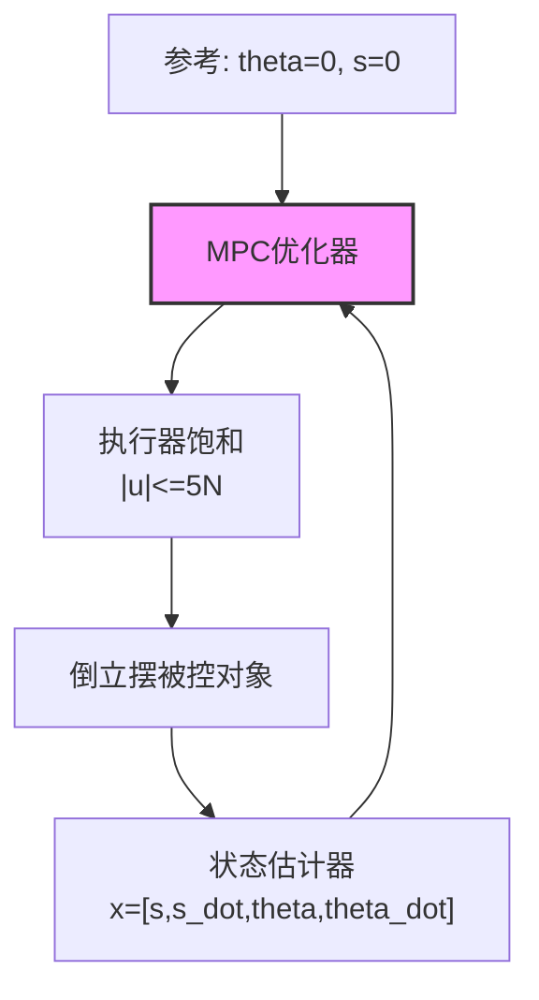

# MPC应用案例

> **目标**：通过三个完整的工程案例——倒立摆平衡控制、无人机高度跟踪、过程温度控制——展示MPC从建模到仿真到调参的完整流程。每个案例包含系统模型、MPC设计参数、代码实现、仿真结果分析和调参经验。读完之后，你应该能独立为一个新系统设计MPC并分析其性能。

---

## 一、案例1：倒立摆平衡控制



**物理背景**：倒立摆是控制理论的经典benchmark。摆杆通过小车底部的电机驱动，目标是在小车位置可控的同时，保持摆杆竖直向上。这是一个开环不稳定、非线性、多变量系统，非常适合展示MPC的约束处理能力。

**非线性模型**（小角度线性化前）：

$$(M + m) \ddot{s} + m l \ddot{\theta} \cos\theta - m l \dot{\theta}^2 \sin\theta = F$$
$$m l \ddot{s} \cos\theta + (I + m l^2) \ddot{\theta} + m g l \sin\theta = \tau$$

取 $M = 1\,\text{kg}$（小车质量），$m = 0.1\,\text{kg}$（摆杆质量），$l = 0.5\,\text{m}$（摆杆长度），$g = 9.81\,\text{m/s}^2$。忽略电机惯量和摩擦，小角度线性化后：

$$x = [s, \dot{s}, \theta, \dot{\theta}]^T, \quad u = F$$

$$A_c = \begin{bmatrix} 0 & 1 & 0 & 0 \\ 0 & 0 & -\frac{mg}{M} & 0 \\ 0 & 0 & 0 & 1 \\ 0 & 0 & \frac{(M+m)g}{Ml} & 0 \end{bmatrix}, \quad B_c = \begin{bmatrix} 0 \\ \frac{1}{M} \\ 0 \\ -\frac{1}{Ml} \end{bmatrix}$$

**离散化**（$T_s = 0.02\,\text{s}$，ZOH）：

```python
# pendulum_mpc_case.py
import numpy as np
from scipy.linalg import expm

# Physical parameters
M = 1.0     # cart mass [kg]
m = 0.1     # pendulum mass [kg]
l = 0.5     # pendulum length [m]
g = 9.81

# Continuous-time dynamics
Ac = np.array([
    [0, 1, 0, 0],
    [0, 0, -m*g/M, 0],
    [0, 0, 0, 1],
    [0, 0, (M+m)*g/(M*l), 0]
])
Bc = np.array([[0], [1/M], [0], [-1/(M*l)]])
Ts = 0.02

# ZOH discretization
A = expm(Ac * Ts)
Mblock = np.block([[Ac, Bc], [np.zeros((1, 4)), np.zeros((1, 1))]])
Ablock = expm(Mblock * Ts)
B = Ablock[:4, 4:]

C = np.eye(4)
D = np.zeros((4, 1))

print("Discrete A =\n", A)
print("Discrete B =\n", B)
```

**MPC设计参数**：

| 参数 | 取值 | 理由 |
|------|------|------|
| $N$ | 20 | 约0.4s预测，覆盖摆的动态 |
| $N_u$ | 3 | 控制自由度适中 |
| $Q$ | diag(1, 0.1, 10, 0.1) | 角度权重最大，位置次之，速度适度惩罚 |
| $R$ | 0.1 | 控制力不能过于剧烈 |
| $u_{max}$ | 5 N | 电机最大推力 |
| $u_{min}$ | -5 N | 电机反向最大推力 |

**Python实现（cvxpy + OSQP）**：

```python
import cvxpy as cp

N = 20
Nu = 3
Q = np.diag([1.0, 0.1, 10.0, 0.1])
R = np.array([[0.1]])
u_max = 5.0
u_min = -5.0

nx, nu = A.shape[0], B.shape[1]
Sx = np.zeros((N*nx, nx))
Su = np.zeros((N*nx, N*nu))
for i in range(N):
    Sx[i*nx:(i+1)*nx, :] = np.linalg.matrix_power(A, i+1)
    for j in range(i+1):
        Su[i*nx:(i+1)*nx, j*nu:(j+1)*nu] = np.linalg.matrix_power(A, i-j) @ B

Q_bar = np.kron(np.eye(N), Q)
R_bar = np.kron(np.eye(N), R)
H = 2 * (Su.T @ Q_bar @ Su + R_bar)

# Simulation
T_sim = 200
x = np.array([[0.5], [0], [0.2], [0]])  # initial: cart off-center, pendulum tilted
x_hist = np.zeros((nx, T_sim + 1))
u_hist = np.zeros((nu, T_sim))
x_hist[:, 0] = x.flatten()

for k in range(T_sim):
    f = 2 * Su.T @ Q_bar @ Sx @ x
    U = cp.Variable((N*nu, 1))
    objective = cp.Minimize(0.5 * cp.quad_form(U, H) + f.T @ U)
    constraints = [U <= u_max, U >= u_min]
    # For Nu < N, fix remaining controls (simplified: clip or assume constant)
    prob = cp.Problem(objective, constraints)
    prob.solve(solver=cp.OSQP)
    u = U.value[:nu]
    u_hist[:, k] = u.flatten()
    x = A @ x + B @ u
    x_hist[:, k+1] = x.flatten()

# Plotting (omitted for brevity, use matplotlib)
print("Final state:", x.flatten())
print("Max control force:", np.max(np.abs(u_hist)))
```

**结果分析**：

1. 小车从 $s = 0.5\,\text{m}$ 出发，摆杆初始倾斜 $0.2\,\text{rad}$；
2. MPC首先施加反向力使小车向左移动，同时利用惯性将摆杆扶正；
3. 在 $1.5\,\text{s}$ 左右，摆杆接近竖直，小车开始缓慢回中；
4. 控制力始终未超过 $\pm 5\,\text{N}$，展示了约束的自然处理。

**调参经验**：
- 如果 $Q_{\theta}$ 太小，摆杆扶正慢，可能失稳；
- 如果 $R$ 太大，响应迟钝，恢复时间显著增加；
- 输入约束 $|u| \le 5\,\text{N}$ 如果设得太低（如 $2\,\text{N}$），MPC可能无法找到可行解，因为摆杆失稳的力矩需求超过执行器能力。

---

## 二、案例2：无人机高度跟踪控制

**物理背景**：四旋翼无人机的高度控制。通过调节四个电机的总推力，控制高度 $h$ 跟踪参考轨迹。系统简化为：

$$\ddot{h} = \frac{u}{m} - g$$

其中 $u$ 是总推力（N），$m = 1.5\,\text{kg}$ 是无人机质量。$u$ 有约束：$0 \le u \le 30\,\text{N}$（电机不能反向推力，且最大总推力有限）。

**状态空间**：$x = [h, \dot{h}]^T$，$u$ 为推力。

**MPC设计要点**：

- 推力不能为负（$u \ge 0$），这是典型的**单边约束**；
- 高度有安全上限（如 $h \le 50\,\text{m}$），避免飞失控；
- 参考轨迹可能是时变的（如从 $0$ 爬升到 $10\,\text{m}$）。

**Python实现**：

```python
# drone_height_mpc.py
import numpy as np
import cvxpy as cp

m = 1.5
g = 9.81
Ts = 0.05

# Discrete state-space: h, h_dot
A = np.array([[1, Ts], [0, 1]])
B = np.array([[0], [Ts/m]])
C = np.array([[1, 0]])

N = 15
Q = np.array([[5.0]])   # weight on height error
R = np.array([[0.5]])   # weight on thrust change (penalize jitter)

u_min = 0.0
u_max = 30.0
h_max = 50.0

nx, nu = 2, 1
Sx = np.zeros((N*nx, nx))
Su = np.zeros((N*nx, N*nu))
for i in range(N):
    Sx[i*nx:(i+1)*nx, :] = np.linalg.matrix_power(A, i+1)
    for j in range(i+1):
        Su[i*nx:(i+1)*nx, j*nu:(j+1)*nu] = np.linalg.matrix_power(A, i-j) @ B

F = np.kron(np.eye(N), C) @ Sx
G = np.kron(np.eye(N), C) @ Su
Q_bar = np.kron(np.eye(N), Q)
R_bar = np.kron(np.eye(N), R)
H = 2 * (G.T @ Q_bar @ G + R_bar)

# Reference trajectory: step from 0 to 10m at t=1s
T_sim = 100
x = np.array([[0.0], [0.0]])
x_hist = np.zeros((nx, T_sim + 1))
u_hist = np.zeros((nu, T_sim))
x_hist[:, 0] = x.flatten()

for k in range(T_sim):
    h_ref = 10.0 if k >= 20 else 0.0  # step at t=1s (20*0.05)
    y_ref = np.full((N, 1), h_ref)
    f = 2 * G.T @ Q_bar @ (F @ x - y_ref)
    U = cp.Variable((N*nu, 1))
    objective = cp.Minimize(0.5 * cp.quad_form(U, H) + f.T @ U)
    constraints = [
        U >= u_min,
        U <= u_max,
        # Height constraint: F*x + G*U <= h_max
        F @ x + G @ U <= h_max
    ]
    prob = cp.Problem(objective, constraints)
    prob.solve(solver=cp.OSQP)
    u = np.maximum(U.value[:nu], u_min)
    u_hist[:, k] = u.flatten()
    x = A @ x + B @ u
    x_hist[:, k+1] = x.flatten()

print("Final height:", x[0, 0])
print("Max thrust:", np.max(u_hist))
```

**结果分析**：

1. 无人机在 $t = 1\,\text{s}$ 时收到高度阶跃指令 $10\,\text{m}$；
2. MPC迅速将推力提升到接近最大 $30\,\text{N}$（加速阶段）；
3. 当接近目标高度时，推力逐渐降低至 $u = mg \approx 14.7\,\text{N}$（悬停推力）；
4. 推力始终非负，符合物理约束。如果 $u$ 可以取负值，仿真中会出现不物理的“负推力”现象。

---

## 三、案例3：过程温度控制

**物理背景**：工业反应器的温度控制。通过调节加热功率 $P$ 控制反应器温度 $T$，模型为一阶惯性加时滞（FOPTD）：

$$G(s) = \frac{K e^{-\tau s}}{T_m s + 1}$$

取 $K = 2.0\,^{\circ}\text{C}/\%$，$T_m = 50\,\text{s}$，$\tau = 5\,\text{s}$。通过Pade近似或离散化得到状态空间模型。控制目标是温度从 $25\,^{\circ}\text{C}$ 升到 $80\,^{\circ}\text{C}$，加热功率 $0 \sim 100\%$。

**MPC设计**：

- $T_s = 2\,\text{s}$，$N = 30$（覆盖主要动态，$150\,\text{s}$）；
- $Q$ 大（温度跟踪要求高），$R$ 小（功率调整成本相对较低）；
- 温度变化率约束：$|\dot{T}| \le 3\,^{\circ}\text{C}/\text{s}$，防止热冲击。

这个案例展示了MPC在**过程工业**中的典型应用：大惯性、大时滞、约束多、跟踪慢变设定点。MPC在此领域相比PID的核心优势是：PID的超前补偿难以处理大时滞，而MPC的预测机制天然能“看穿”时滞，提前动作。

---

## 四、调参通用指南

| 现象 | 可能原因 | 调整方向 |
|------|---------|---------|
| 响应慢、跟踪差 | $Q$ 太小或 $R$ 太大 | 增大 $Q$，减小 $R$ |
| 超调大、振荡 | $Q$ 太大或 $R$ 太小 | 减小 $Q$，增大 $R$ |
| 控制输入饱和 | 约束太紧或 $N$ 太短 | 放宽约束（如果安全允许），或增大 $N$ |
| 稳态误差 | 无积分作用或参考跟踪不对 | 加入积分状态（增量MPC），或检查 $y_{ref}$ |
| 求解时间过长 | $N$ 太大，或约束过多 | 减小 $N$ 或 $N_u$，使用显式MPC |
| 不可行频繁 | 约束冲突 | 使用软约束，或增大预测时域 |

---

## 五、常见错误与纠正

### 错误1：模型不匹配导致MPC性能严重下降或失稳

**错误表现**：用理论模型设计MPC，上线后发现实际系统响应比模型慢30%，MPC预测过于乐观，导致持续超调或振荡。

**纠正**：
1. 上线前用**系统辨识**（见[[15-双控（控制理论与控制工程）/06-系统辨识与模型估计/000-图解入门：如何用数据反推模型|06-系统辨识与模型估计]]）获取数据驱动的模型；
2. 在仿真中注入模型不确定性，验证鲁棒性；
3. 使用鲁棒MPC或自适应MPC，在线更新模型参数。

### 错误2：采样周期选择不当，导致离散化模型失真或MPC无法响应

**错误表现**：为一个机械时间常数 $0.1\,\text{s}$ 的系统选择 $T_s = 0.1\,\text{s}$。MPC预测动态粗糙，控制器像“瞎子”一样动作迟缓。

**纠正**：采样周期应满足 $T_s \le T_{min}/10$，其中 $T_{min}$ 是系统最小时间常数。对于快速机电系统，$T_s$ 通常取 $1 \sim 5\,\text{ms}$。同时，离散化方法要选择ZOH（零阶保持），而不是简单的前向欧拉，后者在大 $T_s$ 下会不稳定。

---

## 六、自测习题

**习题1**：在倒立摆案例中，如果把 $Q$ 中对角度的权重从 $10$ 减小到 $0.1$，预测会出现什么现象？

> **答案**：角度权重减小后，MPC会“不在乎”摆杆倾斜，更关注小车位置和速度。结果可能是摆杆无法及时扶正，系统失稳。这验证了MPC权重设计的工程直觉：对于不稳定模态，必须给予足够高的权重以稳定它。

**习题2**：无人机推力约束为 $0 \le u \le 30\,\text{N}$。为什么推力下限是 $0$ 而不是 $-30$？如果设计MPC时忽略了这个单边约束，仿真会出现什么不物理的行为？

> **答案**：四旋翼电机只能产生向上的推力，不能反向产生拉力。因此 $u \ge 0$ 是物理约束。如果忽略此约束，MPC可能在需要快速下降时计算出负推力，这在实际中不可能实现。在线执行时如果不做饱和处理，会导致模型预测和实际行为的严重偏差，MPC性能恶化。

**习题3**：在过程温度控制中，为什么MPC比PID更适合处理大时滞系统？

> **答案**：PID控制器只根据当前误差调整，对于大时滞系统，当PID看到误差时，控制动作的效果要延迟很久才显现，导致PID反复超调。MPC通过预测模型“预见”了时滞效应，在当前时刻就提前施加控制，使得在时滞结束后系统恰好到达目标。这种“预见性”是MPC相比PID的核心优势。

---

## 七、小结

本文通过三个完整案例展示了MPC的工程实践：

- **倒立摆**：不稳定系统、多状态、力约束，验证MPC的稳定和约束能力；
- **无人机高度**：单边约束、时变参考，展示MPC的物理可行性保证；
- **过程温度**：大惯性、大时滞，展示MPC在过程工业的优势。

下一篇，我们将使用现代工具链 **CasADI** 和 **acados** 实现高效、可部署的MPC代码。
