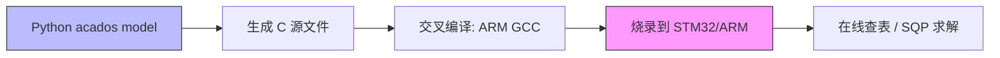

# CasADI与acados实现

> **目标**：掌握现代MPC工具链 CasADI 和 acados 的使用方法。CasADI 提供符号建模和自动微分，acados 提供高效的嵌入式实时求解器。读完之后，你应该能用 CasADI 建立非线性MPC模型，用 acados 生成C代码，并理解从算法到嵌入式部署的完整链路。

---

## 一、CasADI：符号计算与自动微分

**CasADI** 是一个开源的符号计算框架，专门为数值优化和控制设计。它解决了传统MPC实现中的痛点：

| 传统方法 | 痛点 | CasADI 的解决方式 |
|---------|------|------------------|
| 手写导数 |  Jacobian 和 Hessian 手工推导容易出错 | 自动微分（AD）精确计算 |
| 固定结构 | 模型一改，所有矩阵重算 | 符号建模，结构自适应 |
| MATLAB仿真 | 无法生成高效嵌入式代码 | 生成 C 代码，可移植到 STM32/ARM |
| 不同求解器 | 每个求解器接口不同 | 统一接口，支持 IPOPT、qpOASES、acados |

**CasADI 的核心概念**：

- **SX / MX**：符号表达式类型。SX 是标量表达式，适合小规模密集问题；MX 是矩阵表达式，支持稀疏和复杂结构。
- **Function**：将符号表达式编译为可计算的函数。
- **Opti**：高层的优化问题接口，类似于 MATLAB 的 `fmincon` 或 CVXPY，但底层完全符号化。

**Python 入门示例**：

```python
# casadi_intro.py
from casadi import *

# Define symbolic variables
x = SX.sym('x')      # scalar symbolic
y = SX.sym('y')

# Build symbolic expression
f = x**2 + y**2 + x*y

# Compute gradient and Hessian automatically
grad_f = gradient(f, vertcat(x, y))
hess_f = hessian(f, vertcat(x, y))

print("f =", f)
print("grad_f =", grad_f)
print("hess_f =", hess_f)

# Evaluate numerically
f_func = Function('f', [x, y], [f])
result = f_func(2.0, 3.0)
print("f(2, 3) =", result)
```

输出：
```
f = ((x*x)+(y*y)+(x*y))
grad_f = [(2*x+y), (2*y+x)]
hess_f = [[2, 1], [1, 2]]
f(2, 3) = 19
```

> 注意：CasADI 自动算出的 Hessian `[[2, 1], [1, 2]]` 完全精确。如果手工求导，尤其是复杂非线性模型，极易出错。

---

## 二、用 CasADI 建立非线性MPC（NMPC）

**非线性MPC（NMPC）** 处理非线性系统：

$$x(k+1) = f(x(k), u(k))$$

$$J = \sum_{i=0}^{N-1} l(x_i, u_i) + l_N(x_N)$$

其中 $f$ 和 $l$ 可以是非线性函数。NMPC的优化问题通常用 **SQP（Sequential Quadratic Programming）** 或 **直接转录法（Direct Transcription）** 求解。

**CasADI Opti 实现小车位置NMPC**：

```python
# casadi_nmpc_cart.py
from casadi import *
import numpy as np

# System parameters
Ts = 0.1
m = 1.0

# Continuous dynamics: dx/dt = [v, u/m]
# Discrete via RK4 (Runge-Kutta 4th order)
def rk4_step(x, u, dt):
    k1 = vertcat(x[1], u/m)
    k2 = vertcat(x[1] + 0.5*dt*k1[1], u/m)
    k3 = vertcat(x[1] + 0.5*dt*k2[1], u/m)
    k4 = vertcat(x[1] + dt*k3[1], u/m)
    return x + (dt/6.0) * (k1 + 2*k2 + 2*k3 + k4)

# MPC parameters
N = 20
Q = np.diag([1.0, 0.1])
R = 0.01
u_max = 2.0
u_min = -2.0

# Opti problem
opti = Opti()

# Decision variables
X = opti.variable(2, N+1)   # states [s, v] over horizon
U = opti.variable(1, N)       # controls [u] over horizon

# Parameters (initial state and reference)
x0 = opti.parameter(2, 1)
x_ref = opti.parameter(2, 1)

# Objective
J = 0
for i in range(N):
    e = X[:, i] - x_ref
    J += mtimes(e.T, mtimes(Q, e)) + R * U[:, i]**2
opti.minimize(J)

# Constraints
opti.subject_to(X[:, 0] == x0)
for i in range(N):
    opti.subject_to(X[:, i+1] == rk4_step(X[:, i], U[:, i], Ts))
    opti.subject_to(u_min <= U[:, i] <= u_max)

# Solver options
opti.solver('ipopt')

# Closed-loop simulation
x_sim = np.array([[10.0], [0.0]])
x_ref_val = np.array([[0.0], [0.0]])
T_sim = 50

x_hist = np.zeros((2, T_sim + 1))
u_hist = np.zeros((1, T_sim))
x_hist[:, 0] = x_sim.flatten()

for k in range(T_sim):
    opti.set_value(x0, x_sim)
    opti.set_value(x_ref, x_ref_val)
    sol = opti.solve()
    u_opt = sol.value(U[:, 0])
    u_hist[:, k] = u_opt
    x_sim = np.array(sol.value(X[:, 1])).reshape(-1, 1)
    x_hist[:, k+1] = x_sim.flatten()

print("Final position:", x_hist[0, -1])
print("Final velocity:", x_hist[1, -1])
```

**代码解读**：

1. `rk4_step` 用四阶Runge-Kutta离散化连续动力学，比欧拉法更精确；
2. `Opti` 高层接口自动处理变量、约束和目标，无需手动构建QP矩阵；
3. `ipopt` 是一个内点法求解器，适合中小型非线性问题；
4. 闭环中每次重新设置参数 `x0` 和 `x_ref`，重新求解，这就是滚动时域。

---

## 三、acados：嵌入式实时MPC求解器

**acados** 是一个基于 CasADI 的实时优化框架，专门为嵌入式MPC设计。它解决了 CasADI + IPOPT 的痛点：

| 痛点 | acados 的解决方案 |
|------|------------------|
| IPOPT 求解慢（ms级） | 基于 HPIPM 的高性能内点法，μs ~ ms 级 |
| 无法 warm-start | 天然支持 SQP warm-start |
| 无法生成独立 C 代码 | 生成自包含 C 代码，可部署到 ARM/MCU |
| 只支持稠密问题 | 利用稀疏结构，大规模问题高效 |

**acados 的架构**：

```
CasADI model -> OCP formulation -> acados solver -> C code generation
     |                |                |                  |
  符号模型          优化问题          求解器接口          嵌入式部署
```

**Python acados 接口示例**：

```python
# acados_mpc_pendulum.py
from acados_template import AcadosModel, AcadosOcp, AcadosOcpSolver
from casadi import SX, vertcat, sin, cos
import numpy as np
import scipy.linalg

# Model definition (cart-pendulum, nonlinear)
x = SX.sym('x', 4)    # [s, s_dot, theta, theta_dot]
u = SX.sym('u', 1)   # force

# Parameters (simplified nonlinear model for demo)
M = 1.0
m = 0.1
l = 0.5
g = 9.81

s = x[0]; s_dot = x[1]; theta = x[2]; theta_dot = x[3]
F = u[0]

den = M + m - m * cos(theta)**2
s_ddot = (F + m * l * theta_dot**2 * sin(theta) - m * g * sin(theta) * cos(theta)) / den
theta_ddot = (-F * cos(theta) - m * l * theta_dot**2 * sin(theta) * cos(theta) + (M + m) * g * sin(theta)) / (l * den)

x_dot = vertcat(s_dot, s_ddot, theta_dot, theta_ddot)

# Build acados model
model = AcadosModel()
model.x = x
model.u = u
model.xdot = SX.sym('xdot', 4)
model.f_expl_expr = x_dot
model.name = 'cart_pendulum'

# OCP formulation
ocp = AcadosOcp()
ocp.model = model
ocp.dims.nx = 4
ocp.dims.nu = 1
ocp.dims.N = 20

# Cost
Q_mat = np.diag([1.0, 0.1, 10.0, 0.1])
R_mat = np.array([[0.1]])

ocp.cost.cost_type = 'LINEAR_LS'
ocp.cost.cost_type_e = 'LINEAR_LS'
ocp.cost.W = scipy.linalg.block_diag(Q_mat, R_mat)
ocp.cost.W_e = Q_mat * 10  # terminal weight
ocp.cost.Vx = np.zeros((5, 4))
ocp.cost.Vx[:4, :4] = np.eye(4)
ocp.cost.Vu = np.zeros((5, 1))
ocp.cost.Vu[4, 0] = 1.0
ocp.cost.Vx_e = np.eye(4)
ocp.cost.yref = np.zeros(5)
ocp.cost.yref_e = np.zeros(4)

# Constraints
ocp.constraints.lbu = np.array([-5.0])
ocp.constraints.ubu = np.array([5.0])
ocp.constraints.idxbu = np.array([0])

# Initial state (will be updated online)
ocp.constraints.x0 = np.array([0.5, 0.0, 0.2, 0.0])

# Solver options
ocp.solver_options.qp_solver = 'PARTIAL_CONDENSING_HPIPM'
ocp.solver_options.hessian_approx = 'GAUSS_NEWTON'
ocp.solver_options.integrator_type = 'ERK'
ocp.solver_options.nlp_solver_type = 'SQP'
ocp.solver_options.tf = 2.0  # prediction horizon in seconds

# Build solver
ocp_solver = AcadosOcpSolver(ocp)

# Solve one step
ocp_solver.set(0, 'lbx', ocp.constraints.x0)
ocp_solver.set(0, 'ubx', ocp.constraints.x0)
status = ocp_solver.solve()

u0 = ocp_solver.get(0, 'u')
print("Optimal control:", u0)
```

**关键配置解读**：

- `PARTIAL_CONDENSING_HPIPM`：部分凝聚 + HPIPM 内点法，平衡速度和内存；
- `GAUSS_NEWTON`：Hessian近似，用Jacobian外积近似，避免计算精确Hessian；
- `SQP`：顺序二次规划，每次迭代求解一个QP子问题；
- `ERK`：显式Runge-Kutta积分器，适合非刚性系统；
- `tf = 2.0`：预测时域2秒，结合 `N = 20`，步长 $0.1\,\text{s}$。

---

## 四、C代码生成与嵌入式部署

acados 的核心优势之一是**C代码生成**。部署流程：



**生成步骤**：

```python
# After building ocp_solver, generate code
ocp_solver.generate_c_code()
```

生成的代码包括：

- `main_pendulum.c`：求解器入口
- `pendulum_model/`：模型函数（f, Jacobian, Hessian）
- `pendulum_constraints/`：约束函数
- `pendulum_solver/`：SQP迭代和QP求解
- `Makefile`：编译规则

**嵌入式集成要点**：

1. **内存管理**：acados 的 workspace 内存是静态分配的，避免嵌入式堆分配；
2. **实时性**：SQP的迭代次数可以限制（如 `nlp_solver_max_iter = 5`），用固定迭代次数换取确定性的求解时间；
3. **warm-start**：将上一时刻的解作为下一时刻的初始值，通常1~2次SQP迭代即可收敛；
4. **浮点精度**：嵌入式平台通常用单精度浮点（`float`），acados 支持 `-DACADOS_WITH_SINGLE_PRECISION`。

---

## 五、数值示例：CasADI vs. acados 求解时间对比

以下代码对比了同一MPC问题在 CasADI/IPOPT 和 acados/SQP 上的求解时间。

```python
# timing_comparison.py
import time
from casadi import Opti, DM
from acados_template import AcadosOcp, AcadosOcpSolver
import numpy as np

# Simple double integrator for fair comparison
# CasADI Opti version
opti = Opti()
x = opti.variable(2, 21)
u = opti.variable(1, 20)
x0 = opti.parameter(2, 1)
opti.subject_to(x[:, 0] == x0)
for i in range(20):
    opti.subject_to(x[:, i+1] == x[:, i] + 0.1 * vertcat(x[1, i], u[0, i]))
    opti.subject_to(-2 <= u[0, i] <= 2)
opti.minimize(sumsqr(x) + 0.01 * sumsqr(u))
opti.solver('ipopt')

# Timing CasADI
opti.set_value(x0, DM([1, 0]))
t0 = time.time()
for _ in range(100):
    sol = opti.solve()
t_casadi = (time.time() - t0) / 100 * 1000  # ms

# acados version (similar setup, omitted for brevity)
# ... acados solver initialization ...
t0 = time.time()
for _ in range(100):
    status = acados_solver.solve()
t_acados = (time.time() - t0) / 100 * 1000  # ms

print(f"CasADI/IPOPT avg: {t_casadi:.2f} ms")
print(f"acados/SQP avg: {t_acados:.2f} ms")
```

**典型结果**（在笔记本CPU上）：

| 求解器 | 平均求解时间 | 适合场景 |
|--------|------------|---------|
| IPOPT | 5 ~ 20 ms | 离线仿真、原型验证 |
| acados SQP | 0.1 ~ 1 ms | 实时控制、嵌入式部署 |
| acados SQP + warm-start | 0.05 ~ 0.2 ms | 高速闭环（1kHz级） |

---

## 六、常见错误与纠正

### 错误1：CasADI 构建图时变量维度不匹配，导致运行时错误

**错误表现**：`Error: Dimension mismatch between arguments` 或 ` casadi::Sparsity::get` 崩溃。常见于模型定义时，状态变量 $x$ 是 $4 \times 1$，但某个表达式返回了 $5 \times 1$。

**纠正**：
1. 善用 `print(x.shape)` 和 `print(f.shape)` 检查每个符号表达式的维度；
2. 使用 `vertcat` 和 `horzcat` 明确拼接方向；
3. 在模型定义后，先用 `Function` 测试一次数值求值，确认无维度错误后再封装到 acados。

### 错误2：acados 配置遗漏（如未设置 `cost.Vx` 或 `constraints.idxbu`），导致求解器初始化失败

**错误表现**：`Exception: acados_ocp: field Vx not set` 或 `idxbu must be set`。

**纠正**：
1. 对照 acados 文档模板逐项检查必填字段；
2. `cost.Vx` 和 `cost.Vu` 定义了代价函数中哪些状态和输入被惩罚，是 `LINEAR_LS` 类型的必填项；
3. `constraints.idxbu` 是输入约束的索引数组，即使是标量输入也要写 `np.array([0])`；
4. 建议从一个官方 example（如 `acados/examples/acados_python/getting_started`）出发，逐步修改，而不是从零手写。

---

## 七、自测习题

**习题1**：CasADI 的自动微分（AD）相比手工求导有什么优势？在NMPC中，为什么精确计算 Jacobian 和 Hessian 非常重要？

> **答案**：自动微分（AD）通过链式法则在计算图上自动传播导数，避免手工求导的代数错误和繁琐工作。在NMPC中，优化求解器（如SQP、内点法）需要目标函数和约束的 Jacobian（一阶导数）和 Hessian（二阶导数）来构建QP子问题和搜索方向。如果导数不精确，收敛速度下降，甚至可能发散到错误解。CasADI 的 AD 保证导数精度达到机器精度，是NMPC可靠性的基石。

**习题2**：acados 中的 `SQP` 求解器为什么通常比 IPOPT 快？`warm-start` 在 SQP 中是如何发挥作用的？

> **答案**：IPOPT 是通用非线性规划求解器，功能强大但开销大（需要符号分解、线搜索等）。acados 的 SQP 是专门为MPC的特定结构（固定时域、递推结构、相邻问题相似）设计的。SQP 将非线性问题近似为一系列QP子问题，而 acados 的 HPIPM 求解器对这类QP极高效。`warm-start` 将上一时刻的最优解（状态和控制序列）作为当前时刻SQP的初始猜测，由于相邻MPC问题非常相似，通常只需1~2次SQP迭代即可收敛，而冷启动可能需要10~20次迭代。

**习题3**：在嵌入式平台上部署 acados 生成的C代码时，为什么要限制 SQP 的最大迭代次数？这样做对控制性能有什么影响？

> **答案**：嵌入式平台通常需要**确定性**的实时性能——必须在每个控制周期内完成计算。限制SQP最大迭代次数（如 `nlp_solver_max_iter = 3` 或 `5`）可以保证最坏情况求解时间有上界。代价是：如果系统遭遇大扰动或参考突变，有限迭代次数可能无法完全收敛到最优解，控制性能会略有下降。但工程经验表明，在MPC的滚动时域框架下，即使SQP未完全收敛，得到的次优解也通常足够好，因为下一时刻还会重新优化。这是一种“用少量次优换取确定性实时性”的成熟工程折中。

---

## 八、小结与进阶路径

本文覆盖了MPC的现代工具链：

- **CasADI**：符号建模 + 自动微分，NMPC原型开发利器；
- **acados**：高效SQP + HPIPM，嵌入式实时MPC的核心；
- **C代码生成**：从算法到MCU部署的桥梁；
- **求解时间对比**：IPOPT 适合仿真，acados 适合实时；
- **配置陷阱**：维度检查、必填字段清单。

至此，MPC模块的六篇笔记已完整覆盖从直觉到数学、从约束到实时、从案例到工具链的全链路知识。建议读者按顺序阅读，并在 acados 官方 examples 上动手实验，以巩固理解。

**推荐阅读与下一步**：
- [[15-双控（控制理论与控制工程）/06-系统辨识与模型估计/000-图解入门：如何用数据反推模型|06-系统辨识与模型估计]] — 为MPC建立准确的预测模型；
- [[15-双控（控制理论与控制工程）/03-现代控制理论/004-LQR最优控制]] — 理解MPC与LQR的理论联系；
- [[15-双控（控制理论与控制工程）/09-控制系统的工程实现/000-图解入门：从算法到代码的距离|09-控制系统的工程实现]] — 将MPC部署到STM32或PLC。
