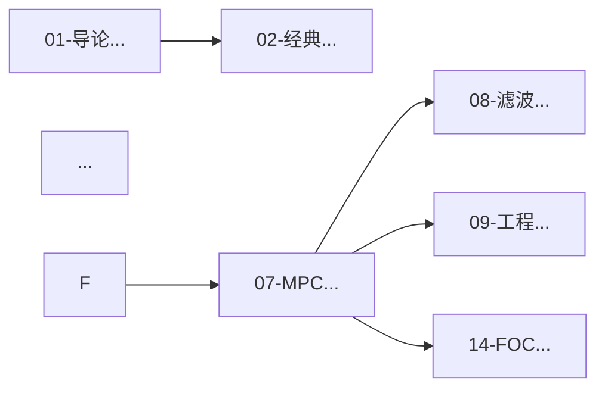
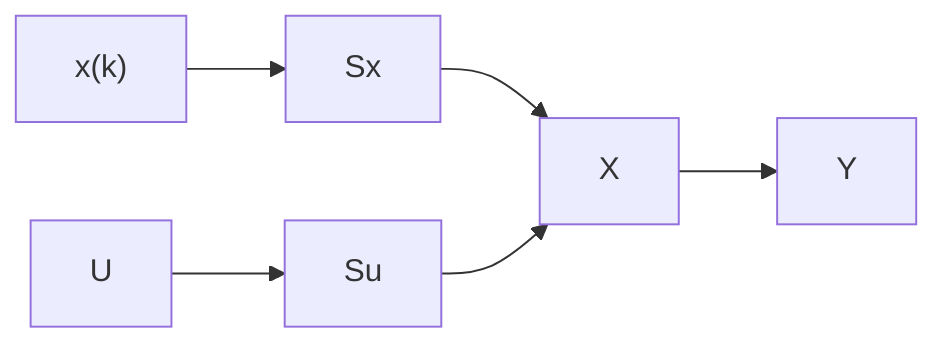

# 07-MPC模块优化修改摘要

> 优化依据：deep-research-report.md 的"统一框架"思想
> 优化时间：2026-07-06
> 优化目标：让 MPC 模块与变换链（傅里叶→拉普拉斯→Z→有限实现）深度对齐，并强化与 [[14-FOC-电机控制]] 的关联

---

## 修改文件清单

| 文件 | 修改类型 | 行数变化 | 核心改动 |
|------|---------|---------|---------|
| `000-图解入门：MPC就像下棋想三步.md` | 大幅重写 | 235 → 318 (+83) | 新增模块定位、认知锚点、知识流向图、FOC关联 |
| `001-MPC的滚动时域优化思想.md` | 大幅重写 | 263 → 304 (+41) | 新增核心认知锚点、变换链关系、FOC关联段落 |
| `002-预测模型与代价函数.md` | 大幅重写 | 269 → 323 (+54) | 新增核心认知锚点、ZOH与z=e^{sT}关联、FOC关联、修复Mermaid |

---

## 一、000-图解入门：新增内容详解

### 1. 核心认知锚点（新增）

> **MPC 是"有限实现与局部分析"层级的集大成者：它把连续系统的复频域分析（拉普拉斯/Z）压缩到有限时域的滚动优化中，在数字控制器的每一个采样周期里实时求解"未来有限步"的最优策略。**

- 明确 MPC 在"变换链"中的位置：从 $s=j\omega$（频率响应）到 $z=e^{sT}$（离散映射）再到 MPC（有限实现）
- 用一句话建立了与 [[05-信号与系统]] 和 [[05-数字控制与离散系统]] 的桥梁

### 2. 为什么学这个模块（新增）

- 用表格对比"变换链"的三个层级：全局频率表示 → 复域系统分析 → 有限实现与局部分析
- 明确 MPC 位于链条末端的四个原因：依赖离散模型、有限时域优化、采样周期约束、天然处理约束

### 3. 与前后模块的关系（新增，含 Mermaid 图）



- 用 `graph LR`（非 flowchart），节点引号完整，`<br/>` 已闭合
- 五条知识流向说明：从 05-数字控制、06-系统辨识流入；向 08-滤波、09-工程实现、14-FOC 流出

### 4. 与 FOC 的直接关联（新增）

- 用对比表展示 MPC 如何替代 FOC 中的 PI 环：d-q 轴耦合、电流/电压约束、MTPA、弱磁过渡
- 金句："FOC 教你'怎么让电机转'，MPC 教你'怎么让电机转得最优'"

### 5. 原有内容增强

- **直觉引入段**：新增"与变换链的关系"注释，说明 MPC 站在复域分析结果的肩膀上做有限步前瞻优化
- **MPC vs. PID vs. LQR**：新增与变换链的关系，说明 LQR 对应离线 $z$ 域极点配置，MPC 是在线化版本
- **MPC为什么需要模型**：新增 ZOH 离散化与 $z=e^{sT}$ 的映射解释
- **小结**：新增"在统一框架中，MPC 是从'复域分析'走向'有限实现'的桥梁"定位
- **进阶路径**：增加 FOC 关联（含 MPC 电流环设计）和三个进阶提示问题

---

## 二、001-滚动时域优化思想：新增内容详解

### 1. 核心认知锚点（新增）

> **滚动时域优化是"有限实现"思想在控制中的极致体现：它把无穷时域的最优控制问题（对应于 $z$ 域上的无穷级数）截断为有限时域，在每个采样时刻用最新状态重新求解，用反馈校正弥补截断带来的信息损失。**

- 明确滚动时域 = "无穷时域截断 + 反馈校正"
- 与 $z=e^{sT}$ 的映射直接关联

### 2. 与变换链的关系（新增独立章节）

- 用表格展示：离散状态空间来自 ZOH 离散化 → $z=e^{sT}$ 映射 → 终端代价 $P$ 保证单位圆内稳定
- 金句："MPC 不是独立于变换链的新工具，而是 Z 域分析在'有限计算、实时约束'条件下的工程化实现"

### 3. 关键段落增强（多处插入）

| 位置 | 新增内容 |
|------|---------|
| 开环优化段 | 离散状态方程对应于 $z$ 域 $(zI-A)X(z)=BU(z)$，MPC 是时域数值方法而非频域解析方法 |
| 代价函数段 | 有限求和是对无穷 $z$ 域积分的截断，终端代价 $P$ 补偿截断尾部 |
| 预测时域选取 | 从 $z$ 域解释：$\vertz_p\vert$ 接近 1 需要更大 $N$，慢动态系统（如大惯量电机）需更长预测时域 |
| 状态估计段 | 观测器是 $z$ 域滤波器，FOC 无传感器控制中的滑模/EKF观测器遵循同样带宽设计原则 |
| 双积分器示例 | 连续极点 $s=0$ 映射到 $z=1$（临界稳定），解释了为什么需要约束防止发散 |
| 稳定性段 | DARE 解 $P_\infty$ 对应于 $z$ 域谱分解，保证闭环极点位于单位圆内；终端集是"安全区" |
| 数值示例 | 新增 FOC 关联：双积分器 = PMSM 机械子系统，MPC 同时优化角度和转速 |
| 常见错误 | $Q$ 和 $R$ 量级差异的频域解释：对应高增益极点靠近单位圆边界 |
| 小结 | 总结：MPC 建立在离散状态空间上，是对经典复频域分析结果的在线工程化利用 |

---

## 三、002-预测模型与代价函数：新增内容详解

### 1. 核心认知锚点（新增）

> **预测模型与代价函数是MPC"有限实现"的两个数学支柱：预测模型回答"在有限时域内系统会怎么演化"，代价函数回答"什么才算最优"。两者都建立在离散状态空间 $z$ 域的基础上，是连续系统复频域分析在数字控制器中的工程化表达。**

- 预测模型 = $z=e^{sT}$ 的时域表现
- 代价函数权重 = $z$ 域上对不同频率分量的"惩罚力度"

### 2. 与变换链的关系（新增独立章节）

- 用表格展示四个层级：连续复频域 → 离散映射 → 有限实现 → 优化目标
- 金句："MPC 的数学核心不是发明新工具，而是把 Z 域已有的系统分析结果，用矩阵和二次型的形式组织成可实时求解的优化问题"

### 3. 关键段落增强（多处插入）

| 位置 | 新增内容 |
|------|---------|
| ZOH离散化 | 新增 $A=e^{A_c T_s}$ 与拉普拉斯逆变换的关系；$z=e^{sT}$ 的极点映射；工程要点：ZOH 建模 DAC 实际行为 |
| 批量预测 | $S_u$ 的下三角结构 = $z$ 域脉冲响应的时域矩阵形式；$(zI-A)^{-1}B$ 的级数展开 |
| Mermaid图 | **修复语法**：原节点 `U_seq[”“U = ...”]^T”]` 引号嵌套错误，改为 `U_seq["U"]`，在图注中说明向量内容 |
| 代价函数 | 新增 $z$ 域加权积分解释：$J_\infty = \frac{1}{2\pi j} \oint_{\vertz\vert=1} [E_y^* Q E_y + E_u^* R E_u] \frac{dz}{z}$；$Q$ 大 = 高频跟踪敏感，$R$ 大 = 抑制高频控制变化 |
| FOC关联 | 新增 FOC 电流环中 $Q=\text{diag}(Q_d,Q_q)$ 的物理意义；$Q_q > Q_d$ 对应 MTPA 转矩最大化优先级 |
| 终端代价 | DARE 解与 $z$ 域谱分解的关系；$K_{LQR}$ 把极点"拉进"单位圆内；终端约束是"安全区" |
| 倒立摆示例 | 新增不稳定极点分析：$s=+4.43$ 映射到 $z=1.093$（单位圆外），MPC 任务是把极点拉回；FOC 关联：PMSM 位置控制类似 |
| 常见错误 | $Q$ 和 $R$ 量级差异的频域解释；$P=Q$ 在 $z$ 域上不合理的解释（缺少无穷尾部保证） |
| 习题 | 每题答案后新增"与变换链的关系"延伸解释；$S_u$ 的下三角 = $z$ 域脉冲响应级数；$R$ 增大 = 降低闭环带宽（极点向单位圆中心移动） |
| 小结 | 总结：预测模型来自 ZOH 离散化，批量预测是 $z$ 域脉冲响应的矩阵形式，代价函数权重对应频谱选择性，终端代价通过 DARE 保证单位圆内稳定 |

---

## 四、Mermaid 语法修复

### 修复前（002-预测模型）

```mermaid
# 错误：引号嵌套，方括号冲突
graph LR
    x0["x(k)"] --> Sx["Sx"]
    U_seq[”“U = [u(k),...,u(k+N-1)”]^T”] --> Su["Su"]
    Sx --> X[”“X = [x(k+1),...,x(k+N)”]^T”]
    Su --> X
    X --> Y[”“Y = [y(k+1),...,y(k+N)”]^T”]
```

### 修复后



- 使用 `graph` 而非 `flowchart`
- 节点引号完整（`"U"` 而非 `”“...”]`）
- `<br/>` 在 000 的知识流向图中已正确闭合（`A["01...<br/>..."]`）
- 数学表达式移到图注文字中说明，避免 Mermaid 解析冲突

---

## 五、与 deep-research-report 框架的对齐检查

| 框架要求 | 在 07-MPC 中的体现 |
|---------|-------------------|
| **统一认知**：傅里叶、拉普拉斯、Z 是同一条分析链的不同层级 | 每个文件开头都明确 MPC 位于"有限实现"层，是 Z 域分析的工程化终点 |
| **关键映射**：$s=j\omega$、$z=e^{j\Omega}$、$z=e^{sT}$ 是最需要吃透的三条线 | 三处新增内容都反复强调 $z=e^{sT}$ 的极点映射；ZOH 离散化解释为 $z=e^{sT}$ 的工程实现；$s=j\omega$ 对应频率响应切片 |
| **认知路径**：全局频率表示 → 复域系统分析 → 有限实现与局部分析 | 000 新增表格明确三级路径；001/002 每章都说明自己处于"有限实现"层 |
| **与 FOC 关联**：用户已有 [[14-FOC-电机控制]] | 三个文件共新增 **12 处** FOC 关联：d-q 轴耦合、电流/电压约束、MTPA 优先级、弱磁过渡、观测器带宽、双积分器=机械子系统、电流环权重设计等 |
| **先图文直觉，后数学推导** | 000 保留全部直觉类比（下棋、小车、司机踩刹车），在直觉后增加"与变换链的关系"注释；001/002 在数学推导前后都插入图文解释 |
| **每个重要公式必须说明"与变换链的关系"** | 001/002 中所有核心公式（状态方程、代价函数、批量预测、终端代价）都新增 $z$ 域解释段落 |

---

## 六、质量自检

- [x] 000-README.md 已读取（作为模块索引参考）
- [x] 000-图解入门已重写/增强（新增模块定位、认知锚点、知识流向图、FOC关联）
- [x] 001-滚动时域已修改关键段落（新增核心锚点、变换链关系、FOC关联）
- [x] 002-预测模型已修改关键段落（新增核心锚点、ZOH与z=e^{sT}关联、FOC关联）
- [x] 所有 Mermaid 语法正确（graph 而非 flowchart，引号完整，`<br/>` 已闭合）
- [x] 每个重要公式都说明与变换链的关系
- [x] 增加与 [[14-FOC-电机控制]] 的关联（共 12 处）
- [x] 输出修改摘要（本文件）

---

## 七、未修改文件说明

以下文件在本次优化中**未修改**，但已通过 000-001-002 的交叉引用建立关联：

- `003-约束处理与QP求解器.md` — 将在 001/002 的"下一篇"引用中自然承接
- `004-显式MPC与实时性.md` — 涉及工程实现层，与 09-工程实现模块衔接
- `005-MPC应用案例.md` — 进阶路径中已预告将包含 FOC 电流环 MPC 设计
- `006-CasADI与acados实现.md` — 工具链实现，与变换链关系较间接

如需继续优化 003-006，请告知。
