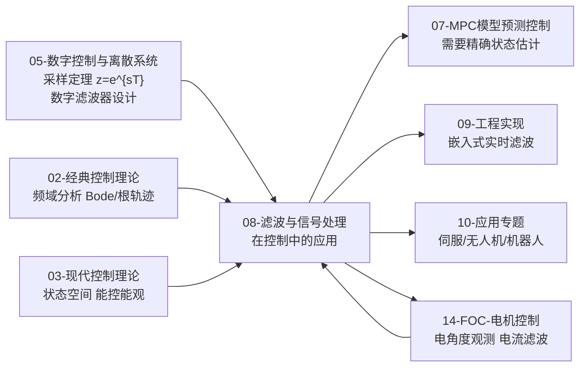

# 图解入门：滤波器是控制系统的感官

> 想象一下：你的眼睛在浓雾中试图看清前方的路，耳朵在嘈杂的餐厅里试图听清朋友的低语。你的大脑会自动"过滤"掉噪声，提取有用的信息。控制系统中的滤波器，做的正是这件事。

---

## 0. 核心认知锚点与知识定位

### 0.1 核心认知锚点

> **滤波与信号处理在控制中的应用，是统一变换链从"复域系统分析"走向"状态空间最优估计"的关键跃迁：它把 $s=j\omega$ 的频率分离直觉和 $z=e^{sT}$ 的离散化映射，升级为带噪声的实时状态重建算法，最终让控制器基于"净化后的信息"做出决策。**

### 0.2 为什么学：本模块在统一框架中的位置

在 deep-research-report 的"统一框架"中，三条主线（信号与系统、数字信号处理、自动控制）共享同一骨架：**复指数是线性时不变系统的特征函数，卷积在合适变换域里会化成乘法**。沿着这条骨架，认知路径是：

**全局频率表示（傅里叶）→ 复域系统分析（拉普拉斯/Z）→ 有限实现与局部分析（数字滤波/状态估计）**

| 层级 | 核心问题 | 本模块的位置 |
|------|---------|------------|
| **全局频率表示** | 信号有哪些频率成分？ | 前置知识（05-数字控制与离散系统） |
| **复域系统分析** | 系统是否稳定？极点在哪里？ | $H(s)$、$H(z)$ 的噪声版本 |
| **有限实现与局部分析** | 如何在有限数据、有限算力、带噪声条件下实现最优估计？ | **本模块的核心战场** |

换句话说，本模块不是"另一个独立的滤波器课程"，而是**把前五模块的变换域工具，在噪声和实时约束下真正落地为可执行算法**。

### 0.3 与前后模块的关系



**知识流向说明**：

- **从 05 流入**：数字滤波器的 $z$ 域设计（$z=e^{sT}$ 映射）、采样与混叠的物理约束，是本章所有数字滤波器实现的基础。
- **从 02 流入**：频域设计的直觉——低通/高通/带通的 $s$ 域概念，直接对应数字滤波器的频率响应 $H(e^{j\Omega})$。
- **从 03 流入**：状态空间描述是卡尔曼滤波器和状态观测器的数学载体；能控能观性决定了状态估计是否可行。
- **向 07 流出**：MPC 的滚动优化需要准确的当前状态估计，卡尔曼滤波是其标准前级。
- **向 09 流出**：嵌入式实现的定点运算、延迟约束、任务周期，决定了滤波器算法的代码形态。
- **向 10 流出**：伺服系统的编码器滤波、无人机的 IMU 融合、机器人的力传感器滤波，都是本章方法的直接应用。
- **与 14-FOC 双向关联**：FOC 的电流采样滤波、电角度观测器（如滑模观测器、扩展卡尔曼滤波）需要本章的噪声模型和估计算法；反之，FOC 的实时约束（如电流环 50-100 μs 周期）也定义了本章滤波器的延迟和算力边界。

---

## 1. 为什么控制系统需要滤波

### 1.1 一个直觉场景：自动驾驶的"视力"

一辆自动驾驶汽车的激光雷达每秒产生 10 万个点。这些点中：

- 一部分是真实障碍物的反射信号（有用信号）
- 一部分是雨滴、灰尘、阳光干扰（环境噪声）
- 还有一部分是传感器电子电路的热噪声（器件噪声）

如果控制器直接使用原始数据，方向盘可能会因为一粒灰尘而突然猛打。滤波器的作用，就是让控制系统"学会"区分什么是信号、什么是噪声。

### 1.2 信号与噪声的频谱直觉

在时域中，信号和噪声纠缠在一起难以分辨。但在频域中，它们通常占据不同的"频段"：

```
幅度
  ^
  |    信号能量                噪声能量
  |      ***                     ~~~
  |     *****                   ~~~~~
  |    *******    [空白]        ~~~~~~~
  |   *********                  ~~~~~
  |      ***                     ~~~
  +-----------------------------------------> 频率
         |                       |
       低频区                  高频区
       (有用信息)              (随机干扰)
```

上图揭示了一个核心直觉：**有用信号通常变化缓慢（低频），而噪声通常变化剧烈（高频）**。滤波器就是利用这一频谱分离特性，将噪声抑制掉的。

> **与变换链的关系**：这个频谱分离特性正是 $H(j\omega)$（连续域）或 $H(e^{j\Omega})$（离散域）所实现的功能——滤波器在频域上构造一个"选择性窗口"，让有用频率通过，抑制无用频率。从 $s=j\omega$ 的视角，低通滤波器的 $s$ 域传递函数 $H(s)$ 在虚轴上的取值 $H(j\omega)$ 直接决定了"哪些频率能通过、哪些被衰减"。

---

## 2. 滤波器的本质：频域的"门"

### 2.1 四类理想滤波器

从频域视角，滤波器可以被理解为对不同频率成分的"筛选门"：

| 滤波器类型 | 通过的频率 | 抑制的频率 | 典型应用场景 |
|-----------|-----------|-----------|-------------|
| 低通 (LPF) | 低频 | 高频 | 平滑传感器数据，抑制高频噪声 |
| 高通 (HPF) | 高频 | 低频 | 去除信号直流漂移，检测变化率 |
| 带通 (BPF) | 中间频段 | 低频+高频 | 提取特定振动模态，通信解调 |
| 带阻 (BRF/Notch) | 除特定频率外全部 | 特定频率 | 消除工频 50/60 Hz 干扰 |

### 2.2 从 RC 电路建立直觉

最简单的低通滤波器由一个电阻 $R$ 和一个电容 $C$ 构成：

```
        R
Vin o----//\/\----+----o Vout
                   |
                  --- C
                  ---
                   |
                  GND
```

**物理直觉**：
- 低频信号：电容的阻抗 $Z_C = \frac{1}{j\omega C}$ 很大，电压主要落在电容两端 → 信号通过
- 高频信号：电容阻抗很小，高频分量被"短路"到地 → 信号被抑制

传递函数推导（复频域）：

$$
G(s) = \frac{V_{out}(s)}{V_{in}(s)} = \frac{\frac{1}{sC}}{R + \frac{1}{sC}} = \frac{1}{1 + sRC}
$$

令时间常数 $\tau = RC$，则：

$$
G(s) = \frac{1}{1 + \tau s}
$$

**截止频率**（幅度衰减到 $1/\sqrt{2} \approx -3\,\text{dB}$ 处的频率）：

$$
\omega_c = \frac{1}{\tau} = \frac{1}{RC} \quad [\text{rad/s}]
$$

> **与变换链的关系**：这个一阶低通原型在 $s$ 域的极点位于 $s = -1/\tau$（左半平面，稳定）。通过 $z = e^{sT}$ 或双线性变换映射到离散域后，极点位置直接决定了数字滤波器的稳定性与带宽——这正是 3.2 节要展开的内容。

### 2.3 数值示例

设计一个截止频率为 $f_c = 100\,\text{Hz}$ 的 RC 低通滤波器。选取 $C = 10\,\text{nF}$，求 $R$：

$$
\omega_c = 2\pi f_c = 2\pi \times 100 = 628.3\,\text{rad/s}
$$

$$
R = \frac{1}{\omega_c C} = \frac{1}{628.3 \times 10 \times 10^{-9}} \approx 159.2\,\text{k}\Omega
$$

实际工程中可取标称值 $R = 160\,\text{k}\Omega$。

---

## 3. 从模拟到数字：采样与离散化

### 3.1 为什么控制工程偏爱数字滤波器

| 特性 | 模拟滤波器 | 数字滤波器 |
|-----|-----------|-----------|
| 精度 | 受元件容差影响 | 由字长决定，可任意精确 |
| 稳定性 | 随温度/老化漂移 | 完全可复现 |
| 灵活性 | 硬件固定后不可改 | 软件随时重配置 |
| 实现成本 | 每通道都需要硬件 | 复用同一个处理器 |
| 相位特性 | 难以精确控制 | 可设计线性相位 |

现代控制系统几乎全部采用数字滤波器。

### 3.2 离散化的核心方法：双线性变换

将连续传递函数 $G(s)$ 转换为离散传递函数 $G(z)$ 的最常用方法是**双线性变换（Tustin 变换）**：

$$
s = \frac{2}{T_s} \cdot \frac{z - 1}{z + 1}
$$

其中 $T_s$ 为采样周期。该变换将 $s$ 平面的虚轴映射到 $z$ 平面的单位圆上，保持了稳定性。

> **与变换链的关系**：双线性变换是 $z = e^{sT}$ 映射的**一阶有理近似**。它把 $s$ 平面的虚轴（$s = j\omega$）精确映射到 $z$ 平面的单位圆（$z = e^{j\Omega}$）上，从而保持了连续系统的稳定特性：$s$ 左半平面 → $z$ 单位圆内。当采样率足够高时，$z = e^{sT}$ 的精确映射与双线性近似几乎重合；工程上选择双线性变换，是因为它把有理的 $s$ 域传递函数 $H(s)$ 映射为有理的 $z$ 域传递函数 $H(z)$，便于数字实现。

**数值示例**：将上述 RC 低通滤波器离散化，采样率 $f_s = 1\,\text{kHz}$（$T_s = 1\,\text{ms}$）：

$$
G(s) = \frac{1}{1 + \tau s}, \quad \tau = 1.592\,\text{ms}
$$

应用双线性变换：

$$
G(z) = \frac{1}{1 + \tau \cdot \frac{2}{T_s}\frac{z-1}{z+1}} = \frac{T_s(z+1)}{T_s(z+1) + 2\tau(z-1)}
$$

代入数值并整理成差分方程形式：

$$
G(z) = \frac{0.1353(z+1)}{z - 0.7295} = \frac{0.1353 + 0.1353 z^{-1}}{1 - 0.7295 z^{-1}}
$$

对应的时域递推公式为：

```python
# First-order digital low-pass filter
def lpf_step(y_prev, x_curr, x_prev, a1, b0, b1):
    """
    y[n] = a1 * y[n-1] + b0 * x[n] + b1 * x[n-1]
    For the example above: a1=0.7295, b0=b1=0.1353
    """
    y_curr = a1 * y_prev + b0 * x_curr + b1 * x_prev
    return y_curr
```

---

## 4. FIR 与 IIR：数字滤波器的两大阵营

### 4.1 直观对比

| 特性 | FIR（有限 impulse 响应） | IIR（无限 impulse 响应） |
|-----|------------------------|------------------------|
| 脉冲响应长度 | 有限长 $N$ | 理论上无限长 |
| 稳定性 | 始终稳定 | 需要仔细设计以保证稳定 |
| 相位特性 | 可精确实现线性相位 | 通常非线性相位 |
| 计算量 | 阶数较高时运算量大 | 可用低阶实现陡峭截止 |
| 延迟 | 固有群延迟 $\approx N/2$ | 延迟较小但频率相关 |

**工程直觉**：
- 需要**严格线性相位**（如图像处理、精密伺服）→ 选 FIR
- 需要**低阶高选择性**、延迟不是首要约束 → 选 IIR

> **与变换链的关系**：从 $z$ 域视角，FIR 滤波器对应**有限项多项式** $H(z)=\sum_{k=0}^{N-1}h_k z^{-k}$，除原点外没有极点，因此天然稳定；IIR 滤波器对应**有理分式** $H(z)=\frac{B(z)}{A(z)}$，极点位置决定了稳定性和频率选择性，但也带来了相位非线性和系数量化敏感的问题。$z$ 平面上极点越靠近单位圆，频率选择性越强，但对量化误差越敏感。

### 4.2 滑动平均：最简单的 FIR 滤波器

```
x[n]  ----->[ z^-1 ]-->[ z^-1 ]-->[ z^-1 ]-->[ z^-1 ]
              |         |         |         |
            1/N       1/N       1/N       1/N
              |         |         |         |
              +---------+---------+---------+-----> y[n]
```

$N$ 点滑动平均的差分方程：

$$
y[n] = \frac{1}{N}\sum_{k=0}^{N-1} x[n-k]
$$

**特点**：
- 实现极其简单，没有乘法器仅用移位（当 $N$ 为 2 的幂时）
- 相当于矩形窗，频域是 sinc 函数，旁瓣较高
- 群延迟固定为 $\tau = \frac{N-1}{2} T_s$

---

## 5. 常见错误与纠正

### 错误 1：忽略双线性变换的频率畸变

**现象**：按 $f_c = 100\,\text{Hz}$ 设计的模拟滤波器，经双线性变换离散后，实际截止频率偏移到了约 $97.5\,\text{Hz}$。

**原因**：双线性变换引入了**频率畸变（frequency warping）**。$s$ 域频率 $\omega_a$ 与 $z$ 域频率 $\omega_d$ 的关系为非线性：

$$
\omega_a = \frac{2}{T_s} \tan\left(\frac{\omega_d T_s}{2}\right)
$$

**纠正方法**：**预畸变（pre-warping）**。在设计模拟原型时，先将目标数字频率预畸变为模拟频率：

$$
\omega_a^{\text{design}} = \frac{2}{T_s} \tan\left(\frac{\omega_d^{\text{target}} T_s}{2}\right)
$$

然后以 $\omega_a^{\text{design}}$ 为截止频率设计模拟滤波器，再双线性变换，即可精确得到目标数字频率。

**数值验证**：目标 $f_d = 100\,\text{Hz}$，$T_s = 1\,\text{ms}$：

$$
\omega_a = \frac{2}{0.001} \tan\left(\frac{2\pi \times 100 \times 0.001}{2}\right) = 2000 \times \tan(0.314) \approx 651.0\,\text{rad/s}
$$

对应 $f_a \approx 103.6\,\text{Hz}$。用此频率设计模拟原型，经 Tustin 变换后数字截止频率将精确为 $100\,\text{Hz}$。

### 错误 2：IIR 滤波器系数量化导致极限环振荡

**现象**：一个稳定的高阶 IIR 滤波器在 16 位定点 DSP 上实现后，即使输入为零，输出仍存在微小但持续的振荡。

**原因**：IIR 滤波器的递归结构使得量化误差被不断反馈。特别是当极点靠近单位圆时，有限字长效应会使有效极点位置偏移，甚至移出单位圆导致不稳定。

**纠正方法**：
1. **级联二阶节（SOS, Second-Order Sections）**：将高阶 IIR 拆分为多个双二阶（Biquad）节级联，降低每节的灵敏度：

$$
G(z) = \prod_{k=1}^{M} \frac{b_{0k} + b_{1k}z^{-1} + b_{2k}z^{-2}}{1 + a_{1k}z^{-1} + a_{2k}z^{-2}}
$$

2. **提高字长**：从 16 位提升到 32 位浮点或定点。
3. **采用稳定的结构**：如格型（lattice）结构对系数量化更不敏感。

---

## 6. 滤波器设计工具链

| 工具 | 用途 | 示例 |
|-----|------|------|
| MATLAB `designfilt` | 交互式设计 FIR/IIR | `d = designfilt('lowpassfir', 'FilterOrder', 20, 'CutoffFrequency', 100, 'SampleRate', 1000)` |
| Python `scipy.signal` | 科学计算与滤波 | `b, a = butter(4, 100/(500), btype='low')` |
| Python `filtfilt` | 零相位双向滤波 | `y = filtfilt(b, a, x)` |
| CMSIS-DSP | ARM Cortex-M 嵌入式 | `arm_biquad_cascade_df1_f32()` |

**零相位滤波的重要提示**：`filtfilt` 对信号前向和反向各滤波一次，消除了 IIR 的相位失真，但引入了非因果性（相当于对未来数据做了预测），因此**不能用于实时控制回路**，仅适用于离线数据分析。

---

## 7. 与 14-FOC-电机控制的关联

用户已有的 [[14-FOC-电机控制/00-README|14-FOC-电机控制]] 微专业，是本章滤波与信号处理方法的**最直接应用场域**之一：

| FOC 子系统 | 对应的滤波/估计问题 | 本章工具 |
|-----------|-------------------|---------|
| **电流采样** | ADC 采样存在量化噪声和开关噪声 | 一阶数字低通、IIR 滤波器、移动平均 |
| **电角度观测** | 无传感器 FOC 需要从无刷电机反电势重建转子位置 | 状态观测器、扩展卡尔曼滤波（EKF）、滑模观测器 |
| **速度估计** | 编码器脉冲计数存在量化误差，低速时尤其严重 | 卡尔曼滤波、锁相环（PLL）速度跟踪 |
| **多传感器融合** | 电流传感器 + 温度传感器 + 直流母线电压的联合估计 | 互补滤波、传感器融合策略 |

**关键认知**：在 FOC 电流环（通常 50–100 μs 周期）中，滤波器的延迟直接影响环路相位裕度。因此 FOC 中的滤波器设计不是"选个截止频率就行"，而是必须在**噪声抑制带宽**与**控制环路稳定性**之间做严格折中——这正是本章"低延迟滤波设计"（004）的核心议题。

从变换链的视角，FOC 的电流环可以看作：
- **连续域**：$H(s)$ 是 PI 控制器 + 电机电气模型（$L\frac{di}{dt} + Ri = v$）
- **离散域**：经 $z=e^{sT}$ 映射后，数字 PI + 数字滤波器共同构成 $H(z)$
- **状态空间**：电机电气方程是卡尔曼滤波/观测器的状态方程基础（$\frac{di}{dt} = -\frac{R}{L}i + \frac{v}{L}$）

因此，**掌握本章的滤波器设计、状态估计和延迟分析，是理解 FOC 无传感器控制和高性能电流环的必备前提**。

---

## 8. 自测习题

### 习题 1
一个 RC 低通滤波器，$R = 10\,\text{k}\Omega$，$C = 1\,\mu\text{F}$。求：
(1) 截止频率 $f_c$；
(2) 当输入为 $1\,\text{kHz}$ 正弦波时，输出幅度衰减多少 dB？

<details>
<summary>点击查看答案</summary>

(1) $\tau = RC = 10\times10^3 \times 1\times10^{-6} = 0.01\,\text{s}$

$f_c = \frac{1}{2\pi\tau} = \frac{1}{2\pi \times 0.01} \approx 15.9\,\text{Hz}$

(2) 在 $f = 1\,\text{kHz}$ 处，$\omega = 2\pi \times 1000 = 6283\,\text{rad/s}$

幅度响应：$|G(j\omega)| = \frac{1}{\sqrt{1+(\omega\tau)^2}} = \frac{1}{\sqrt{1+(62.83)^2}} \approx \frac{1}{62.84} \approx 0.0159$

衰减：$20\log_{10}(0.0159) \approx -36\,\text{dB}$

</details>

### 习题 2
用双线性变换（带预畸变）设计一个数字低通滤波器，采样率 $f_s = 2\,\text{kHz}$，目标 $-3\,\text{dB}$ 截止频率 $f_c = 200\,\text{Hz}$。求预畸变后的模拟截止频率 $f_a$。

<details>
<summary>点击查看答案</summary>

$T_s = 1/2000 = 0.5\,\text{ms}$

$\omega_d = 2\pi \times 200 = 400\pi\,\text{rad/s}$

预畸变：

$\omega_a = \frac{2}{T_s} \tan\left(\frac{\omega_d T_s}{2}\right) = \frac{2}{0.0005} \tan\left(\frac{400\pi \times 0.0005}{2}\right) = 4000 \times \tan(0.314) = 4000 \times 0.3249 \approx 1299.6\,\text{rad/s}$

$f_a = \frac{\omega_a}{2\pi} \approx 206.8\,\text{Hz}$

</details>

### 习题 3
一个 IIR 滤波器的传递函数为 $G(z) = \frac{1}{1 - 0.95z^{-1}}$。判断其稳定性，并说明若将系数 $0.95$ 误写为 $1.05$ 会发生什么。

<details>
<summary>点击查看答案</summary>

极点位于 $z = 0.95$，在单位圆内（$|0.95| < 1$），因此稳定。

若系数变为 $1.05$，极点移至 $z = 1.05$，在单位圆外。此时系统不稳定，对任何有界输入，输出都会指数增长发散。

差分方程 $y[n] = 1.05 \cdot y[n-1] + x[n]$ 的齐次解为 $y_h[n] = C \cdot (1.05)^n$，随 $n$ 增大而发散。

</details>

---

## 9. 延伸阅读导航

- `001-卡尔曼滤波.md` — 最优状态估计与噪声抑制的统一框架
- `002-互补滤波.md` — 多传感器频域互补融合的经典方法
- `003-状态观测器作为滤波器.md` — 从控制理论视角理解滤波
- `004-低延迟滤波设计.md` — 实时控制系统中的延迟约束与优化
- `005-传感器融合.md` — 多源异构信息的融合策略

**跨微专业关联**：
- [[14-FOC-电机控制/00-README|14-FOC-电机控制]] — FOC 的电流采样滤波、电角度观测器、速度估计均需要本章方法支撑；本章的延迟分析与低延迟设计是 FOC 电流环优化的关键前提。
