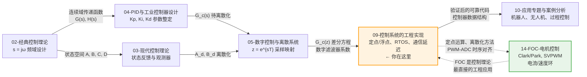
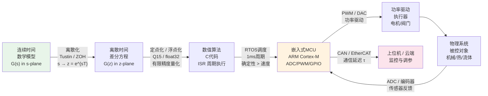
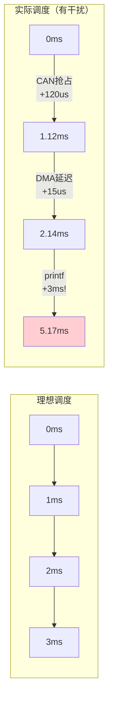

# 图解入门：从算法到代码的距离

> **核心认知锚点**：09-模块是"变换链"的**最后一环**——把复域设计（$s$平面/$z$平面）变成有限精度、有限时间、有限资源的工程现实。如果说 $s=j\omega$ 回答了"系统有什么频率成分"，$z=e^{sT}$ 回答了"采样后模态如何映射"，那么本模块回答的是：**这些变换在 16 位定点数、1 ms 周期、72 MHz MCU 上，如何不翻车。**

> **一句话直觉**：控制算法是"想怎么做"，C代码是"告诉机器一步一步怎么做"——中间隔着采样周期、量化误差、栈溢出和通信延迟这四座大山。

---

## 为什么学这个模块：它在统一框架中的位置

在整个"双控"微专业的知识地图中，各模块沿着一条**变换链**层层推进：

```
02-经典控制理论          05-数字控制与离散系统          09-控制系统的工程实现（你在这里）
     │                          │                              │
     ▼                          ▼                              ▼
  连续域分析               离散化与Z变换                  有限精度实现
  s = jω 频域设计          z = e^{sT} 模态映射            定点数、RTOS、通信延迟
```

这条链的**起点**是**全局频率表示**（傅里叶/拉普拉斯的频域视角），回答"系统有什么动态特性"；**中间**是**复域系统分析**（传递函数、极点零点、稳定性），回答"如何设计控制器让系统听话"；**终点**是**有限实现与局部分析**（DFT/FFT、数字滤波、时频分析），回答"如何在真实硬件上可靠运行"。

**09-模块是这条链的终点，也是所有理论通往物理世界的闸门。** 前面的模块告诉你"应该怎样"，本模块告诉你"实际能怎样"。

### 与前后模块的关系

前接**05-数字控制与离散系统**（$z=e^{sT}$ 的数学基础：采样、保持、差分方程），前接**04-PID与工业控制器设计**（控制器参数设计理论），后接**10-应用专题与案例分析**（实战验证）。更重要的是，本模块与**[[14-FOC-电机控制/00-README|14-FOC-电机控制]]**微专业形成直接映射关系——FOC中的电流环、速度环离散化、定点 Clarke/Park 变换、PWM 周期与 ADC 采样对齐，都是本模块理论的即时应用。



> **知识流向说明**：从 $s$ 到 $z$ 的箭头是**数学变换**（靠 `c2d` 或手算完成），从 $z$ 到 C 代码的箭头是**工程实现**（靠本模块的定点运算、实现结构、调度策略完成）。两条虚线连接 [[14-FOC-电机控制/00-README|14-FOC-电机控制]]，因为 FOC 是控制理论在嵌入式系统中最典型、最严苛的应用场景之一——10 kHz 电流环、定点坐标变换、无传感器观测器，全部都需要本模块的知识。

---

## 一张图看懂：从Simulink到MCU的完整链路



上图展示了一条完整的控制工程链路。许多初学者在学完PID和状态空间后会产生一个错觉：既然公式都懂了，那在单片机上跑起来应该只是"敲几行代码"的事。实际上，每跨越一个箭头，都隐藏着一类工程问题。本模块作为"变换链"的终点，需要把复域设计的优美数学，转化为在有限资源约束下的可靠代码。后续六篇笔记会逐个山头翻过去。

> **与变换链的关系**：上图的第一个箭头 "$s \to z = e^{sT}$" 正是 deep-research-report 中强调的三条关键映射之一。05-模块教你理解这个映射的数学本质，09-模块教你处理这个映射在工程实现中的代价：Tustin 法的频率压缩、ZOH 的相位损失、定点化带来的量化噪声。

---

## 四座山之间的"语言鸿沟"

### 第一座山：连续→离散（$s$ 平面到 $z$ 平面）

在MATLAB里，一个PI控制器可以写成一行传递函数：

$$ G_c(s) = K_p + \frac{K_i}{s} $$

但在单片机上，没有 $s$ 算子，也没有无穷小的 $dt$。你只有每 $T_s$ 秒执行一次的循环。把积分 $\frac{1}{s}$ 翻译成C语言，就变成了一个**累加器**：

```c
// integral accumulator —— 这是 1/s 在 z 域的时域化身
static float integral = 0.0f;

void control_loop(float setpoint, float measurement) {
    float error = setpoint - measurement;
    integral += error * Ts;          // discrete integration: u[k] = u[k-1] + Ts * e[k]
    float output = Kp * error + Ki * integral;
    write_dac(output);
}
```

这行 `integral += error * Ts` 就是 $\frac{1}{s}$ 在数字世界里的化身。用 $z$ 变换的语言说：$\frac{1}{s}$ 经后向欧拉离散化后变成 $\frac{T_s}{1 - z^{-1}}$，对应的差分方程正是 `integral[k] = integral[k-1] + Ts * e[k]`。

> **与变换链的关系**：这个离散化过程就是 $z = e^{sT}$ 的工程近似。05-模块告诉你映射的数学形式，本模块告诉你：如果 $T_s$ 选得太大，这个近似会扭曲原系统的动态特性（高频相位损失）；如果 $T_s$ 选得太小，MCU会喘不过气（算力不足）。

### 第二座山：理想数值→有限精度

在MATLAB里，`float` 有32位，`double` 有64位，你几乎不会考虑精度问题。但在一个成本敏感的项目里，你用的可能是没有FPU（浮点单元）的8位或16位MCU，所有运算必须用**定点数**完成。

想象一下这个场景：你的编码器分辨率是10000脉冲/转，电机最高转速3000 rpm = 50 rps。每个采样周期（1 ms）内，编码器最多前进50个脉冲。但如果你用16位定点数表示位置，65535的刻度范围看似充裕，一旦加上积分环节，一个微小的偏差经过几万次累加后就会溢出。

```
实际场景：
  编码器反馈：10000 ppr
  采样周期：   1 ms
  最大转速：   3000 rpm → 每个Ts最多移动 (3000/60)*10000*0.001 ≈ 500 counts
  16位有符号整数范围：-32768 ~ +32767
  看似安全？但加上位置积分和速度估计后，溢出风险立刻出现。
```

> **与变换链的关系**：DFT/FFT 告诉我们有限字长效应（量化噪声、谱泄漏）的数学来源。在控制器实现中，定点系数的量化会改变零极点位置——这意味着 $z$ 平面里精心设计的稳定极点，可能因为 Q15 格式的舍入而漂移到单位圆外。

### 第三座山：实时性——不是"快"，而是"确定"

一个常见的误解是："我的MCU主频72 MHz，跑个PID肯定够快。" 但实时控制的核心不是**快**，而是**确定性**。

假设你的控制周期设定为1 ms。在理想世界里，每次中断都在精确的1.000 ms时刻触发。现实是：

| 干扰源 | 最坏情况延迟 | 后果 |
|--------|------------|------|
| DMA搬运ADC数据 | 5-20 us | 错过中断入口 |
| CAN总线接收中断 | 50-200 us | 控制任务被抢占 |
| printf调试输出 | 数毫秒 | 周期抖动严重 |
| 缓存未命中 | 数十us | ARM Cortex-A系列 |
| 浮点运算仿真 | 10-100x | 无FPU的MCU |



上图的"理想调度"与"实际调度"对比说明：一个3 ms的printf调用可以让后续所有控制周期彻底乱套。这就是为什么工业控制器里**严禁在中断服务程序里调用printf**——它不是慢，而是它的执行时间不确定。

### 第四座山：通信与分布式——时间不再同步

当你从单机控制扩展到多节点分布式控制时，会遇到一个更深层的麻烦：**不同节点的时钟不同步**。

想象两个PLC通过Ethernet交换数据：
- PLC-A在 $t=0.0$ ms 发送了一个位置指令
- 网络延迟让这个数据包在 $t=2.3$ ms 才到达PLC-B
- PLC-B在 $t=2.5$ ms 把这个值用于控制计算
- 但它以为这是 $t=2.5$ ms 的最新指令，不知道它其实是2.3 ms之前的"旧消息"

这2.3 ms的差异在低速机械系统里也许可以忽略，但在机器人关节控制（带宽50 Hz以上）中，这会导致相位裕度急剧下降，甚至失稳。后续笔记会详细讲解如何用**时间戳补偿**和**Smith预估器**来处理这种延迟。

> **与FOC的关联**：在[[14-FOC-电机控制/00-README|14-FOC-电机控制]]中，多轴伺服系统常通过 EtherCAT 或 CANopen 连接。主站每 1 ms 下发位置指令，从站的电流环以 10-20 kHz 本地运行。本模块的通信延迟分析直接对应 FOC 多轴同步中的"分布时钟"（Distributed Clock）问题。

---

## 数值示例：一个"简单"PID从理论到落地的代价

以下是一个完整的数值示例，展示同一个PI控制器在MATLAB理想世界 vs 嵌入式现实世界的差异。

**被控对象**：直流电机，传递函数 $G(s) = \frac{10}{s(0.1s+1)}$

**控制器**：PI，$K_p = 2.0, K_i = 5.0$

| 维度 | MATLAB（理想） | 嵌入式现实 | 差异影响 |
|------|--------------|-----------|---------|
| 采样周期 | 连续（或10 us） | $T_s = 1$ ms | 相位损失约 $18°$（$\omega_{gc}=100$ rad/s） |
| 数值格式 | double (64-bit) | 定点 Q15 | 信噪比降低约 $90$ dB |
| 积分方法 | 精确 $\int$ | 前向欧拉 | 高频段引入额外相位滞后 |
| 中断抖动 | 0 | $\pm 50$ us (5%) | 等效额外噪声注入 |
| 输出量化 | 连续 | 12-bit DAC | 极限环振荡风险 |

用MATLAB做一个快速仿真对比：

```matlab
% ideal continuous-time
s = tf('s');
G = 10/(s*(0.1*s+1));
K = 2 + 5/s;
T_ideal = feedback(K*G, 1);

% discretized with Ts=1ms
Ts = 0.001;
K_d = c2d(K, Ts, 'tustin');   % 控制器用Tustin，保持频域特性
G_d = c2d(G, Ts, 'zoh');      % 被控对象用ZOH，反映DAC真实行为
T_discrete = feedback(K_d*G_d, 1);

% compare step response
step(T_ideal, T_discrete);
legend('Continuous', 'Discrete Ts=1ms');
```

在典型的结果中，离散化后的系统超调量会增加2-5%，调节时间延长10-20%。如果 $T_s$ 进一步加大到5 ms，系统可能直接失稳。

> **与变换链的关系**：这里 `c2d` 的本质是 $z = e^{sT}$ 的数值近似。Tustin 法（双线性变换）把 $s$ 平面的整个左半平面映射到 $z$ 平面的单位圆内，保证了稳定性的保持——这正是 $z = e^{sT}$ 映射的工程化智慧。

---

## 常见错误与纠正

### 错误1：把MATLAB的`c2d`结果直接抄进C代码，忽略差分方程的数值条件

**错误做法**：

MATLAB给出离散控制器 $G_c(z) = \frac{2.5z - 2.0}{z - 1}$，直接写出：

```c
u[k] = 2.5 * e[k] - 2.0 * e[k-1] + u[k-1];  // dangerous!
```

**问题分析**：这个差分方程本身是正确的，但如果 $e[k]$ 和 $e[k-1]$ 的数值范围差异很大（比如一个很大、一个很小），减法会导致**灾难性抵消**（catastrophic cancellation），有效位数急剧减少。

**纠正方法**：将控制器改写为**直接II型实现**（Direct Form II），把积分器和比例通路分开，避免两个相近大数相减：

```c
typedef struct {
    float Kp, Ki, Ts;
    float integral;   // separate integrator state
} PI_Controller;

float pi_update(PI_Controller* c, float setpoint, float measurement) {
    float error = setpoint - measurement;
    c->integral += error * c->Ts;
    return c->Kp * error + c->Ki * c->integral;
}
```

### 错误2：在ISR（中断服务程序）里做浮点运算，且没有保存FPU上下文

**错误做法**：在ARM Cortex-M4/M7上开启了FPU，却在高优先级中断里直接做浮点运算，而没有调用 `portASSERT_IF_INTERRUPT_PRIORITY_INVALID()` 或类似保护。

**问题分析**：FreeRTOS等RTOS在任务切换时需要保存/恢复FPU寄存器。如果ISR中使用FPU而上下文保存不完整，会导致任务间的浮点寄存器值互相污染。症状非常隐蔽：控制输出会偶尔出现"跳变"，但单独调试每个任务又都正常。

**纠正方法**：
1. 在ISR中尽量只做定点运算或整数运算
2. 如果必须用浮点，确保 `configUSE_TASK_FPU_SUPPORT` 配置正确
3. 更安全的做法：ISR只做ADC读取和标志置位，把控制计算放到主循环或专门的控制任务中

> **与FOC的关联**：在 FOC 的低成本实现中，工程师常常在 Cortex-M0（无FPU）上用定点数完成整个 Clarke/Park 变换和 PI 电流环。这要求对 Q 格式、溢出、缩放有精确的理解——正是本模块第二篇笔记的核心内容。

---

## 本模块的知识地图

```
09-控制系统的工程实现
├── 000-图解入门：从算法到代码的距离      ← 你在这里（全景图 + 变换链定位）
├── 001-控制算法到C代码的映射              ← 差分方程、状态空间、结构化实现
│                                              z = e^{sT} 的代码化身
├── 002-定点与浮点运算                     ← Q格式、溢出、缩放、数值噪声
│                                              有限精度的工程现实
├── 003-实时调度与任务周期                 ← RTOS、中断、抖动、优先级
│                                              确定性 > 速度的哲学
├── 004-通信延迟与分布式控制               ← 网络化控制、Smith预估、时钟同步
│                                              多节点FOC/EtherCAT的根基
├── 005-安全关键系统的容错                 ← 看门狗、冗余、故障安全模式
└── 006-调参工具链                         ← 仿真标定、在线调参、日志分析
```

> **变换链视角**：从 000 到 006，模块内部也遵循"从数学到工程"的递进。001-002 处理 $z$ 域到数字的映射（数值问题），003-004 处理实时性和通信（时序问题），005-006 处理可靠性和调参（工程闭环）。

---

## 自测习题

### 习题1

一个连续PI控制器的参数为 $K_p=3.0, K_i=8.0$。采样周期 $T_s=2$ ms。用前向欧拉法离散化后，写出控制输出的差分方程，并计算当 $e[k]=0.5, e[k-1]=0.3, u[k-1]=1.2$ 时的 $u[k]$。

**答案**：

前向欧拉：$s \approx \frac{z-1}{T_s}$，故 $\frac{1}{s} \approx \frac{T_s}{z-1}$。

$U(z) = \left(K_p + \frac{K_i T_s}{z-1}\right) E(z)$

$(z-1)U(z) = [(z-1)K_p + K_i T_s] E(z)$

转换为时域：$u[k] = u[k-1] + K_p(e[k]-e[k-1]) + K_i T_s e[k]$

代入数值：

$$ u[k] = 1.2 + 3.0(0.5-0.3) + 8.0 \times 0.002 \times 0.5 = 1.2 + 0.6 + 0.008 = 1.808 $$

> **变换链检查**：前向欧拉是 $z = e^{sT}$ 的一阶近似（$z \approx 1 + sT_s$）。对 $s$ 平面左半平面的极点，前向欧拉可能将其映射到 $z$ 平面单位圆外，导致离散系统不稳定——这也是工程中更推荐使用 Tustin 或后向欧拉的原因。

---

### 习题2

一个16位有符号定点数采用Q12格式（12位小数），其数值分辨率是多少？若用它表示 $K_p=2.5$，量化后的整数值是多少？量化误差是多少？

**答案**：

Q12分辨率：$\Delta = 2^{-12} \approx 2.44 \times 10^{-4}$

整数值：$N = \text{round}(2.5 \times 2^{12}) = \text{round}(10240) = 10240$

实际存储值：$10240 \times 2^{-12} = 2.5$，恰好无误差。

若 $K_p = \pi \approx 3.14159$：

$N = \text{round}(3.14159 \times 4096) = \text{round}(12867.96) = 12868$

实际值：$12868 / 4096 = 3.1416016$

量化误差：$|3.1416016 - 3.14159| \approx 1.16 \times 10^{-5}$

---

### 习题3

判断正误："既然我的MCU主频是100 MHz，那么控制周期设为100 us（10 kHz）一定没问题。"

**答案**：错误。主频高不代表控制周期可以无限小。限制因素包括：
1. ADC转换时间（可能数十us）
2. 传感器响应带宽（如果传感器带宽只有1 kHz，10 kHz采样没有意义）
3. 执行器动态（如果电机时间常数是10 ms，1 kHz已足够）
4. 离散化本身引入的数值问题（周期越小，差分越敏感噪声）
5. **变换链视角**：$T_s$ 越小，$z = e^{sT}$ 的近似越精确，但定点实现中 $z^{-1}$ 的系数越接近1，数值条件越差（灾难性抵消风险增加）

正确做法是根据被控对象带宽按采样定理选择，通常取 $f_s = 20 \sim 50 \times f_{bw}$。

---

## 延伸阅读提示

- `05-数字控制与离散系统`：$z = e^{sT}$ 的数学基础——为什么Tustin比前向欧拉更稳定
- `04-PID与工业控制器设计`：控制器本身的理论设计——$s$ 平面上的参数整定
- `08-滤波与信号处理在控制中的应用`：ADC噪声预处理——DFT/FFT 视角下的数字滤波器
- `[[14-FOC-电机控制/00-README|14-FOC-电机控制]]`：控制理论最直接的应用——定点 Clarke/Park 变换、离散电流环、PWM-ADC 时序对齐
