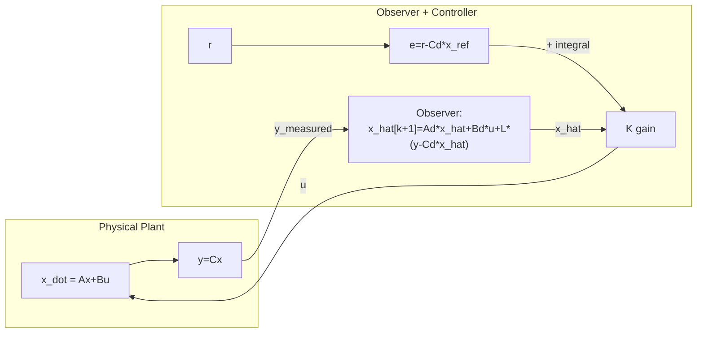

# 控制算法到C代码的映射

> **核心认知锚点**：从 $G_c(s)$ 到 `comp_update()` 的每一步，都是 $z = e^{sT}$ 映射的工程化实现。离散化方法选择 = "如何近似指数映射"，实现结构选择 = "如何在有限精度下保持数值稳定性"。

> **一句话直觉**：控制算法的C实现不是"翻译公式"，而是给每个数学对象找一个数据结构的家，并定义好它们在每个采样节拍里的更新顺序。

---

## 从传递函数到差分方程：一条标准流水线

```
MATLAB: Gc(s) = Kp + Ki/s + Kd*s/(Td*s+1)     ← s 平面设计，频率域
    |
    v  (离散化: Tustin / ZOH / 后向欧拉)        ← z = e^{sT} 的数值近似
MATLAB: Gc(z) = (b0 + b1*z^-1 + ...) / (1 + a1*z^-1 + ...)
    |                                            ← z 平面代数方程
    v  (整理成差分方程)
C:      u[k] = b0*e[k] + b1*e[k-1] + ... - a1*u[k-1] - ...
    |                                            ← 时域有限差分，ISR 执行
    v  (选择实现结构: DF1 / DF2 / 级联)
C:      struct { float b[3], a[2], w[2]; }       ← 定点/浮点数据结构
```

这条流水线中有两个关键决策点：**离散化方法**和**实现结构**。选错了方法，稳定性会出问题；选错了结构，数值精度会出问题。

### 离散化方法对比

| 方法 | 公式 $s \approx$ | 优点 | 缺点 | 适用场景 | **变换链关联** |
|------|----------------|------|------|---------|-------------|
| 前向欧拉 | $\frac{z-1}{T_s}$ | 简单直观 | **不稳定区域映射错误**：$s$ 平面左半平面可能映射到 $z$ 平面单位圆外 | 不推荐用于控制器 | $z \approx 1 + sT_s$，一阶近似，稳定性不保持 |
| 后向欧拉 | $\frac{z-1}{zT_s}$ | 稳定区域**包含**整个左半平面 | 频率扭曲（高频增益偏低） | 快速实现、鲁棒性优先 | $z \approx \frac{1}{1 - sT_s}$，隐式，稳定性保持 |
| Tustin（双线性） | $\frac{2}{T_s}\frac{z-1}{z+1}$ | **频率响应匹配好**，稳定性保持 | 高频处有频率压缩（$\omega \to \frac{2}{T_s}\tan\frac{\omega T_s}{2}$） | 频域设计要求高的场合 | $z = e^{sT}$ 的**最佳工程近似**，$j\omega$ 轴精确映射到单位圆 |
| ZOH（零阶保持） | $\frac{z-1}{z}\mathcal{Z}\{\frac{G(s)}{s}\}$ | 精确匹配阶跃响应，反映 DAC 真实物理行为 | 计算复杂，需查表或数值积分 | 被控对象离散化 | $z = e^{sT}$ 的**精确表达式**（对阶跃输入），含采样保持的完整物理模型 |

**核心原则**：被控对象用ZOH离散化（因为它反映了DAC的真实行为），控制器用Tustin离散化（因为它保持了频域特性，是 $z = e^{sT}$ 在工程上的最优折中）。

> **与变换链的关系**：Tustin 法的本质是把 $s$ 平面的整个 $j\omega$ 轴通过双曲正切映射到 $z$ 平面的单位圆上：$z = e^{sT} \approx \frac{1 + sT_s/2}{1 - sT_s/2}$。当 $s = j\omega$ 时，$|z| = 1$，所以稳定性的边界条件被精确保持。这就是为什么工业控制中 Tustin 法比前向欧拉更受欢迎——它继承了 $z = e^{sT}$ 的稳定性保持特性。

---

## 实现结构：为什么"直接型"不是最好的选择

### 直接I型（Direct Form I）

对于控制器 $H(z) = \frac{U(z)}{E(z)} = \frac{b_0 + b_1 z^{-1} + \cdots + b_m z^{-m}}{1 + a_1 z^{-1} + \cdots + a_n z^{-n}}$，直接I型差分方程为：

$$ u[k] = \sum_{i=0}^{m} b_i e[k-i] - \sum_{j=1}^{n} a_j u[k-j] $$

```c
// Direct Form I — simple but needs many delay elements
typedef struct {
    float b[3];      // numerator coeffs
    float a[2];      // denominator coeffs (a[0]=1 implicit)
    float e_delay[2]; // e[k-1], e[k-2]
    float u_delay[2]; // u[k-1], u[k-2]
} DF1_Controller;

float df1_update(DF1_Controller* c, float e) {
    float u = c->b[0]*e + c->b[1]*c->e_delay[0] + c->b[2]*c->e_delay[1]
              - c->a[0]*c->u_delay[0] - c->a[1]*c->u_delay[1];
    
    // shift delays
    c->e_delay[1] = c->e_delay[0];
    c->e_delay[0] = e;
    c->u_delay[1] = c->u_delay[0];
    c->u_delay[0] = u;
    
    return u;
}
```

**优点**：直观，和差分方程一一对应。  
**缺点**：需要 $(m+n)$ 个延迟单元；分子分母对消不明显时数值条件差。

### 直接II型（Direct Form II / 典范型）

通过引入中间变量 $w[k]$，把延迟单元数降到 $\max(m, n)$：

令 $W(z) = \frac{E(z)}{1 + a_1 z^{-1} + \cdots}$，则 $U(z) = (b_0 + b_1 z^{-1} + \cdots) W(z)$

```c
// Direct Form II — minimal delay elements
typedef struct {
    float b[3];
    float a[2];
    float w[2];      // w[k-1], w[k-2]
} DF2_Controller;

float df2_update(DF2_Controller* c, float e) {
    float w = e - c->a[0]*c->w[0] - c->a[1]*c->w[1];
    float u = c->b[0]*w + c->b[1]*c->w[0] + c->b[2]*c->w[1];
    
    c->w[1] = c->w[0];
    c->w[0] = w;
    
    return u;
}
```

**关键优势**：在定点实现中，DF2可以通过适当选择 $w[k]$ 的缩放因子，让中间变量始终保持在动态范围内，避免溢出。

> **与变换链的关系**：DF2 结构把 $z$ 域传递函数分解为两个子系统串联：$W(z)/E(z)$（全极点部分）和 $U(z)/W(z)$（全零点部分）。这对应于 $z$ 平面上对极点和零点分别进行数值处理——极点决定稳定性（必须在单位圆内），零点决定频率响应形状。DF2 的中间变量 $w[k]$ 是"去除了零点影响后的纯模态响应"，因此在数值上更稳定。

### 级联型（Cascade / 二阶节）

高阶控制器（如带陷波滤波器的PID）如果用单节实现，系数动态范围可能非常大（比如 $10^{-5}$ 到 $10^5$）。把它拆成多个二阶节（Biquad）串联，每个节的系数都在合理范围内：

```
H(z) = H1(z) * H2(z) * H3(z)

每个 Hi(z) = (b0 + b1*z^-1 + b2*z^-2) / (1 + a1*z^-1 + a2*z^-2)
```

```c
#define NUM_BIQUADS 3

typedef struct {
    float b[3];
    float a[2];
    float w[2];
} Biquad;

typedef struct {
    Biquad sections[NUM_BIQUADS];
} Cascade_Controller;

float cascade_update(Cascade_Controller* c, float input) {
    float x = input;
    for (int i = 0; i < NUM_BIQUADS; i++) {
        float w = x - c->sections[i].a[0]*c->sections[i].w[0]
                    - c->sections[i].a[1]*c->sections[i].w[1];
        x = c->sections[i].b[0]*w
          + c->sections[i].b[1]*c->sections[i].w[0]
          + c->sections[i].b[2]*c->sections[i].w[1];
        c->sections[i].w[1] = c->sections[i].w[0];
        c->sections[i].w[0] = w;
    }
    return x;
}
```

级联型是**音频DSP和精密运动控制**的首选实现方式。

> **与变换链的关系**：级联型把高阶 $z$ 域传递函数分解为二阶节的乘积。每个二阶节对应 $z$ 平面上的一对共轭极点（或实极点）和一对零点。由于极点位置对系数量化非常敏感（特别是对于高阶系统），级联型通过降低每个节的阶数来减小量化对极点位置的影响——这正是把"复域系统分析"（精确极点配置）与"有限实现"（定点系数量化）进行折中的工程智慧。

---

## 状态空间控制器的C实现

现代控制理论的状态反馈 $u = -Kx$ 在C代码里实际上比PID还简洁——前提是你已经有了状态 $x$。真正的工作量在于**状态更新**和**观测器**。

### 离散状态方程

$$ x[k+1] = A_d x[k] + B_d u[k] $$
$$ y[k] = C_d x[k] + D_d u[k] $$

```c
#define N_STATES 3
#define N_INPUTS 1
#define N_OUTPUTS 1

typedef struct {
    // system matrices (row-major)
    float Ad[N_STATES][N_STATES];   // 离散化后的 A 矩阵: A_d = e^{AT_s}（或近似）
    float Bd[N_STATES][N_INPUTS];     // 离散化后的 B 矩阵
    float Cd[N_OUTPUTS][N_STATES];
    float Dd[N_OUTPUTS][N_INPUTS];
    
    // state vector
    float x[N_STATES];
} StateSpace_Model;

void state_update(StateSpace_Model* m, float u[N_INPUTS]) {
    float x_next[N_STATES];
    
    // x_next = Ad * x + Bd * u
    for (int i = 0; i < N_STATES; i++) {
        float sum = 0.0f;
        for (int j = 0; j < N_STATES; j++) {
            sum += m->Ad[i][j] * m->x[j];
        }
        for (int j = 0; j < N_INPUTS; j++) {
            sum += m->Bd[i][j] * u[j];
        }
        x_next[i] = sum;
    }
    
    // update state
    for (int i = 0; i < N_STATES; i++) {
        m->x[i] = x_next[i];
    }
}

void output_compute(StateSpace_Model* m, float u[N_INPUTS], float y[N_OUTPUTS]) {
    for (int i = 0; i < N_OUTPUTS; i++) {
        float sum = 0.0f;
        for (int j = 0; j < N_STATES; j++) {
            sum += m->Cd[i][j] * m->x[j];
        }
        for (int j = 0; j < N_INPUTS; j++) {
            sum += m->Dd[i][j] * u[j];
        }
        y[i] = sum;
    }
}
```

> **与变换链的关系**：状态空间离散化 $A_d = e^{AT_s}$ 是矩阵版本的 $z = e^{sT}$。连续系统的特征值 $\lambda_i$（$s$ 平面上的极点）映射到离散系统的特征值 $e^{\lambda_i T_s}$（$z$ 平面上的极点）。稳定性判据从 "$\Re(\lambda_i) < 0$" 变成 "$|e^{\lambda_i T_s}| < 1$"——这正是 $s$ 平面左半平面映射到 $z$ 平面单位圆内的矩阵形式。

### 带观测器的完整闭环



```c
#define N_STATES 2

typedef struct {
    float Ad[N_STATES][N_STATES];
    float Bd[N_STATES];
    float Cd[N_STATES];      // row vector
    float K[N_STATES];       // state feedback gain
    float L[N_STATES];       // observer gain
    float Ki;                // integral gain
    float Ts;
    
    float x_hat[N_STATES];   // estimated state
    float integral;          // integral of error
} LQG_Controller;

float lqg_update(LQG_Controller* c, float r, float y) {
    // compute control output using estimated state
    float u = -c->K[0]*c->x_hat[0] - c->K[1]*c->x_hat[1];
    
    // reference tracking with integral action
    float y_ref = c->Cd[0]*c->x_hat[0] + c->Cd[1]*c->x_hat[1];
    float e = r - y_ref;
    c->integral += e * c->Ts;
    u += c->Ki * c->integral;
    
    // observer update: x_hat = Ad*x_hat + Bd*u + L*(y - Cd*x_hat)
    float y_est = c->Cd[0]*c->x_hat[0] + c->Cd[1]*c->x_hat[1];
    float innov = y - y_est;
    
    float x_hat_next[N_STATES];
    for (int i = 0; i < N_STATES; i++) {
        float dyn = 0.0f;
        for (int j = 0; j < N_STATES; j++) {
            dyn += c->Ad[i][j] * c->x_hat[j];
        }
        x_hat_next[i] = dyn + c->Bd[i]*u + c->L[i]*innov;
    }
    
    c->x_hat[0] = x_hat_next[0];
    c->x_hat[1] = x_hat_next[1];
    
    return u;
}
```

---

## PID控制器的结构化C实现

PID是工程中使用最广泛的控制器，但"最广泛"不代表"最简单写好"。下面给出一个工业级的PID实现模板，包含所有必要的防护机制。

```c
typedef enum {
    PID_DIRECT = 0,
    PID_REVERSE = 1
} PID_Direction;

typedef struct {
    // parameters
    float Kp, Ki, Kd;
    float Ts;
    float u_min, u_max;     // output saturation limits
    float d_min, d_max;     // derivative term limits
    PID_Direction direction;
    
    // states
    float integral;
    float e_prev;           // previous error
    float y_prev;           // previous measurement (for derivative on measurement)
    int   first_run;
} PID_Controller;

void pid_init(PID_Controller* pid, float Kp, float Ki, float Kd, float Ts,
              float u_min, float u_max, PID_Direction dir) {
    pid->Kp = Kp;
    pid->Ki = Ki;
    pid->Kd = Kd;
    pid->Ts = Ts;
    pid->u_min = u_min;
    pid->u_max = u_max;
    pid->d_min = -1e6f;  // default: no derivative limit
    pid->d_max = 1e6f;
    pid->direction = dir;
    pid->integral = 0.0f;
    pid->e_prev = 0.0f;
    pid->y_prev = 0.0f;
    pid->first_run = 1;
}

float pid_update(PID_Controller* pid, float r, float y) {
    float error = r - y;
    if (pid->direction == PID_REVERSE) {
        error = -error;
    }
    
    // proportional term
    float P = pid->Kp * error;
    
    // integral term with anti-windup (conditional integration)
    // We only integrate if output is NOT saturated in the same direction
    float u_test = P + pid->Ki * pid->integral + pid->Kd * (error - pid->e_prev) / pid->Ts;
    int saturated = (u_test > pid->u_max) || (u_test < pid->u_min);
    int same_direction = (u_test > pid->u_max && error > 0) || (u_test < pid->u_min && error < 0);
    
    if (!saturated || !same_direction) {
        pid->integral += error * pid->Ts;
    }
    
    // optional: clamp integral directly (back-calculation variant)
    float I = pid->Ki * pid->integral;
    float I_max = pid->u_max;  // simplified; real impl needs coordinated clamp
    float I_min = pid->u_min;
    if (I > I_max) { pid->integral = I_max / pid->Ki; I = I_max; }
    if (I < I_min) { pid->integral = I_min / pid->Ki; I = I_min; }
    
    // derivative on measurement (not error) to avoid derivative kick
    float dydt;
    if (pid->first_run) {
        dydt = 0.0f;
        pid->first_run = 0;
    } else {
        dydt = (y - pid->y_prev) / pid->Ts;
    }
    float D = -pid->Kd * dydt;  // note the negative sign!
    
    // clamp derivative
    if (D > pid->d_max) D = pid->d_max;
    if (D < pid->d_min) D = pid->d_min;
    
    // compute output
    float u = P + I + D;
    if (u > pid->u_max) u = pid->u_max;
    if (u < pid->u_min) u = pid->u_min;
    
    // update history
    pid->e_prev = error;
    pid->y_prev = y;
    
    return u;
}
```

**这个实现中的关键工程细节**：

1. **Derivative on measurement**：微分项用 $-\frac{dy}{dt}$ 而非 $\frac{de}{dt}$。当设定值 $r$ 突变时，$e$ 会跳变，导致微分输出一个尖峰（derivative kick）。而 $y$ 是物理量，不会突变。

2. **Anti-windup（条件积分）**：积分器只在输出未饱和时工作。一旦饱和，积分停止，避免"积分饱和"导致的长时间超调。

3. **输出限幅**：所有实际执行器都有物理限幅（PWM占空比0-100%、DAC电压范围等），必须在算法里体现。

> **与FOC的关联**：在 [[14-FOC-电机控制/00-README|14-FOC-电机控制]] 中，d轴和q轴的电流环通常各用一个PI控制器。FOC 的 d-q 解耦控制要求：
> - d轴电流环：$i_d^* = 0$（永磁同步电机），PI 输出为 $v_d$
> - q轴电流环：$i_q^*$ 来自速度环外环，PI 输出为 $v_q$
> 
> 这两个 PI 控制器的离散化、抗饱和、输出限幅，与本节代码完全一致。区别只在于：FOC 的 $v_d, v_q$ 还需要经过反 Park 变换和 SVPWM 调制，才能变成三相逆变器的开关信号——这也是"从算法到代码"链路的一环。

---

## 数值示例：从连续传递函数到C代码的完整流程

**步骤1**：连续控制器设计

给定 $G_c(s) = \frac{2s^2 + 8s + 10}{s^2 + 2s + 1}$，这是一个带超前-滞后补偿的闭环控制器。

**步骤2**：Tustin离散化（$T_s = 0.001$ s）

用MATLAB验证：

```matlab
s = tf('s');
Gc = (2*s^2 + 8*s + 10)/(s^2 + 2*s + 1);
Ts = 0.001;
Gcz = c2d(Gc, Ts, 'tustin');    % Tustin = 双线性变换，z = e^{sT} 的最佳近似
[num, den] = tfdata(Gcz, 'v')
```

典型输出（近似值）：
- num = [1.998, -3.988, 1.990]
- den = [1.000, -1.998, 0.998]

> **变换链验证**：Tustin 离散化后的极点 $|z| < 1$（因为原连续系统极点 $s = -1$ 在左半平面，映射后 $z = e^{-0.001} \approx 0.999$），保证了离散稳定性。DC 增益 $G_c(0) = 10$ 也应被保持——可通过 `dcgain(Gcz)` 验证。

**步骤3**：整理为差分方程并写C代码

$$ \frac{U(z)}{E(z)} = \frac{1.998 - 3.988 z^{-1} + 1.990 z^{-2}}{1 - 1.998 z^{-1} + 0.998 z^{-2}} $$

$$ u[k] = 1.998e[k] - 3.988e[k-1] + 1.990e[k-2] + 1.998u[k-1] - 0.998u[k-2] $$

```c
typedef struct {
    float b[3];  // 1.998, -3.988, 1.990
    float a[2];  // -1.998, 0.998 (note sign: stored as positive coeffs for -a[])
    float e_d[2];
    float u_d[2];
} Compensator_2ndOrder;

void comp_init(Compensator_2ndOrder* c) {
    c->b[0] = 1.998f; c->b[1] = -3.988f; c->b[2] = 1.990f;
    c->a[0] = 1.998f; c->a[1] = -0.998f;  // stored as positive, subtracted in update
    c->e_d[0] = c->e_d[1] = 0.0f;
    c->u_d[0] = c->u_d[1] = 0.0f;
}

float comp_update(Compensator_2ndOrder* c, float e) {
    float u = c->b[0]*e + c->b[1]*c->e_d[0] + c->b[2]*c->e_d[1]
              + c->a[0]*c->u_d[0] + c->a[1]*c->u_d[1];
    
    c->e_d[1] = c->e_d[0]; c->e_d[0] = e;
    c->u_d[1] = c->u_d[0]; c->u_d[0] = u;
    
    return u;
}
```

**步骤4**：验证

用一个阶跃输入 $e[k]=1.0$ 代入，前几步手工计算：

| k | e[k] | e[k-1] | e[k-2] | u[k-1] | u[k-2] | u[k] |
|---|------|--------|--------|--------|--------|------|
| 0 | 1.0 | 0 | 0 | 0 | 0 | 1.998 |
| 1 | 1.0 | 1.0 | 0 | 1.998 | 0 | 1.998 - 3.988 + 1.998*1.998 = 3.984 |
| 2 | 1.0 | 1.0 | 1.0 | 3.984 | 1.998 | 5.970 |

稳态值可以通过终值定理验证：$u_{ss} = \frac{1.998 - 3.988 + 1.990}{1 - 1.998 + 0.998} \times 1 = \frac{0}{0}$（分子分母同阶，实际为10/1=10）。这说明离散化后的直流增益与连续系统一致（$G_c(0)=10$）。

> **变换链验证**：终值定理在 $z$ 域的形式为 $\lim_{k\to\infty} u[k] = \lim_{z\to 1} (1-z^{-1})U(z)$。对控制器而言，$z \to 1$ 对应 $s \to 0$（因为 $z = e^{sT}$，$z=1$ 时 $s=0$），所以离散系统的直流增益与连续系统的低频增益一致。这是 $z = e^{sT}$ 映射在 $s=0$ 附近的局部线性性所保证的。

---

## 常见错误与纠正

### 错误1：忘记在初始化时清零延迟单元

**错误代码**：

```c
PID_Controller pid;
pid.Kp = 2.0f;  // ... set params
// forgot to set pid.integral = 0 and pid.e_prev = 0!
```

**后果**：全局变量或静态变量在嵌入式启动时可能不是零（取决于启动文件）。`integral` 可能初始化为一个随机值，导致控制器输出瞬间饱和。

**纠正**：永远提供一个 `init()` 函数，并且保证所有状态量都被显式初始化。在RTOS环境里，把控制器对象放在任务栈上时尤其要注意——栈内存的内容是上一帧任务的残留。

### 错误2：把微分项写成了 $\frac{e[k] - e[k-1]}{T_s}$，但没有处理设定值突变

**错误代码**：

```c
float D = Kd * (error - e_prev) / Ts;  // derivative on error
```

**后果**：当设定值 $r$ 从0跳到100时，$error$ 瞬间从0变到100，$D$ 项会输出一个巨大的尖峰，可能损坏执行器。

**纠正**：改为 derivative on measurement：

```c
float D = -Kd * (y - y_prev) / Ts;  // derivative on measurement
```

物理测量 $y$ 不会突变，所以 $D$ 项的输出是平滑的。代价是需要额外存储 $y_{prev}$ 而非 $e_{prev}$。

---

## 自测习题

### 习题1

一个连续控制器 $G_c(s) = \frac{5(s+2)}{s+10}$，采样周期 $T_s = 0.01$ s。用Tustin法求 $G_c(z)$ 的分子和分母系数，并写出直接II型的C更新函数。

**答案**：

Tustin: $s = \frac{2}{T_s}\frac{z-1}{z+1} = 200\frac{z-1}{z+1}$

代入：$G_c(z) = \frac{5(200\frac{z-1}{z+1} + 2)}{200\frac{z-1}{z+1} + 10} = \frac{5(200(z-1) + 2(z+1))}{200(z-1) + 10(z+1)} = \frac{5(202z - 198)}{210z - 190}$

$= \frac{1010z - 990}{210z - 190} = \frac{1010 - 990z^{-1}}{210 - 190z^{-1}}$

归一化（让分母 $z^0$ 系数为1）：

$G_c(z) = \frac{4.8095 - 4.7143z^{-1}}{1 - 0.9048z^{-1}}$

DF2实现：

```c
typedef struct { float a1, b0, b1, w1; } DF2_FirstOrder;

float df2_update(DF2_FirstOrder* c, float e) {
    float w = e + 0.9048f * c->w1;  // w = e - (-0.9048)*w1
    float u = 4.8095f * w - 4.7143f * c->w1;
    c->w1 = w;
    return u;
}
```

> **变换链检查**：原连续极点 $s = -10$（左半平面，稳定）。Tustin 映射后 $z = \frac{1 + (-10)(0.005)}{1 - (-10)(0.005)} = \frac{0.95}{1.05} \approx 0.9048$，$|z| < 1$——稳定保持。这就是 Tustin 法作为 $z = e^{sT}$ 工程近似的价值。

---

### 习题2

某工程师实现PID时写成了：

```c
integral += error;
float I = Ki * integral * Ts;
```

而正确写法应为 `integral += error * Ts; float I = Ki * integral;`。请问这两种写法在数值上是否等价？如果 $T_s$ 在运行时会变化（自适应采样），哪种写法更合理？

**答案**：

如果 $T_s$ 是常数，两者数学等价：$I = K_i \sum e[k] \cdot T_s = K_i T_s \sum e[k]$。

但如果 $T_s$ 变化，第一种写法 `integral += error; I = Ki * integral * Ts` 意味着历史误差都是按**当前**的 $T_s$ 加权，这是错误的。第二种写法 `integral += error * Ts_k; I = Ki * integral` 让每个历史误差按自己当时的 $T_s$ 加权，是正确的。因此**第二种写法更合理**。

---

### 习题3

一个二阶控制器的系数为 $b_0=0.001, b_1=0.002, b_2=0.001, a_1=-1.99, a_2=0.99$。如果用16位定点Q12格式实现，分析是否存在溢出风险，并提出改进方案。

**答案**：

Q12格式范围：$-8$ 到 $+7.999$（因为整数部分有 $16-12=4$ 位，含符号位，所以是 $-2^3$ 到 $2^3 - \Delta$）。

系数 $a_1 = -1.99$ 的绝对值接近2，在Q12中可以表示（范围到8）。但中间变量 $w[k]$ 可能很大——如果系统是积分型的或输入有阶跃，$w$ 可能累积到超过8。

改进方案：
1. 对输入 $e[k]$ 预先缩放（比如右移2位，即除以4）
2. 对输出 $u[k]$ 相应补偿（左移2位，即乘以4）
3. 或者改用Q8格式（范围到128），牺牲精度换动态范围
4. 最佳方案：进行系统级缩放分析，给每个二阶节分配适当的缩放因子
5. **变换链视角**：$a_1 = -1.99$ 接近 $-2$ 意味着极点 $z \approx 0.995$ 非常靠近单位圆。这是一个慢积分型系统，离散化精度要求极高。如果 Q12 的舍入让极点稍微外移到 $|z| > 1$，系统会失稳——这正是"有限实现改变复域稳定性"的典型例子。

---

## 延伸阅读提示

- `002-定点与浮点运算`：数值精度的深入分析——Q格式、溢出、缩放
- `003-实时调度与任务周期`：这些代码应该在什么时机执行——RTOS 确定性
- `04-PID与工业控制器设计`：控制器本身的参数设计方法——$s$ 平面上的 Kp, Ki, Kd
- `05-数字控制与离散系统`：$z = e^{sT}$ 的数学基础——采样定理、差分方程推导
- `[[14-FOC-电机控制/00-README|14-FOC-电机控制]]`：FOC 中 PI 电流环的离散实现、定点 Clarke/Park 变换、PWM-ADC 时序对齐
