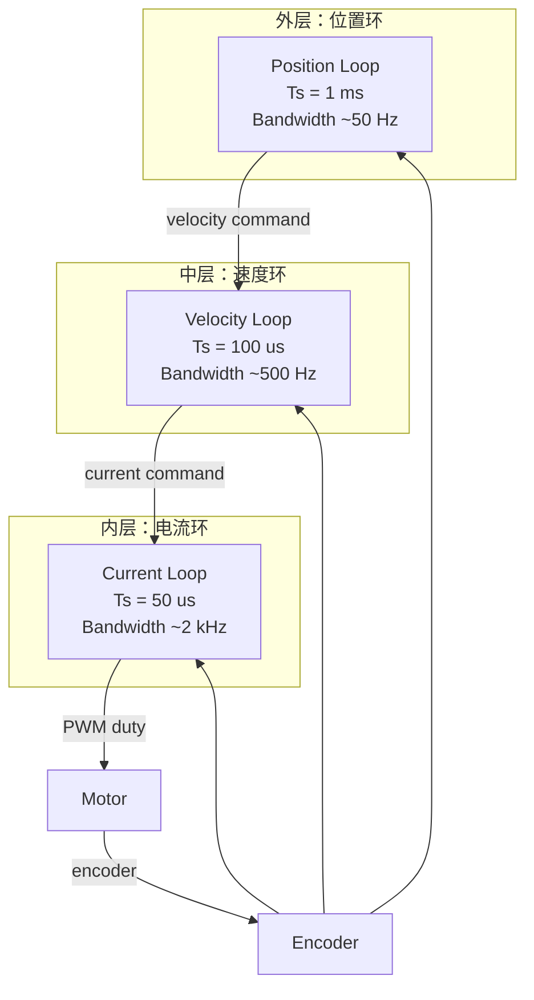

# 实时调度与任务周期

> **一句话直觉**：实时控制不是"跑得越快越好"，而是"必须在截止期限之前完成，每次都不能晚"——就像火车时刻表，准点比超速更重要。

---

## 实时系统的基本概念

### 硬实时 vs 软实时 vs 非实时

```
┌─────────────────────────────────────────────────────────────┐
│                     任务响应时间要求                          │
├─────────────────────────────────────────────────────────────┤
│  硬实时：超过截止期限 = 系统故障                              │
│         例：汽车ABS刹车、飞机飞控、医疗器械                    │
│                                                             │
│  软实时：偶尔超过截止期限 = 性能下降，但不致命                │
│         例：视频流媒体、在线游戏、温控系统                     │
│                                                             │
│  非实时：越快越好，没有严格期限                               │
│         例：后台日志处理、数据分析                             │
└─────────────────────────────────────────────────────────────┘
```

控制系统的任务周期（采样周期 $T_s$）就是一个**硬实时截止期限**：每次中断到来，必须在下一个中断之前完成所有计算并输出控制量。如果做不到，等效于采样周期不均匀，这会引入相位噪声，严重时导致失稳。

### 抖动（Jitter）的定义与危害

设理想控制周期为 $T_s$，实际第 $k$ 次采样的时刻为 $t_k$。抖动定义为：

$$ J_k = t_k - k T_s $$

```
理想:   |    |    |    |    |    |    |
         Ts   Ts   Ts   Ts   Ts   Ts

实际:   |  |   | |    |      |  |   |
         ^ jitter: timing variation
```

抖动的危害可以用离散系统理论来分析。设一个连续系统被非均匀采样，等效的离散系统矩阵变为时变矩阵：

$$ x[k+1] = A_d(\delta_k) x[k] + B_d(\delta_k) u[k] $$

其中 $\delta_k = t_{k+1} - t_k$ 是变化的实际周期。如果 $A_d$ 有特征值接近单位圆，周期波动会让这些特征值偶尔跑出单位圆，系统就会振荡或发散。

---

## 控制任务的周期设计

### 采样定理的工程解释

Nyquist定理说：$f_s > 2 f_{max}$。在控制工程中，这只是**底线**，不是**推荐值**。实际经验法则是：

$$ f_s = (20 \sim 50) \times f_{bw} $$

其中 $f_{bw}$ 是闭环带宽（或开环穿越频率）。

| 被控对象 | 带宽 $f_{bw}$ | 推荐采样率 $f_s$ | 推荐周期 $T_s$ |
|---------|-------------|----------------|---------------|
| 温度控制 | 0.01-0.1 Hz | 1-5 Hz | 200 ms - 1 s |
| 压力/液位控制 | 0.1-1 Hz | 5-20 Hz | 50-200 ms |
| 机械位置伺服 | 10-50 Hz | 200 Hz - 2 kHz | 0.5-5 ms |
| 电机电流环 | 500 Hz - 2 kHz | 10-20 kHz | 50-100 us |
| 电力电子变换器 | 1-10 kHz | 20-100 kHz | 10-50 us |

### 多级控制环的周期分配

典型伺服系统有三层控制环，每层有不同的周期：



**设计原则**：
1. 内环带宽 = (5~10) × 外环带宽
2. 内环采样率 = (5~10) × 外环采样率
3. 外环的输出变化率必须被内环的带宽覆盖

---

## 中断驱动 vs 轮询 vs RTOS任务

### 三种执行模型的对比

| 特性 | 轮询（裸机主循环） | 中断驱动 | RTOS多任务 |
|------|------------------|---------|-----------|
| 实现复杂度 | 低 | 中 | 高 |
| 时间确定性 | 差（受主循环长度影响） | 好（由硬件定时器保证） | 好（由调度器保证） |
| 多任务支持 | 手动状态机 | 中断嵌套 | 原生支持 |
| 代码可维护性 | 中（大状态机难以扩展） | 中 | 高（任务隔离） |
| 典型应用 | 简单温控 | 电机驱动 | 机器人、自动驾驶 |

### 中断驱动的典型架构

```c
// Timer ISR: triggered every 100 us
void TIM2_IRQHandler(void) {
    if (TIM2->SR & TIM_SR_UIF) {
        TIM2->SR &= ~TIM_SR_UIF;  // clear flag
        
        // read sensors (ADC, encoder)
        adc_start_conversion();
        encoder_read(&pos, &vel);
        
        // execute control algorithm
        float u = current_controller_update(ref_current, measured_current);
        
        // write output (PWM compare register)
        TIM1->CCR1 = (uint16_t)(u * PWM_PERIOD);
    }
}
```

**关键规则**：
1. ISR里不要做浮点运算（除非FPU上下文保存完善）
2. ISR里不要调用阻塞函数（如`printf`、`malloc`）
3. ISR执行时间 < 50% 的周期时间（留裕量给低优先级中断）

### RTOS任务的优先级设计

```c
// FreeRTOS priority definitions
#define PRIO_MOTION    (configMAX_PRIORITIES - 1)  // highest: safety critical
#define PRIO_CURRENT   (configMAX_PRIORITIES - 2)  // high: inner loop
#define PRIO_VELOCITY  (configMAX_PRIORITIES - 3)  // medium
#define PRIO_POSITION  (configMAX_PRIORITIES - 4)  // lower: outer loop
#define PRIO_COMM      (configMAX_PRIORITIES - 5)  // low: CAN/EtherCAT
#define PRIO_LOGGING   (configMAX_PRIORITIES - 6)  // lowest
```

**速率单调调度（Rate Monotonic, RM）理论**：周期越短的任务，优先级应该越高。RM在任务集利用率不超过 $U_{lub} = n(2^{1/n}-1)$ 时保证可调度。对于大量任务，$U_{lub} \approx 69\%$。这意味着CPU不能跑满——必须留出30%+的余量给中断和调度开销。

---

## 调度延迟的来源与量化

### 中断延迟的组成

```
Total latency = Interrupt delay + ISR prologue + Algorithm execution + ISR epilogue

where:
  Interrupt delay = 12 cycles (ARM Cortex-M, 12-clock latency)
  ISR prologue    = 12 cycles (push LR, R0-R3, R12, PSR)
  Execution       = depends on algorithm
  ISR epilogue    = 12 cycles (pop registers, return)
```

在72 MHz STM32F1上，一次空中断的最小开销约 $36 \times 14ns \approx 0.5$ us。

### 上下文切换开销

RTOS任务切换比裸机中断更重，因为需要保存/恢复整个任务上下文（所有通用寄存器 + FPU寄存器）。

| 平台 | 任务切换时间 |
|------|------------|
| FreeRTOS on Cortex-M3 | 84 clocks ≈ 1.2 us @ 72 MHz |
| FreeRTOS on Cortex-M4F | 120-200 clocks ≈ 1.7-2.8 us @ 72 MHz |
| Zephyr on Cortex-M4 | 60-100 clocks |
| Linux PREEMPT_RT on ARM A9 | 10-100 us |

**数值示例**：假设电流环周期50 us，用FreeRTOS任务实现。一次任务切换约2 us，占周期的4%。如果同时有3个高优先级中断可能抢占，最坏情况额外延迟6 us，总抖动达到16%——这已经接近很多电流环能容忍的上限。

**工程结论**：最内层控制环（电流环）通常放在**定时器中断**里，不用RTOS任务。外层环（位置、通信）可以放在RTOS任务中。

---

## 数值示例：计算控制任务的最坏执行时间

**场景**：STM32F407（168 MHz，Cortex-M4F，单精度FPU），实现一个3阶状态观测器 + 状态反馈控制器。

**代码分析**：

```c
float u = -K[0]*x[0] - K[1]*x[1] - K[2]*x[2];  // 3 multiplies, 2 adds

// observer update: x = Ad*x + Bd*u + L*(y - Cd*x)
// Matrix-vector multiply: 3x3 * 3x1 = 9 mult, 6 add
// Bd*u: 3 mult
// y - Cd*x: 3 mult, 2 add
// L*innov: 3 mult
// final adds: 3
```

总计约：25次浮点乘法，15次浮点加法。

Cortex-M4F的FPU：
- 单精度乘法：1-3 cycles（pipeline特性）
- 单精度加法：1-3 cycles
- 加载/存储：2 cycles each（from SRAM）

估算总执行时间：

$$ T_{exec} \approx (25 + 15) \times 3 \text{ cycles} + \text{memory overhead} \approx 200 \text{ cycles} $$

在168 MHz下：$200 / 168\text{MHz} \approx 1.2$ us。

如果采样周期是50 us，CPU利用率约2.4%，非常宽松。但如果算法升级到MPC（每周期求解一个QP），执行时间可能跳到1-10 ms，必须用更慢的外层周期或更强大的处理器。

---

## 常见错误与纠正

### 错误1：在中断服务程序里调用printf调试

**错误代码**：

```c
void TIM2_IRQHandler(void) {
    float error = setpoint - feedback;
    printf("error = %f\n", error);  // NEVER do this in ISR!
    // ... control logic
}
```

**问题分析**：`printf`的执行时间是**高度不确定**的。如果串口波特率115200，输出一个"error = 0.123456\n"（约20字符），至少需要 $20 \times 10 / 115200 \approx 1.7$ ms。在这段时间里：
1. 所有同级或更低优先级中断被屏蔽
2. 下一次定时器中断可能被错过或严重延迟
3. 控制周期产生巨大抖动

**纠正方法**：

```c
// Use a ring buffer for deferred logging
typedef struct {
    float data[100];
    uint32_t head, tail;
} LogBuffer;

volatile LogBuffer g_log;

void TIM2_IRQHandler(void) {
    float error = setpoint - feedback;
    
    // log to buffer (just a few cycles)
    uint32_t next = (g_log.head + 1) % 100;
    if (next != g_log.tail) {
        g_log.data[g_log.head] = error;
        g_log.head = next;
    }
    
    // ... control logic
}

// Low-priority task or main loop prints
void log_task(void) {
    while (g_log.head != g_log.tail) {
        float val = g_log.data[g_log.tail];
        printf("error = %f\n", val);  // OK: not in ISR
        g_log.tail = (g_log.tail + 1) % 100;
    }
}
```

### 错误2：用软件延时（空循环）代替硬件定时器

**错误代码**：

```c
while(1) {
    control_loop();
    for (int i = 0; i < 10000; i++);  // "wait"
}
```

**问题分析**：
1. 空循环的周期随编译器优化级别、CPU主频变化而变化
2. 如果控制循环执行时间变化（比如条件分支），总周期也会变化
3. 无法与其他中断协调

**纠正方法**：始终使用硬件定时器中断：

```c
// Configure TIM2 to trigger every 1ms
TIM2->PSC = 8399;     // prescaler: 84MHz / 8400 = 10kHz
TIM2->ARR = 9;        // 10kHz / 10 = 1kHz
TIM2->DIER |= TIM_DIER_UIE;
NVIC_EnableIRQ(TIM2_IRQn);
TIM2->CR1 |= TIM_CR1_CEN;
```

---

## 自测习题

### 习题1

某系统有三个控制任务：
- 任务A（电流环）：周期1 ms，执行时间0.1 ms
- 任务B（速度环）：周期5 ms，执行时间0.3 ms
- 任务C（位置环）：周期20 ms，执行时间0.5 ms

用速率单调调度（RM）分配优先级，并计算总CPU利用率。判断该任务集是否可调度（RM的利用率上界：$U_{lub} = 3(2^{1/3}-1) \approx 0.78$）。

**答案**：

RM优先级：A最高，B次之，C最低。

CPU利用率：

$$ U = \frac{0.1}{1} + \frac{0.3}{5} + \frac{0.5}{20} = 0.1 + 0.06 + 0.025 = 0.185 $$

$U = 18.5\% < 78\%$，任务集**完全可调度**。即使考虑到RTOS开销（上下文切换、中断延迟），仍有很大余量。

---

### 习题2

一个电机电流环原本在50 us周期内稳定运行。由于增加了串口通信任务，最坏情况下定时器中断被延迟了15 us。原来的控制器是按50 us设计的。分析这种抖动对系统稳定性的影响，并提出两种缓解方案。

**答案**：

**影响分析**：

15 us抖动相当于30%的周期变化。离散系统的等效 $z$ 平面极点会随采样周期变化：

$$ z = e^{sT_s} \Rightarrow \Delta z \approx s e^{sT_s} \Delta T_s $$

如果原系统相位裕度只有 $30°$，周期增大会导致相位进一步损失约 $15\% \times 30° \approx 4.5°$，可能使系统进入不稳定区域。

**缓解方案**：

1. **提升定时器中断优先级**：把控制定时器设为最高中断优先级，通信任务设为低优先级。保证控制中断不被抢占。

2. **自适应采样补偿**：测量实际采样间隔 $\delta_k$，用变采样率离散化更新控制器：

```c
float actual_Ts = measure_time_since_last_interrupt();
float Kp_adaptive = Kp_continuous;  // P gain is Ts-independent
integral += error * actual_Ts;      // I gain effectively scales with Ts
```

这样即使周期抖动，积分项的"每秒钟累积量"仍然是正确的。

---

### 习题3

解释为什么在硬实时控制系统中，"平均CPU利用率80%"不等于"系统安全"，而必须关注最坏情况执行时间（WCET）。

**答案**：

平均利用率掩盖了最坏情况的组合。例如：

- 正常情况下：电流环0.05 ms + 速度环0.2 ms + 通信0.1 ms = 0.35 ms每1ms周期，利用率35%
- 但每个月有一次上位机下发大批量参数更新，通信处理突增至2 ms
- 同时如果这时发生了编码器故障，故障处理任务额外需要1 ms
- 最坏情况总需求：3 ms > 1 ms周期，系统必然错过截止期限

硬实时系统的设计必须基于**WCET分析**（静态分析或大量测量），确保即使在所有任务同时触发的最坏情况下，系统仍然满足所有截止期限。

---

## 延伸阅读提示

- `001-控制算法到C代码的映射`：代码本身如何在中断里组织
- `004-通信延迟与分布式控制`：当控制环跨越多个节点时的调度问题
- `005-安全关键系统的容错`：实时系统中的故障检测与响应
