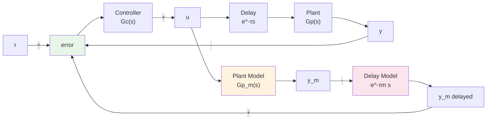

# 通信延迟与分布式控制

> **一句话直觉**：当你把控制器从一块板子拆成两块板子时，最大的变化不是"算力翻倍"，而是信号在铜线或光纤里多了几毫秒的"旅行时间"——这毫秒之差足以让原本稳定的系统振荡起来。

---

## 网络延迟的组成与模型

### 延迟从哪里来


| 延迟分量 | 典型范围 | 决定因素 | 是否可控 |
|---------|---------|---------|---------|
| 编码/解码时间 $T_{codec}$ | 1-100 us | 协议复杂度、CPU负载 | 是（简化协议） |
| 传播时间 $T_{prop}$ | 0.3-5 us/km | 物理距离、介质 | 否（受布局限制） |
| 排队/竞争时间 $T_{queue}$ | 0-数ms | 网络负载、协议类型 | 是（协议设计） |
| 处理/转发时间 $T_{proc}$ | 1-50 us | 交换机/网关性能 | 部分 |

**关键认知**：在分布式控制中，$T_{prop}$ 往往只占一小部分，**排队和竞争才是延迟大头**。

### 延迟的随机性模型

网络延迟通常不是固定的，而是随机变量。一个常用模型是：

$$ \tau_k = \tau_{nom} + \tau_{var,k} $$

其中 $\tau_{nom}$ 是标称延迟，$\tau_{var,k}$ 是随机波动。对于工业以太网（EtherCAT、PROFINET），$\tau_{var,k}$ 可以做到 $< 1$ us（确定性调度）；对于标准以太网（TCP/IP），$\tau_{var,k}$ 可能达到数十ms。

---

## 延迟对控制系统的理论影响

### 一个简单例子：延迟让开环相位损失

考虑一个开环传递函数 $L(s) = \frac{K}{s}$（积分器），闭环带宽 $\omega_{bw}$。

加入延迟 $\tau$ 后，开环变为 $L(s)e^{-\tau s}$。在穿越频率 $\omega_{gc}$ 处，延迟引入的相位损失为：

$$ \phi_{loss} = -\omega_{gc} \tau \quad \text{(radians)} $$

```
示例：
  ω_gc = 100 rad/s, τ = 5 ms
  φ_loss = -100 × 0.005 = -0.5 rad = -28.6°
  
  如果原相位裕度只有 35°，损失后只剩 6.4°——几乎不稳定。
```

**经验法则**：为了不超过 $5°$ 相位损失，要求：

$$ \tau < \frac{5° \times \pi}{180° \times \omega_{gc}} \approx \frac{0.09}{\omega_{gc}} $$

对于 $\omega_{gc} = 100$ rad/s，$\tau < 0.9$ ms。这意味着很多高速控制系统（电流环、力控制）根本**不能**把传感器和控制器分开放。

### 延迟系统的特征方程

闭环系统 $G(s)e^{-\tau s}$ 的特征方程不再是多项式，而是**超越方程**：

$$ 1 + G(s)e^{-\tau s} = 0 $$

这意味着：
1. 根的数量是**无穷**的（不像有限维系统只有有限个极点）
2. 即使 $G(s)$ 本身稳定，加入延迟也可能让系统失稳
3. 不能直接用Routh-Hurwitz判据，需要**Nyquist判据**或**Pade近似**

---

## 补偿延迟的三种方法

### 方法一：Smith预估器

Smith预估器是最经典的延迟补偿方法，核心思想是：在控制器内部建立一个**无延迟模型**，用模型的预测输出代替实际延迟后的反馈。



如果模型完美（$G_{p,m} = G_p, \tau_m = \tau$），控制器看到的反馈等价于**没有延迟的系统**，可以按无延迟系统设计。

```matlab
% Smith predictor in discrete time (simplified)
% Gp_m: plant model without delay
% tau_m: estimated delay

% Inside control loop:
y_delayed = delay_line_output(y_m_buffer, tau_m);
e = r - (y - y_delayed);  % compensated error
u = Kp * e;  % or any controller

% update model
y_m = Gp_m_update(u);
shift_buffer(y_m_buffer, y_m);
```

**Smith预估器的局限**：
1. 对模型误差敏感。如果实际延迟 $\tau$ 和模型 $\tau_m$ 偏差10%，补偿效果急剧下降。
2. 对负载扰动没有补偿能力（因为扰动发生在延迟之后）。

### 方法二：时间戳补偿（时间同步法）

如果分布式节点有同步的时钟（如IEEE 1588 PTP精确时间协议），可以在数据包里带上"产生时间戳"。控制器收到旧数据时，用模型**外推**当前状态。

```
时间线：
  t=0.0ms    传感器采样，时间戳 T_sen = 0.0
  t=2.3ms    数据到达控制器（延迟 τ=2.3ms）
  t=2.5ms    控制器执行，当前时间 T_now = 2.5
  
  控制器知道：数据是2.5ms之前的，需要外推
  x_hat(2.5) = x_hat(0.0) + A_d*x_hat*0.0025 + B_d*u_avg*0.0025
```

**要求**：
1. 各节点时钟同步精度 $< 10\%$ 的控制周期（如周期1ms，同步精度 $< 100$ us）
2. 控制器内部有可信的被控对象模型用于外推
3. 网络延迟可以被测量或估计

### 方法三：鲁棒控制设计（容忍延迟）

与其补偿延迟，不如在设计控制器时就**让系统对延迟不敏感**。这通常意味着**降低带宽**、**增加阻尼**。

| 设计策略 | 效果 | 代价 |
|---------|------|------|
| 降低 $\omega_{gc}$ | 相位损失减少 | 响应变慢 |
| 增加相位超前（超前补偿） | 抵消延迟相位损失 | 高频噪声放大 |
| 设计为低通特性 | 对延迟敏感度降低 | 跟踪精度下降 |

---

## 分布式控制的通信协议选型

### 主流工业协议对比

| 协议 | 拓扑 | 延迟 | 抖动 | 带宽 | 适用场景 |
|------|------|------|------|------|---------|
| CAN 2.0 | 总线 | 0.1-1 ms | 中 | 1 Mbps | 汽车、低成本分布式 |
| CAN FD | 总线 | 0.05-0.5 ms | 中 | 5-8 Mbps | 现代汽车网络 |
| EtherCAT | 菊花链 | 10-100 us | <1 us | 100 Mbps | 高端伺服、机器人 |
| PROFINET IRT | 星形/线形 | 50-500 us | <1 us | 100 Mbps-1 Gbps | 工厂自动化 |
| Modbus TCP | 星形 | 1-10 ms | 大 | 100 Mbps | 楼宇、过程控制 |
| Ethernet/IP | 星形 | 1-10 ms | 大 | 1 Gbps | 工厂信息化 |
| TSN (IEEE 802.1) | 任意 | <100 us | <1 us | 1 Gbps+ | 下一代工业以太网 |

```
选择决策树：
  需要 < 100 us 确定性？
    → 是: EtherCAT, PROFINET IRT, TSN
    → 否: 需要 < 1 ms？
        → 是: CAN FD, Modbus TCP
        → 否: 标准以太网/串口即可
```

---

## 数值示例：延迟补偿与不补偿的对比

**被控对象**：直流电机，$G_p(s) = \frac{20}{s(0.05s+1)}$

**控制器**：PI，$K_p = 2.0, K_i = 20$（按无延迟设计，带宽约20 Hz）

**网络延迟**：$\tau = 5$ ms

用MATLAB仿真：

```matlab
s = tf('s');
Gp = 20/(s*(0.05*s+1));
K = 2 + 20/s;

% closed-loop without delay
T0 = feedback(K*Gp, 1);

% with delay (Pade approximation)
tau = 0.005;
Gp_delay = Gp * exp(-tau*s);
Gp_delay_pade = pade(Gp_delay, 2);  % 2nd-order Pade approx
T_delay = feedback(K*Gp_delay_pade, 1);

% Smith predictor (ideal model)
% Implementation requires special structure, use custom model

step(T0, T_delay);
legend('No delay', 'With 5ms delay');
```

**典型结果**：

| 指标 | 无延迟 | 5ms延迟（无补偿） | 5ms延迟（Smith补偿） |
|------|--------|------------------|-------------------|
| 超调量 | 15% | 65% | 18% |
| 调节时间 | 0.2 s | 0.8 s（振荡） | 0.22 s |
| 相位裕度 | 45° | 12° | 42° |

Smith预估器能把性能恢复到接近无延迟的水平，但前提是模型准确。如果模型增益有20%误差，Smith预估器可能让系统比不补偿还糟。

---

## 常见错误与纠正

### 错误1：在分布式系统中假设"数据包总是按顺序到达"

**错误假设**：控制器收到的数据总是按时间顺序的，即 $t_{k} < t_{k+1}$ 的发送时刻对应接收时刻也是有序的。

**现实**：在基于标准以太网的系统中，UDP数据包可能乱序；即使使用TCP，重传机制也会引入额外的、非均匀的延迟。

**后果**：如果控制器直接用最新收到的数据包编号，可能跳过中间数据，或者把一个"旧数据包"当成最新数据使用。等效于采样周期突然变化或出现"时间倒流"，系统会出现阶跃响应。

**纠正方法**：

```c
typedef struct {
    uint32_t sequence_num;  // monotonically increasing
    uint32_t timestamp_us;  // send time
    float data;
} SensorPacket;

void controller_receive(SensorPacket* pkt) {
    if (pkt->sequence_num <= last_received_seq) {
        // out-of-order or duplicate packet, drop or handle carefully
        return;
    }
    
    if (pkt->sequence_num > last_received_seq + 1) {
        // packet(s) lost! Use model prediction or hold last valid
        for (uint32_t i = last_received_seq + 1; i < pkt->sequence_num; i++) {
            predict_state_using_model();
        }
    }
    
    last_received_seq = pkt->sequence_num;
    use_packet_data(pkt);
}
```

### 错误2：忽略时钟漂移，导致时间戳补偿越来越不准

**错误做法**：系统上电时一次性同步时钟，之后不再校准。

**问题分析**：两个晶振的标称频率是相同的（比如25 MHz），但温度漂移和制造公差导致实际频率有差异。假设两个节点的晶振相差10 ppm（百万分之十），每秒钟会漂移10 us，100秒后漂移1 ms。如果控制周期是1 ms，100秒后时间戳补偿就完全错了。

**纠正方法**：
1. 使用同步协议（PTP、Sync over EtherCAT）定期校准
2. 用温度补偿晶振（TCXO）或恒温晶振（OCXO）降低漂移率
3. 在控制器端维护一个估计的时钟漂移率，做长期补偿：

```c
float clock_drift_ppm = 10.0f;  // estimated from PTP measurements
float local_time = raw_timer * (1.0f + clock_drift_ppm * 1e-6f);
```

---

## 自测习题

### 习题1

一个伺服系统的开环穿越频率 $\omega_{gc} = 50$ rad/s。网络延迟 $\tau = 10$ ms。计算延迟引入的相位损失，并判断如果原相位裕度为40°，系统是否稳定。

**答案**：

$$ \phi_{loss} = -\omega_{gc} \tau = -50 \times 0.01 = -0.5 \text{ rad} = -28.6° $$

剩余相位裕度：$40° - 28.6° = 11.4°$。

系统**仍然稳定**（相位裕度>0），但鲁棒性非常差。任何额外的相位滞后（比如 aging 的传感器滤波器）都可能让它失稳。工程上，通常要求剩余相位裕度 $> 15°$。

---

### 习题2

Smith预估器为什么对模型误差敏感？假设实际被控对象增益为 $K_p = 1.2$，但模型增益为 $K_{p,m} = 1.0$，延迟都相同。分析Smith预估器补偿后系统的闭环特性。

**答案**：

Smith预估器的补偿信号是 $y_{model} - y_{model,delayed}$。如果模型增益偏低，预估器会"低估"无延迟输出，导致控制器看到的等效误差比实际大。

具体来说，如果 $K_{p,m} < K_p$，预估器输出的 $y_{model}$ 偏小，$y - y_{model,delayed}$ 会偏大，控制器会过度反应。闭环可能出现超调增大甚至振荡。

定量分析：补偿后的等效开环为 $G_c(s)G_p(s)$，但反馈通路有 $G_p(s) - G_{p,m}(s)(1 - e^{-\tau s})$。当 $G_{p,m} \neq G_p$ 时，这个反馈通路不再抵消延迟，甚至可能引入额外的相位滞后。

---

### 习题3

EtherCAT和CAN总线在实时性上的根本差异是什么？为什么EtherCAT可以达到us级抖动？

**答案**：

**根本差异**：

1. **介质访问控制**：
   - CAN：CSMA/CA（载波侦听多路访问/冲突避免），多个节点竞争总线，可能仲裁失败重试
   - EtherCAT：主站轮询，从站按精确顺序转发，没有竞争

2. **帧结构**：
   - CAN：每帧最大8字节数据，需要多次传输
   - EtherCAT：一个"列车"帧穿过所有从站，每个从站在帧经过时"下车"读数据/"上车"写数据，单次通信完成所有节点

3. **硬件实现**：
   - EtherCAT从站用专用ESC芯片（如ET1100），数据转发在硬件完成，无需软件干预
   - CAN需要控制器中断参与收发

**EtherCAT低抖动的原因**：主站精确控制发送时机，从站转发延迟固定（约1 us/站），没有随机排队和仲裁。

---

## 延伸阅读提示

- `003-实时调度与任务周期`：延迟在多任务调度中的叠加效应
- `005-安全关键系统的容错`：网络延迟故障如何触发安全模式
- `07-MPC模型预测控制`：MPC如何处理网络延迟（网络控制系统NCS）
