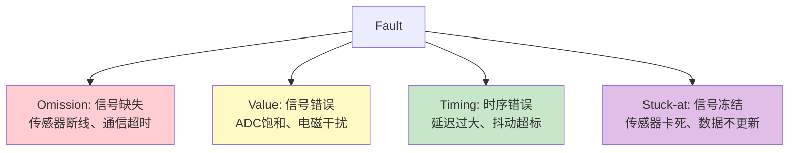
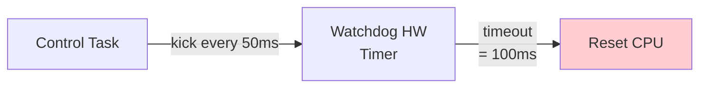
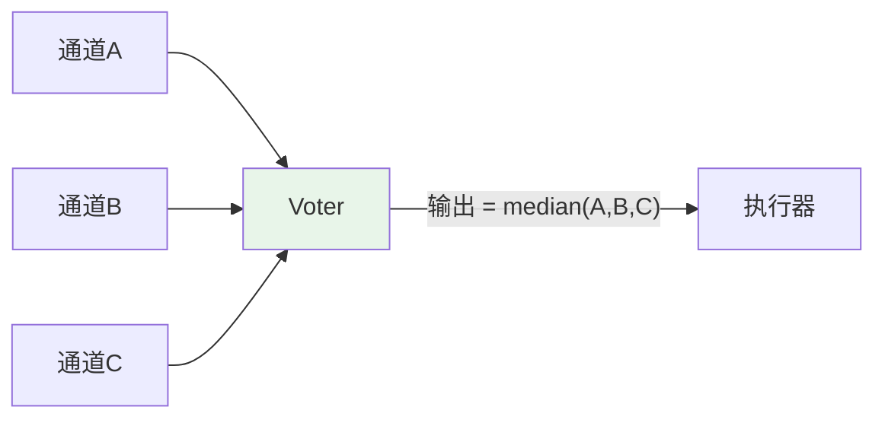
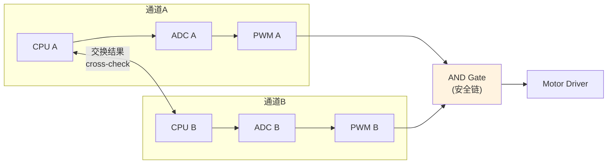

# 安全关键系统的容错

> **一句话直觉**：安全关键系统的设计哲学不是"永远不要出错"，而是"出错之后，系统必须能知道、能停下、能进入一个安全的状态"——就像电梯的抱闸，即使钢缆断了，也要让轿厢停住。

---

## 安全关键系统的基本概念

### 安全完整性等级（SIL）

IEC 61508标准定义了四个安全完整性等级：

| 等级 | 风险降低因子 | 每小时危险失效概率 | 典型应用 |
|------|------------|------------------|---------|
| SIL 1 | 10-100 | $10^{-5} \sim 10^{-6}$ | 简单的过程控制 |
| SIL 2 | 100-1000 | $10^{-6} \sim 10^{-7}$ | 燃烧器管理、化工 |
| SIL 3 | 1000-10000 | $10^{-7} \sim 10^{-8}$ | 轨道交通、核电站辅助 |
| SIL 4 | 10000-100000 | $10^{-8} \sim 10^{-9}$ | 航空飞控、核反应堆保护 |

```
控制系统的安全性不是"功能正确"，而是"故障时行为可预期"。
一个SIL 3系统允许偶尔出现功能错误，但绝不允许出现危险失效。
```

### 故障的分类



**控制系统中必须检测的故障**：

| 故障类型 | 检测方法 | 响应时间要求 |
|---------|---------|------------|
| 传感器断线 | 范围检查、变化率检查 | 1-2个控制周期 |
| 传感器漂移 | 冗余比较、模型预测校验 | 秒级 |
| 执行器饱和 | 反馈比较、指令-输出差 | 1个控制周期 |
| 控制器死机 | 看门狗定时器 | 10-100 ms |
| 通信超时 | 心跳包、序列号检查 | 2-3个周期 |

---

## 软件层面的容错机制

### 看门狗定时器（Watchdog Timer）

看门狗是最基础、最重要的安全机制。它的逻辑极其简单：



```c
// In main control loop (must run every cycle)
void control_loop(void) {
    // ... sensor read, control compute, output write ...
    
    // kick watchdog
    IWDG->KR = 0xAAAA;  // reload watchdog counter
}
```

**设计规则**：
1. 看门狗超时时间 = (2-5) × 正常控制周期
2. 看门狗在控制任务**末尾**踢狗，而不是开头（确保整个任务执行完）
3. 不要把踢狗放在中断里——如果主循环死循环但中断还在跑，看门狗不会触发

**更安全的做法：窗口看门狗**

```c
// Window watchdog: must be kicked within [T_min, T_max]
// Too early = fault (unexpected fast loop, maybe stuck in ISR)
// Too late = fault (slow loop or deadlock)

// kick only after minimum time elapsed
if (elapsed_ms > WWDG_MIN_MS) {
    WWDG->CR = 0x7F;  // refresh
}
```

### 范围检查与变化率检查

```c
typedef struct {
    float min_val, max_val;      // physical range
    float max_rate;              // max change per sample
    float last_valid;            // last known good value
    uint8_t fault_count;
    uint8_t fault_threshold;     // debounce: N faults before declaring fault
} SensorMonitor;

Sensor_Validity sensor_check(SensorMonitor* m, float raw) {
    // 1. Range check
    if (raw < m->min_val || raw > m->max_val) {
        m->fault_count++;
        if (m->fault_count >= m->fault_threshold) {
            return SENSOR_FAULT_RANGE;
        }
        return SENSOR_DEBOUNCE;  // use last_valid for now
    }
    
    // 2. Rate-of-change check
    float rate = fabsf(raw - m->last_valid) / Ts;
    if (rate > m->max_rate) {
        m->fault_count++;
        if (m->fault_count >= m->fault_threshold) {
            return SENSOR_FAULT_RATE;
        }
        return SENSOR_DEBOUNCE;
    }
    
    // healthy
    m->fault_count = 0;
    m->last_valid = raw;
    return SENSOR_OK;
}
```

**去抖动（Debounce）的重要性**：电磁干扰可能让传感器偶尔跳出一个错误值。如果每次异常都立即切换为故障模式，系统会过于敏感。设置阈值（如连续3次异常才确认故障）可以过滤瞬态噪声。

### 三模冗余（TMR）与多数表决

对于SIL 3/4系统，单一传感器或CPU不够安全。三模冗余（Triple Modular Redundancy）用三个独立通道同时执行，结果通过**多数表决**决定：



```c
float median_of_three(float a, float b, float c) {
    if ((a >= b && a <= c) || (a <= b && a >= c)) return a;
    if ((b >= a && b <= c) || (b <= a && b >= c)) return b;
    return c;
}

float voter_output(float ch_a, float ch_b, float ch_c) {
    float out = median_of_three(ch_a, ch_b, ch_c);
    
    // detect divergence: if one channel is too far from median, flag it
    float tol = 0.05f * fabsf(out);  // 5% tolerance
    if (fabsf(ch_a - out) > tol) fault_flags |= CH_A_FAULT;
    if (fabsf(ch_b - out) > tol) fault_flags |= CH_B_FAULT;
    if (fabsf(ch_c - out) > tol) fault_flags |= CH_C_FAULT;
    
    return out;
}
```

**TMR的成本**：3倍硬件、3倍软件验证、表决器本身必须可靠。航空系统常用TMR，工业伺服通常用**双通道交叉校验**（成本折中）。

---

## 硬件层面的容错

### 双通道交叉校验（Dual Channel Cross-check）



两个CPU独立执行相同控制算法，定期交换结果。如果偏差超过阈值，双双进入安全状态（关闭PWM）。**AND门**确保只有两个通道都同意"可以运行"时，执行器才得电。

### 安全链（Safety Chain）

```
安全链 = 多个安全开关的串联逻辑

  急停按钮 ──┐
  门开关 ───┼──[安全继电器]── 驱动器使能
  光栅 ────┤
  故障状态─┘

任何一个开关断开 → 安全继电器失电 → 驱动器关闭 → 电机自由停车
```

安全链必须是**硬接线**的，不能由软件控制。软件可以通知安全链需要断开，但不能阻止安全链断开。这是功能安全的基本原则：安全功能不依赖可能出错的软件。

---

## 故障响应策略：降级模式设计

当检测到故障时，系统不是简单地"停机"，而是进入**分级降级模式**：

| 等级 | 名称 | 触发条件 | 行为 | 恢复条件 |
|------|------|---------|------|---------|
| 0 | 正常运行 | 无故障 | 全功能 | — |
| 1 | 警告模式 | 轻微异常 | 降低性能、记录日志 | 异常消失 |
| 2 | 限速模式 | 传感器单通道故障 | 限制速度/力矩 | 重启后自检通过 |
| 3 | 停机保持 | 关键传感器故障 | 电机抱闸、位置保持 | 人工复位 |
| 4 | 安全停机 | 执行器/通信故障 | 切断动力、自由停车 | 人工检修 |
| 5 | 紧急制动 | 安全链触发 | 机械制动、断电 | 物理复位 |

```c
typedef enum {
    MODE_NORMAL = 0,
    MODE_WARNING = 1,
    MODE_DERATED = 2,
    MODE_HOLD = 3,
    MODE_SAFE_STOP = 4,
    MODE_EMERGENCY = 5
} SystemMode;

SystemMode g_mode = MODE_NORMAL;

void fault_handler(FaultType fault) {
    switch (fault) {
        case FAULT_SENSOR_NOISE:
            if (g_mode == MODE_NORMAL) {
                g_mode = MODE_WARNING;
                log_event("Sensor noise detected");
            }
            break;
            
        case FAULT_SENSOR_CHANNEL_LOST:
            g_mode = MODE_DERATED;
            limit_velocity(0.5f);  // reduce to 50% speed
            log_event("Sensor channel lost, derated mode");
            break;
            
        case FAULT_ENCODER_INVALID:
            g_mode = MODE_HOLD;
            engage_brake();
            disable_pwm();
            log_event("Encoder invalid, holding position");
            break;
            
        case FAULT_DRIVE_OVERCURRENT:
        case FAULT_SAFETY_CHAIN:
            g_mode = MODE_EMERGENCY;
            emergency_brake();
            disconnect_power();
            log_event("EMERGENCY STOP triggered");
            break;
    }
}
```

---

## 数值示例：故障检测的阈值计算

**场景**：一个增量式编码器（2500 ppr）安装在电机轴上，最高转速3000 rpm。编码器断线检测用"变化率检查"实现。

**参数**：
- 最大转速：3000 rpm = 50 rps = 50000 counts/s
- 采样周期：$T_s = 1$ ms
- 每周期最大正常增量：$\Delta_{max} = 50000 \times 0.001 = 50$ counts

**阈值设计**：

$$ \text{threshold} = 1.5 \times \Delta_{max} = 75 \text{ counts} $$

（1.5倍裕量是为了覆盖加速阶段的瞬态超速）

```c
#define ENCODER_MAX_DELTA 75  // counts per 1ms

EncoderStatus encoder_check(int32_t current, int32_t previous) {
    int32_t delta = current - previous;
    if (abs(delta) > ENCODER_MAX_DELTA) {
        // Could be: encoder fault, OR motor overspeed, OR electrical noise
        if (++fault_counter >= 3) {
            return ENCODER_FAULT;
        }
    } else {
        fault_counter = 0;
    }
    return ENCODER_OK;
}
```

**如果编码器断线**：
- 正常情况：每1ms位置更新约50 counts
- 断线后：位置值不更新，delta = 0（但这不会触发rate check！）
- 还需要检测"长时间无变化"：如果速度指令非零但编码器连续5ms不变，判定为断线

```c
if (command_velocity != 0 && abs(delta) < 2 && ++stuck_counter >= 5) {
    return ENCODER_STUCK;  // wire broken or encoder failed
}
```

---

## 常见错误与纠正

### 错误1：只在软件里做安全判断，没有硬件安全链

**错误设计**：所有安全功能（过流、超速、急停）都由软件检测，然后软件关闭PWM。

**问题分析**：如果软件本身崩溃了（比如堆栈溢出跑飞），它永远不会执行"关闭PWM"的代码。此时即使传感器检测到危险，系统也无法响应。

**纠正方法**：
1. 硬件过流保护用比较器直接切断PWM（响应时间 < 1 us）
2. 急停按钮接到安全继电器，不经过软件
3. 看门狗超时直接复位MCU，让PWM输出进入默认低电平状态

### 错误2：故障检测太敏感，导致误报率过高

**错误设计**：编码器变化率阈值设为 $\Delta_{max} = 1.0 \times \text{理论最大}$，没有裕量。电机加速阶段偶尔触发故障。

**后果**：操作员频繁遇到"假故障"，逐渐对报警信号麻痹（alarm fatigue），最终忽略真正的故障。

**纠正方法**：
1. 阈值设为1.2-1.5倍理论最大值，留出动态裕量
2. 引入去抖动：连续3次异常才确认故障
3. 区分"瞬态超限"（可能是噪声）和"持续异常"（可能是真故障）

```c
// Good: hysteresis and debounce
if (abs(delta) > HARD_THRESHOLD) {
    if (++fault_counter >= DEBOUNCE_COUNT) {
        declare_fault();
    }
} else if (abs(delta) < SOFT_THRESHOLD) {
    // only clear fault when back to truly normal range
    if (fault_counter > 0) fault_counter--;
}
```

---

## 自测习题

### 习题1

一个安全关键系统使用看门狗定时器，超时时间为100 ms。某工程师把看门狗踢狗操作放在定时器中断的入口（中断一进来就踢狗），而不是控制任务完成后。分析这种做法的问题。

**答案**：

如果控制任务本身因为某种原因死循环或卡死，但定时器中断还在触发，那么每次中断都会踢狗，看门狗永远不会复位。这意味着看门狗失去了保护主循环卡死的功能。

正确做法：在控制任务执行完成后踢狗，或者使用窗口看门狗，确保踢狗既不能太早也不能太晚。

---

### 习题2

三模冗余（TMR）系统中有三个传感器读数：$A=10.2, B=10.5, C=99.0$。C显然故障。用多数表决求输出，并说明如果只用简单平均（三数平均）会得出什么错误结果。

**答案**：

中值表决：median(10.2, 10.5, 99.0) = 10.5

同时检测C偏差：$|99.0 - 10.5| = 88.5 > 5\% \times 10.5 = 0.525$，flag C为故障。

简单平均：$(10.2 + 10.5 + 99.0) / 3 = 39.9$，结果完全错误，会把系统引入危险状态。

---

### 习题3

设计一个双通道交叉校验系统的故障检测策略。通道A和通道B各自计算控制输出。正常情况下两者偏差应 $< 2\%$。如果偏差达到10%以上，系统应如何响应？如果偏差在5%-10%之间，又该如何处理？

**答案**：

```
偏差 < 2%:  正常运行，输出取平均值

2% ≤ 偏差 < 5%:  进入警告模式，增加监控频率，
                   记录日志供后续分析，输出取中值

5% ≤ 偏差 < 10%: 进入降级模式，限制输出幅度（如50%），
                   尝试判断哪个通道更可信（比如用历史一致性）
                   如果不确定，选择更保守的输出

偏差 ≥ 10%:  立即安全停机，关闭执行器，
              因为两个通道结果严重冲突，无法判断谁正确
```

这种分级响应避免了一次小偏差就停机，同时保证大偏差时绝不冒险。

---

## 延伸阅读提示

- `003-实时调度与任务周期`：看门狗与任务调度的配合
- `004-通信延迟与分布式控制`：分布式系统的故障检测
- IEC 61508 / ISO 13849 功能安全标准原文
