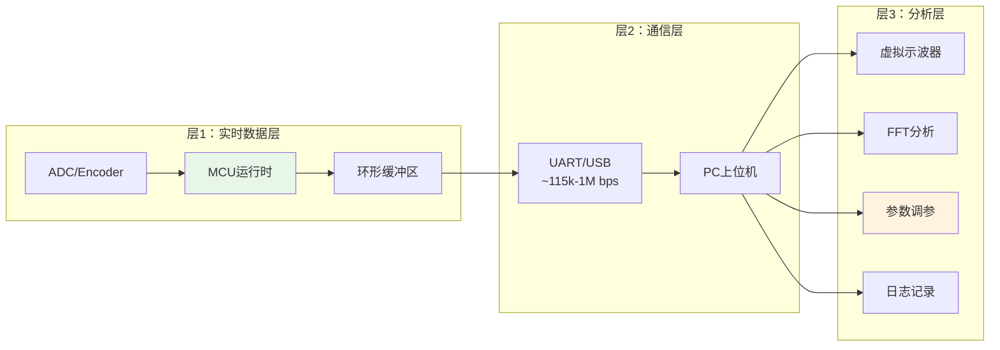

# 调参工具链

> **一句话直觉**：控制器参数不是在办公室里"算出来"的，而是在机器旁边"试出来"的——你需要一套工具，把理论和现场之间的鸿沟变成可观测、可调整、可记录的数字。

---

## 从理论到现场的鸿沟


控制理论教给你如何设计一个控制器——给定模型、给定性能指标，可以算出理论上最优的参数。但现实世界的麻烦在于：

1. **模型是错的**：摩擦力随温度变化，负载惯量随工件改变，电机电感随电流饱和
2. **传感器是脏的**：编码器有量化噪声，电流传感器有温漂，ADC有接地噪声
3. **执行器是有限的**：PWM分辨率只有12位，功放有死区和饱和
4. **扰动是不可预测的**：电网电压波动、机械振动、操作员误操作

调参工具链的价值就是：让你在**不重新编译代码**的情况下，观察系统行为、调整参数、记录结果，最终找到一组在真实工况下鲁棒的参数。

---

## 调参工具链的三层架构



---

## 实时数据层：嵌入式端的实现

### 变量监控表

核心数据结构是一个"监控变量表"，把需要观测的变量地址注册到一张表中：

```c
#define MAX_TRACE_VARS 16

typedef enum {
    TYPE_FLOAT = 0,
    TYPE_INT32 = 1,
    TYPE_UINT16 = 2
} TraceType;

typedef struct {
    void* addr;
    TraceType type;
    const char* name;
} TraceVar;

static TraceVar g_trace_table[MAX_TRACE_VARS];
static int g_trace_count = 0;

void trace_register(const char* name, void* addr, TraceType type) {
    if (g_trace_count < MAX_TRACE_VARS) {
        g_trace_table[g_trace_count].name = name;
        g_trace_table[g_trace_count].addr = addr;
        g_trace_table[g_trace_count].type = type;
        g_trace_count++;
    }
}

// Usage in init:
// trace_register("error", &ctrl.error, TYPE_FLOAT);
// trace_register("integral", &ctrl.integral, TYPE_FLOAT);
// trace_register("output", &ctrl.output, TYPE_FLOAT);
```

### 触发式记录

连续发送所有数据会压垮通信带宽。更聪明的做法是**触发式记录**：平时只在环形缓冲区里写，当某个条件满足时，把触发前后各N个点的数据打包发出去。

```c
#define TRACE_DEPTH 200

typedef struct {
    float data[MAX_TRACE_VARS][TRACE_DEPTH];
    uint32_t head;  // write pointer
    uint32_t tail;  // read pointer
    int trigger_armed;
    int triggered;
    float trigger_level;
    int trigger_var_idx;  // which variable to watch
} TraceBuffer;

void trace_sample(TraceBuffer* buf, float* values) {
    for (int i = 0; i < g_trace_count; i++) {
        buf->data[i][buf->head] = values[i];
    }
    buf->head = (buf->head + 1) % TRACE_DEPTH;
    
    // check trigger
    if (buf->trigger_armed && !buf->triggered) {
        float val = values[buf->trigger_var_idx];
        if (fabsf(val) > buf->trigger_level) {
            buf->triggered = 1;
            buf->tail = (buf->head + TRACE_DEPTH / 2) % TRACE_DEPTH;
            // send notification to host
        }
    }
}
```

**触发后发送的数据包含**：触发前100个周期 + 触发后100个周期，共200个周期的波形。这让你能观察到"故障发生之前系统在做什么"。

---

## 通信层：协议设计

### 轻量级二进制协议（推荐用于控制调试）

```
帧结构：[SOF:1][CMD:1][LEN:2][PAYLOAD:LEN][CRC:2][EOF:1]

SOF = 0xAA 0x55 (2 bytes, pattern unlikely in data)
CMD = 0x01: read var table
      0x02: read trace data
      0x10: write parameter (float)
      0x11: write parameter (int32)
      0x20: arm trigger
CRC = CRC-16/CCITT
```

**为什么不用ASCII/JSON**：
- 二进制协议解析快（没有`sprintf`/`scanf`开销）
- 帧长短、确定性强（适合实时通信）
- 没有字符串转义问题

```c
// Encode a float parameter write command
void send_param_write_float(const char* name, float value) {
    uint8_t frame[64];
    int idx = 0;
    frame[idx++] = 0xAA;
    frame[idx++] = 0x55;
    frame[idx++] = 0x10;  // cmd: write float param
    
    uint16_t len = 4 + strlen(name) + 1;
    frame[idx++] = (len >> 8) & 0xFF;
    frame[idx++] = len & 0xFF;
    
    memcpy(&frame[idx], &value, 4);  // little-endian float
    idx += 4;
    strcpy((char*)&frame[idx], name);
    idx += strlen(name) + 1;
    
    uint16_t crc = crc16(frame, idx);
    frame[idx++] = (crc >> 8) & 0xFF;
    frame[idx++] = crc & 0xFF;
    
    uart_send(frame, idx);
}
```

---

## 分析层：PC端工具

### 虚拟示波器

用Python + matplotlib 可以在5分钟内搭一个虚拟示波器：

```python
import serial
import struct
import matplotlib.pyplot as plt
import numpy as np
from collections import deque

# Serial port setup
ser = serial.Serial('COM3', 921600, timeout=0.01)

# Ring buffers for live plotting
N = 500
buffers = {
    'ref': deque(maxlen=N),
    'y': deque(maxlen=N),
    'u': deque(maxlen=N),
    'error': deque(maxlen=N)
}

plt.ion()
fig, axes = plt.subplots(2, 1, figsize=(10, 6))
line_ref, = axes[0].plot([], [], 'g-', label='ref')
line_y, = axes[0].plot([], [], 'b-', label='y')
line_u, = axes[1].plot([], [], 'r-', label='u')
axes[0].set_ylabel('Position')
axes[1].set_ylabel('Control')
axes[1].set_xlabel('Sample')
axes[0].legend()
axes[1].legend()

for ax in axes:
    ax.set_xlim(0, N)
    ax.grid(True)

def parse_frame(data):
    # Parse binary frame from MCU
    # Return dict of variable values
    if len(data) < 8:
        return None
    if data[0] != 0xAA or data[1] != 0x55:
        return None
    cmd = data[2]
    length = struct.unpack('>H', data[3:5])[0]
    payload = data[5:5+length]
    # ... parse based on cmd
    return {'ref': 0.0, 'y': 0.0, 'u': 0.0, 'error': 0.0}

while True:
    raw = ser.read(64)
    if raw:
        vals = parse_frame(raw)
        if vals:
            for k in buffers:
                buffers[k].append(vals[k])
            
            x = np.arange(len(buffers['y']))
            line_ref.set_data(x, buffers['ref'])
            line_y.set_data(x, buffers['y'])
            line_u.set_data(x, buffers['u'])
            
            for ax in axes:
                ax.relim()
                ax.autoscale_view()
            fig.canvas.draw()
            fig.canvas.flush_events()
```

### 频响分析工具

用MATLAB或Python做频响分析，识别实际系统的伯德图：

```matlab
% Frequency response identification using swept sine
% System: motor position vs voltage command

frequencies = logspace(0, 2, 50);  % 1 Hz to 100 Hz
Ts = 0.001;
mag = zeros(size(frequencies));
phase = zeros(size(frequencies));

for i = 1:length(frequencies)
    f = frequencies(i);
    t = 0:Ts:10;  % 10 seconds per frequency
    u = sin(2*pi*f*t);
    
    % send to system and collect output
    y = run_swept_sine_on_hardware(u);
    
    % FFT at target frequency
    U = fft(u);
    Y = fft(y);
    idx = round(f * length(t) * Ts) + 1;
    
    G = Y(idx) / U(idx);
    mag(i) = abs(G);
    phase(i) = angle(G) * 180/pi;
end

% Plot Bode
subplot(2,1,1); semilogx(frequencies, 20*log10(mag)); grid;
ylabel('Magnitude [dB]'); title('Measured Bode Plot');
subplot(2,1,2); semilogx(frequencies, phase); grid;
ylabel('Phase [deg]'); xlabel('Frequency [Hz]');
```

**频率扫描法的优势**：不依赖精确的数学模型，直接测出系统的真实频响。测出的伯德图可以和仿真对比，验证模型准确性。

---

## 在线参数调参的方法论

### 逐步调参流程

```
Step 1: 确认系统开环响应
  - 给一个很小的阶跃输入（比如10%额定电压）
  - 观察输出是否有响应、方向是否正确
  - 如果不响应，检查接线、传感器、执行器

Step 2: 先调P，再调I，最后调D
  - P=0, I=0, D=0
  - 逐步增加Kp直到系统出现轻微振荡
  - 回退Kp到70%，加入Ki消除稳态误差
  - 最后加入Kd抑制超调（如果需要）

Step 3: 验证鲁棒性
  - 改变负载（加重/减轻）
  - 改变参考信号（方波、斜坡、正弦）
  - 引入扰动（用手推、加摩擦）
  - 系统必须保持稳定

Step 4: 记录最终参数
  - 保存到非易失存储器（EEPROM/Flash）
  - 记录调试日志（环境、负载、测试条件）
```

### Ziegler-Nichols在线法（闭环法）

```
1. 只保留比例控制（Ki=0, Kd=0）
2. 逐步增加Kp，直到系统出现等幅振荡
3. 记录临界增益 K_u 和振荡周期 T_u
4. 按表设置PID参数：

   控制器类型    Kp        Ki (=Kp/Ti)    Kd (=Kp*Td)
   P            0.5*Ku     -               -
   PI           0.45*Ku    0.54*Ku/Tu      -
   PID          0.6*Ku     1.2*Ku/Tu      0.075*Ku*Tu
```

**数值示例**：

某电机速度环在 $K_p = 8.0$ 时出现等幅振荡，周期 $T_u = 0.15$ s。

则Z-N PID参数：
- $K_p = 0.6 \times 8.0 = 4.8$
- $K_i = 1.2 \times 8.0 / 0.15 = 64.0$
- $K_d = 0.075 \times 8.0 \times 0.15 = 0.09$

```matlab
% Verify in simulation
Kp = 4.8; Ki = 64.0; Kd = 0.09;
C = pid(Kp, Ki, Kd);
step(feedback(C*G, 1));
```

---

## 数值示例：完整调参会话记录

**系统**：直线电机平台，质量 $m = 2.0$ kg，推力常数 $K_f = 20$ N/A，电流动态忽略。

**目标**：位置阶跃响应，超调 $< 10\%$，调节时间 $< 0.5$ s，无稳态误差。

**Step 1: 开环测试**

给0.5A电流指令，电机开始运动。从虚拟示波器读到的速度阶跃响应：

$$ v(t) = \frac{K_f I}{m} t = \frac{20 \times 0.5}{2.0} t = 5 t \text{ m/s}^2 $$

这是一个纯积分对象：$G(s) = \frac{K_f}{m s^2} = \frac{10}{s^2}$。

**Step 2: P-only测试**

$K_p = 100$：响应缓慢，有稳态误差  
$K_p = 500$：响应加快，仍有稳态误差  
$K_p = 2000$：出现振荡，频率约10 Hz

记录：$K_u \approx 2000, T_u \approx 0.1$ s

**Step 3: Z-N整定**

$K_p = 0.6 \times 2000 = 1200$  
$K_i = 1.2 \times 2000 / 0.1 = 24000$  
$K_d = 0.075 \times 2000 \times 0.1 = 15$

**Step 4: 仿真验证**

```matlab
s = tf('s');
G = 10/s^2;
K = 1200 + 24000/s + 15*s;
T = feedback(K*G, 1);
step(T, 1);  % 1 second simulation
```

结果：超调约25%，太大。需要减小 $K_i$ 或增加 $K_d$。

**Step 5: 微调**

$K_p = 1200, K_i = 12000, K_d = 30$ → 超调12%  
$K_p = 1000, K_i = 8000, K_d = 40$ → 超调8%, 调节时间0.4s ✓

最终参数保存到Flash：

```c
typedef struct {
    uint32_t magic;     // 0xDEADBEEF to verify valid
    float Kp, Ki, Kd;
    uint16_t crc;
} PID_Params;

const PID_Params g_saved_params __attribute__((section(".flash_params"))) = {
    .magic = 0xDEADBEEF,
    .Kp = 1000.0f,
    .Ki = 8000.0f,
    .Kd = 40.0f,
    .crc = 0x1234
};
```

---

## 常见错误与纠正

### 错误1：在调参时只看不保存，重启后参数丢失

**错误做法**：每次用串口工具修改参数，只在RAM里生效。断电重启后参数归零。

**纠正方法**：设计参数保存机制：

```c
typedef struct {
    float Kp, Ki, Kd;
    uint32_t checksum;
} ParamBlock;

void params_save_to_flash(ParamBlock* p) {
    p->checksum = crc32((uint8_t*)p, sizeof(ParamBlock) - 4);
    flash_erase_sector(PARAM_SECTOR);
    flash_write(PARAM_SECTOR, (uint32_t*)p, sizeof(ParamBlock));
}

int params_load_from_flash(ParamBlock* p) {
    memcpy(p, (void*)PARAM_FLASH_ADDR, sizeof(ParamBlock));
    uint32_t calc = crc32((uint8_t*)p, sizeof(ParamBlock) - 4);
    if (calc != p->checksum) {
        return -1;  // corrupted, use defaults
    }
    return 0;
}
```

### 错误2：只调阶跃响应，不验证跟踪性能和抗扰性

**错误做法**：调好了一个漂亮的阶跃响应（超调5%、调节时间0.2s）就认为完成了。但现场运行时是**正弦跟踪**或**斜坡跟踪**，阶跃响应好的参数不一定跟踪好。

**纠正方法**：调参完成后必须测试三类信号：

| 测试信号 | 考察能力 | 失败表现 |
|---------|---------|---------|
| 阶跃 | 快速响应、稳定性 | 振荡、超调过大 |
| 斜坡 | 跟踪能力、稳态误差 | 滞后、累计误差 |
| 正弦（扫频） | 频带宽度、谐振 | 高频衰减、共振峰 |
| 方波 | 重复跟踪精度 | 每周期起始位置漂移 |
| 随机扰动 | 抗扰性 | 被扰动后恢复慢 |

```matlab
% comprehensive test suite
figure;
subplot(3,1,1); step(T); title('Step response');
subplot(3,1,2); lsim(T, [0:0.001:2], 0:0.001:2); title('Ramp tracking');
subplot(3,1,3); t = 0:0.001:2; u = sin(2*pi*5*t); lsim(T, u, t); title('Sine tracking @ 5Hz');
```

---

## 自测习题

### 习题1

某电机系统用Ziegler-Nichols闭环法整定PID。纯P控制下，系统在 $K_p = 12$ 时出现周期为0.2 s的等幅振荡。请计算Z-N PID参数，并预测预期超调量。

**答案**：

$K_u = 12, T_u = 0.2$ s

- $K_p = 0.6 \times 12 = 7.2$
- $K_i = 1.2 \times 12 / 0.2 = 72.0$
- $K_d = 0.075 \times 12 \times 0.2 = 0.18$

Z-N PID的超调量通常在20%-30%之间。如果超调要求严格，需要在此基础上手动微调（通常减小Ki、增大Kd）。

---

### 习题2

设计一个二进制通信帧用于在线调参。要求：帧头可靠识别、支持float/int参数读写、有CRC校验。写出帧格式，并计算发送一个float参数写命令的最小帧长度。

**答案**：

帧格式（字节）：

| 字段 | 长度 | 说明 |
|------|------|------|
| SOF1 | 1 | 0xAA |
| SOF2 | 1 | 0x55 |
| CMD | 1 | 0x10=write float, 0x11=write int, 0x01=read |
| LEN | 2 | payload长度（大端） |
| Payload | N | 数据内容 |
| CRC | 2 | CRC-16/CCITT |

Write float payload = 4 bytes (float value) + 1 byte (param index) = 5 bytes

总帧长 = 2 + 1 + 2 + 5 + 2 = 12 bytes

---

### 习题3

解释为什么频率扫描法（扫频正弦注入）比阶跃响应法更适合辨识系统频响。在哪些场景下阶跃响应法反而更方便？

**答案**：

**扫频法的优势**：
1. 频率分辨率高：可以精确测量每个频率点的增益和相位
2. 信噪比好：正弦信号能量集中在单一频率，可以用窄带滤波提取响应
3. 不受线性假设限制：如果系统非线性，扫频法可以揭示谐波失真

**阶跃法的优势**：
1. 实施简单：不需要信号发生器，只需改变设定值
2. 快速：一次阶跃就能看到全貌
3. 现场友好：不需要额外的激励信号，不会干扰正常生产

**选择建议**：实验室建模用扫频法，现场粗调用阶跃法，精调结合两者。

---

## 延伸阅读提示

- `04-PID与工业控制器设计`：PID参数的理论设计方法（与在线调参互补）
- `06-系统辨识与模型估计`：用数据驱动的方法获取系统模型
- `001-控制算法到C代码的映射`：调参后的参数如何固化到代码中
