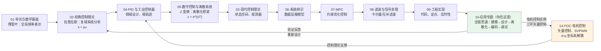
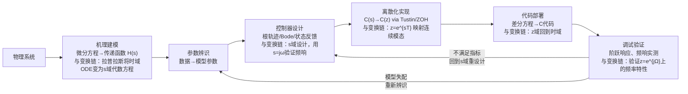

# 图解入门：控制理论如何落地

> **核心认知锚点**：本模块是"变换链"的最后一环——从傅里叶的全局频率表示，经拉普拉斯的复域系统分析，穿越 Z 域的离散化桥梁，最终落地为让物理系统精确运动的一行 C 代码。同时也是验证闭环：应用中的问题会反哺理论，驱动你回到 $s$ 域或 $z$ 域重新审视设计。

---

## 为什么学这个模块：它在统一框架中的位置

在学习双控微专业的前九个模块中，你已经走过了一条完整的"变换链"：

**认知路径：全局频率表示 → 复域系统分析 → 有限实现与局部分析 → 应用落地**

| 模块 | 层级 | 核心问题 | 变换域 | 关键映射 |
|------|------|----------|--------|----------|
| 01-导论与数学基础 | 全局频率表示 | 信号有哪些频率成分？ | 傅里叶级数/变换 | — |
| 02-经典控制理论 | 复域系统分析 | 系统如何响应、是否稳定？ | 拉普拉斯 $s$ 域 | $s = j\omega$ |
| 04-PID 与工业控制器 | 复域设计 | 控制器如何配置满足指标？ | $s$ 域根轨迹/Bode | $s = j\omega$ |
| 05-数字控制与离散系统 | 有限实现 | 如何在数字处理器上实现？ | Z 域 | $z = e^{sT}$ |
| 09-工程实现 | 局部分析 | 代码、精度、实时性如何保证？ | 差分方程、定点数 | $z = e^{j\Omega}$ |
| **10-应用专题（本模块）** | **应用落地** | **理论能否让真实系统按指令运动？** | **全链贯通** | **三条映射同时生效** |

> **关键洞察**：傅里叶、拉普拉斯、Z 不是互相竞争的工具，而是同一条分析链的不同层级。傅里叶回答"有哪些频率"，拉普拉斯回答"这些频率是否伴随增长/衰减，系统是否因果稳定"，Z 变换回答"采样后如何用有限数据与算力实现控制"。本模块的任务，就是让你亲眼看到这条链的末端如何咬合真实世界的齿轮。

---

## 与前后模块的关系



上图的知识流向说明：

- **前九模块**是纵向深入：从频率分析到复域系统，再到数字实现与工程部署。每一层都建立在前一层的基础上，通过 $s = j\omega$ 和 $z = e^{sT}$ 两条关键映射保持连贯。
- **本模块**是横向贯通：用真实工程案例（伺服、过程控制、机器人、无人机、电力电子、汽车）把前面所有模块串联验证。如果调试中发现系统震荡，你需要回到 $s$ 域检查相位裕度；如果发现数字实现不稳定，你需要回到 $z$ 域检查极点是否落在单位圆内。
- **FOC 微专业**是纵向延伸：你已经掌握的 [[14-FOC-电机控制/00-README|14-FOC-电机控制]] 中的电流环 PI、速度环 PI、矢量解耦（$d$-$q$ 坐标系）、SVPWM 调制，正是控制理论在电机驱动领域的直接应用。本模块中的伺服系统控制与电力电子变换器控制，与 FOC 共享同一套"变换链"工具箱。

---

## 控制理论落地的全景地图

控制理论的价值不在于推导本身，而在于让物理系统按照人的意图精确运动。一个控制算法从纸面到硬件，通常经历以下阶段：



这个闭环叫做**V 型开发流程**的右半边。非科班出身的工程师最常犯的错误是：拿到一个 PID 代码就往里填参数，跳过建模和辨识，结果调参调到怀疑人生。理解"变换链"的完整路径，才能知道**每个环节为什么必须存在**——不是因为我们喜欢数学，而是因为物理世界只按微分方程运动，而微分方程的求解和分析，恰好需要拉普拉斯和 Z 变换这两把钥匙。

---

## 阶段一：从物理系统到数学模型

### 直觉理解

想象你要控制一台直流电机转到一个精确角度。你首先得知道：**施加多少电压，电机转速会如何变化？** 这就是模型的作用——它是对物理因果关系的数学压缩。

### 建模的两条路径

| 路径 | 方法 | 优点 | 缺点 | 适用场景 |
|------|------|------|------|----------|
| 白箱 | 牛顿/基尔霍夫定律 | 物理可解释 | 需要深入了解系统 | 电机、机械臂 |
| 黑箱 | 输入输出数据拟合 | 不需要机理 | 外推性差 | 化工过程 |
| 灰箱 | 结构已知+参数辨识 | 兼顾两者 | 需要部分先验 | 大多数工程场景 |

### 数值示例：直流电机建模

一台永磁直流电机的电枢回路方程和转矩方程为：

$$
L_a \frac{di_a}{dt} + R_a i_a + K_e \omega = V_a
$$

$$
J \frac{d\omega}{dt} + B \omega = K_t i_a - T_L
$$

其中：
- $L_a = 2.5 \, \text{mH}$，电枢电感
- $R_a = 2.0 \, \Omega$，电枢电阻
- $K_e = 0.05 \, \text{V/(rad/s)}$，反电动势常数
- $K_t = 0.05 \, \text{N·m/A}$，转矩常数
- $J = 0.001 \, \text{kg·m}^2$，转动惯量
- $B = 0.001 \, \text{N·m/(rad/s)}$，阻尼系数

以电压 $V_a$ 为输入、转速 $\omega$ 为输出，忽略负载转矩 $T_L$，对两式取**拉普拉斯变换**并消去 $I_a(s)$，得到传递函数：

$$
G(s) = \frac{\Omega(s)}{V_a(s)} = \frac{K_t}{L_a J s^2 + (R_a J + L_a B) s + (R_a B + K_e K_t)}
$$

> **与变换链的关系**：这一步的本质是**拉普拉斯变换将时域微分方程转化为 $s$ 域的代数方程**。$s$ 不仅是符号——它编码了系统的所有模态（极点）和增益特性（零点），而这些模态在时域里被隐藏在一堆导数中。拉普拉斯域让"稳定性"变得一目了然：只要看极点是否在左半平面。

代入数值：

$$
G(s) = \frac{0.05}{2.5 \times 10^{-3} \times 0.001 \cdot s^2 + (2.0 \times 0.001 + 2.5 \times 10^{-3} \times 0.001) s + (2.0 \times 0.001 + 0.05 \times 0.05)}
$$

$$
G(s) = \frac{0.05}{2.5 \times 10^{-6} s^2 + 2.0025 \times 10^{-3} s + 4.5 \times 10^{-3}}
$$

分子分母同除以 $2.5 \times 10^{-6}$：

$$
G(s) = \frac{20000}{s^2 + 801 s + 1800}
$$

这是一个典型的二阶系统，直流增益约 $20000/1800 \approx 11.1 \, \text{rad/(s·V)}$。分母的两个根就是系统的**极点**，在 $s$ 平面的位置决定了系统的动态响应特征——这正是复域分析的强大之处。

---

## 阶段二：控制器设计

### 设计目标到控制律的映射

| 设计目标 | 典型控制器 | 关键参数 | 变换域工具 |
|----------|-----------|----------|------------|
| 快速响应、小超调 | PD / 超前校正 | $\omega_n$, $\zeta$ | 根轨迹（$s$ 平面） |
| 消除稳态误差 | PI / 滞后校正 | $K_i$ 积分增益 | Bode 图（$s = j\omega$） |
| 抑制扰动 | 高带宽环路 + 前馈 | 环路增益 | Nyquist 判据 |
| 约束满足 | MPC | 预测时域、约束集 | 状态空间 + 优化 |

### 一个完整的伺服速度控制设计

对上面的直流电机，设计一个 PI 速度控制器。设控制器为：

$$
C(s) = K_p + \frac{K_i}{s}
$$

> **与变换链的关系**：PI 控制器的积分项 $1/s$ 在 $s$ 域中是一个原点极点，它对应时域中的积分运算。通过 $s = j\omega$ 映射到频域，可以看出积分器在低频段提供无限大增益（消除稳态误差），在高频段衰减为 $-20\,\text{dB/dec}$。这是"复域设计、频域验证"的典型流程。

开环传递函数：

$$
L(s) = C(s) G(s) = \frac{K_p s + K_i}{s} \cdot \frac{20000}{s^2 + 801 s + 1800}
$$

采用**模态配置法**：希望闭环主导极点位于 $s = -50 \pm j50$（对应 $\zeta = 0.707$，$\omega_n = 70.7 \, \text{rad/s}$，约 5% 超调）。

特征方程为 $1 + L(s) = 0$，展开后可用根轨迹或数值方法求解 $K_p, K_i$。通过试凑或 MATLAB `place`/`rlocus` 工具，可得一组可行参数：

$$
K_p \approx 0.08, \quad K_i \approx 2.0
$$

> **与变换链的关系**：闭环极点在 $s$ 平面中的位置直接决定了时域响应（超调量、调节时间、振荡频率）。这正是拉普拉斯域分析的核心价值——在复平面上"放置"极点，就是在时域上"塑造"动态行为。$s = \sigma + j\omega$ 中，$\sigma$ 控制衰减速度，$\omega$ 控制振荡频率。

---

## 阶段三：离散化与代码实现

连续控制器必须在数字处理器（MCU/DSP/PLC）上实现。最常用的是**后向欧拉法**和**双线性变换（Tustin）**。

### 双线性变换

将 $s \approx \frac{2}{T_s} \frac{z-1}{z+1}$ 代入 $C(s)$，其中 $T_s$ 为采样周期。

> **与变换链的关系**：双线性变换是 $s$ 平面与 $z$ 平面之间的**保角映射**的近似。精确映射是 $z = e^{sT}$，但它在有理函数上无法直接操作。Tustin 变换用 $s \leftrightarrow \frac{2}{T_s}\frac{z-1}{z+1}$ 保持稳定性（$s$ 左半平面 → $z$ 单位圆内），并避免频率混叠。理解这一点，你就理解了为什么"连续系统稳定不代表离散化后稳定"——不同的离散化方法对 $z = e^{sT}$ 的近似精度不同。

对于 PI 控制器 $C(s) = K_p + \frac{K_i}{s}$，Tustin 离散化后：

$$
C(z) = K_p + K_i \frac{T_s}{2} \frac{z+1}{z-1}
$$

整理为差分方程形式。令 $u(k)$ 为第 $k$ 时刻控制输出，$e(k)$ 为误差：

$$
u(k) = \nu(k-1) + \frac{T_s}{2} [e(k) + e(k-1)]
$$

$$
u(k) = K_p e(k) + K_i \nu(k)
$$

> **与变换链的关系**：从 $C(z)$ 到差分方程，本质上是**Z 逆变换**——把 $z$ 的移位算子还原为时域的延迟操作（$z^{-1}$ 对应 $k-1$ 时刻）。$z = e^{sT}$ 的映射在这里变成了可执行的代码：$s$ 域中的积分（$1/s$）变成了数字累加器，$s$ 域中的比例（$K_p$）变成了乘法指令。

### C 代码实现

```c
/* PI speed controller for DC motor
 * Sampling period: Ts = 1 ms
 * 与变换链的关系：下面的代码就是 z 域传递函数 C(z) 的时域实现。
 * 每一行代码都对应 z 域中的一个代数操作。
 */
#define KP          0.08f
#define KI          2.0f
#define TS          0.001f
#define INTG_MAX    10.0f   /* Anti-windup limit */

typedef struct {
    float integrator;
    float e_prev;
    float u_prev;
} PI_Controller;

void pi_init(PI_Controller *ctrl) {
    ctrl->integrator = 0.0f;
    ctrl->e_prev     = 0.0f;
    ctrl->u_prev     = 0.0f;
}

float pi_update(PI_Controller *ctrl, float setpoint, float measurement) {
    float e = setpoint - measurement;
    
    /* Trapezoidal integration —— 对应 z 域中的 (z+1)/(z-1) */
    ctrl->integrator += 0.5f * TS * (e + ctrl->e_prev);
    
    /* Anti-windup clamping —— 对应 z 域中的饱和非线性 */
    if (ctrl->integrator > INTG_MAX)
        ctrl->integrator = INTG_MAX;
    else if (ctrl->integrator < -INTG_MAX)
        ctrl->integrator = -INTG_MAX;
    
    float u = KP * e + KI * ctrl->integrator;
    
    ctrl->e_prev = e;
    ctrl->u_prev = u;
    return u;
}
```

---

## 阶段四：调试验证

### 调试检查清单

| 检查项 | 方法 | 合格标准 | 变换链验证点 |
|--------|------|----------|------------|
| 采样周期 | 示波器测 PWM / 中断周期 | $T_s \ll \tau_{min}/10$ | 验证 $z = e^{sT}$ 的近似精度 |
| 信号噪声 | 示波器 FFT / 频谱分析 | 噪声 < 1% 量程 | $s = j\omega$ 上的频响分析 |
| 稳态误差 | 阶跃响应最终值 | $\verte_{ss}\vert < 1\%$ | 验证 $s = 0$（直流）处的环路增益 |
| 超调量 | 阶跃响应峰值 | $\sigma < 5\%$ | 验证闭环极点 $s = -\zeta\omega_n \pm j\omega_n\sqrt{1-\zeta^2}$ |
| 相位裕度 | 开环 Bode 图 | $PM > 45°$ | 验证 $s = j\omega_{gc}$ 处的相位 |

### MATLAB 验证脚本

```matlab
% Continuous-time motor model
% 与变换链的关系：在 s 域设计、在 s=jω 处验证频响
La = 2.5e-3; Ra = 2.0; Ke = 0.05; Kt = 0.05;
J = 0.001; B = 0.001;
num = Kt;
den = [La*J, Ra*J + La*B, Ra*B + Ke*Kt];
G = tf(num, den);

% PI controller
Kp = 0.08; Ki = 2.0;
C = tf([Kp, Ki], [1, 0]);

% Closed-loop step response (s 域验证)
sys_cl = feedback(C*G, 1);
figure; step(sys_cl);
title('Closed-Loop Speed Response');
grid on;

% Check phase margin (s=jω 验证)
figure; margin(C*G);

% Discrete-time verification (z 域验证)
Ts = 0.001;
Cd = c2d(C, Ts, 'tustin');  % s → z 映射
Gd = c2d(G, Ts, 'zoh');     % 带零阶保持的精确离散化
sys_cl_d = feedback(Cd*Gd, 1);
figure; step(sys_cl_d);
title('Discrete Step Response (Ts = 1ms)');
grid on;
% 对比连续与离散响应，验证 z=e^{sT} 的映射质量
```

---

## 与 [[14-FOC-电机控制/00-README|14-FOC-电机控制]] 的关联

如果你已经学过 FOC 微专业，你会立刻认出上面的流程就是 FOC 的核心骨架：

| FOC 环节 | 对应本模块内容 | 变换域 | 关键公式 |
|----------|---------------|--------|----------|
| 电流环 PI（$d$-$q$ 轴） | 电流环设计 | $s$ 域 | $C_i(s) = K_{pi} + K_{ii}/s$ |
| 速度环 PI | 速度环设计 | $s$ 域 | $C_\omega(s) = K_{p\omega} + K_{i\omega}/s$ |
| 矢量解耦（Clarke/Park） | 坐标变换与模型简化 | $s$ 域 → 时域 | $i_d, i_q$ 解耦后分别控制 |
| SVPWM 调制 | 电力电子变换器控制 | 离散时域 | 占空比 → 开关信号 |
| 编码器反馈 | 传感器与信号处理 | 离散时域 | $z$ 域的采样与延迟模型 |

> **关键洞察**：FOC 本质上就是"变换链"在电机控制领域的完整实例。Park 变换是**时域**的坐标旋转（把三相交流变成直流等效），电流环/速度环 PI 是**$s$ 域**的控制器设计，SVPWM 是**离散时域**的功率级实现，而编码器采样和电流采样则是**$z$ 域**的采样过程。理解统一框架，就是理解 FOC 为什么这样工作。

---

## 常见错误与纠正

### 错误 1：采样周期选得太大

**现象**：系统震荡甚至发散，离散化后的系统稳定性变差。

**原因**：连续系统稳定不代表离散化后稳定。通过 $z = e^{sT}$ 映射，$s$ 左半平面的极点会映射到 $z$ 平面单位圆内，但离散化方法（如欧拉法）的近似误差可能把极点推出单位圆。采样频率应满足 $f_s \ge 20 \sim 40 \times f_{BW}$，其中 $f_{BW}$ 是系统带宽。

**纠正**：对上面的电机系统，带宽约 $80 \, \text{rad/s} \approx 12.7 \, \text{Hz}$，至少选择 $T_s = 1 \, \text{ms}$（$f_s = 1 \, \text{kHz}$）。

> **与变换链的关系**：这个错误的核心是忽略了 $z = e^{sT}$ 映射的**频率扭曲**。当 $T_s$ 太大时，$s$ 平面中的高频模态被映射到 $z$ 平面时发生严重失真，双线性变换的近似误差急剧增大。Tustin 变换虽然保持稳定性，但会改变穿越频率，需要在设计时预补偿（prewarping）。

### 错误 2：积分饱和导致大超调

**现象**：大阶跃时电机电压饱和，积分项持续累积，即使误差变号后输出仍长时间饱和，造成严重超调。

**纠正**：代码中必须加入抗积分饱和（Anti-windup）逻辑，如上面的 clamping 所示。更高级的方法是**条件积分**或**回算抗饱和（back-calculation）**。

---

## 自测习题

**1.** 上例中直流电机的直流增益约为多少？若期望稳态转速为 $100 \, \text{rad/s}$，理论所需电压是多少？加入 PI 控制器后为什么稳态误差为零？

> 答案：$G(0) = 20000/1800 \approx 11.11 \, \text{rad/(s·V)}$。所需电压 $V = 100/11.11 \approx 9.0 \, \text{V}$。加入 PI 控制器后，积分项在 $s$ 域中引入原点极点（$1/s$），使开环传递函数在 $s=0$ 处趋向无穷大，从而对阶跃输入的稳态误差为零。这是 $s$ 域分析的标志性结论——**积分器消除阶跃稳态误差**。

**2.** 为什么 PI 控制器的积分项需要抗饱和？简述 clamping 方法的实现思路。在 $s$ 域和 $z$ 域中分别如何理解这个问题？

> 答案：因为执行器有物理限幅（如电机电压 $0 \sim 24\,\text{V}$），当误差大时积分项会持续累积。Clamping 方法在积分项超过预设限幅时将其钳位。在 $s$ 域中，这相当于给积分器引入了一个非线性饱和环节；在 $z$ 域中，这相当于对累加器的状态变量 $x_I[k]$ 设置了上下界约束。

**3.** 用双线性变换将 $C(s) = 2 + \frac{10}{s}$ 离散化，$T_s = 0.01\,\text{s}$，写出 $C(z)$ 的表达式。并说明这个变换与 $z = e^{sT}$ 精确映射的关系。

> 答案：
> $$C(z) = 2 + 10 \cdot \frac{0.01}{2} \frac{z+1}{z-1} = 2 + 0.05\frac{z+1}{z-1}$$
> 整理得：
> $$C(z) = \frac{2.05 z - 1.95}{z - 1}$$
> 双线性变换是 $z = e^{sT}$ 的一阶 Padé 近似：$e^{sT} \approx \frac{1 + sT/2}{1 - sT/2}$，因此 $s \approx \frac{2}{T}\frac{z-1}{z+1}$。当 $T_s$ 足够小时，两者非常接近；$T_s$ 越大，频率扭曲越严重。

**4.** 下图中哪条曲线最可能是采样周期过短的系统响应？

```
   ^
 y |    A: 平滑上升，稍有超调
   |    B: 剧烈震荡，发散
   |    C: 严重锯齿状，量化明显
   |    D: 响应极慢，无超调
   +------------------------> t
```

> 答案：C。采样周期过短不会导致不稳定，但会使量化效应和数值精度问题凸显，表现为锯齿状响应。注意"过短"与"过大"的区别：过大时（B）系统可能因离散化失真而发散；过短时（C）系统稳定但精度受损。这可以通过 $z = e^{sT}$ 理解：$T$ 过大导致映射失真，$T$ 过小导致 $z$ 平面极点聚集在 $z=1$ 附近，数值条件变差。

---

## 本章小结

控制理论落地 = 建模 → 设计 → 离散化 → 编码 → 调试。每一步都有明确的方法和工具。但更重要的是，每一步都不是孤立的——它们通过**变换链**串联在一起：

1. **建模**用拉普拉斯把微分方程变成 $s$ 域代数方程，看到极点和零点。
2. **设计**在 $s$ 域配置极点，通过 $s = j\omega$ 验证频域特性。
3. **离散化**通过 $z = e^{sT}$ 把 $s$ 域控制器映射到 $z$ 域，保持稳定性。
4. **编码**把 $z$ 域的差分方程变成 C 代码的累加器和乘法器。
5. **调试**在时域验证，如果失败，回到 $s$ 域或 $z$ 域重新分析。

记住三句话：

1. **没有模型的控制是盲人骑瞎马。**
2. **没有抗饱和的 PI 是定时炸弹。**
3. **不理解 $s = j\omega$、$z = e^{j\Omega}$、$z = e^{sT}$ 这三条映射，所有公式都是碎片。**

下一章开始，我们将深入各个具体应用领域，用同样的流程解决真实工程问题。
