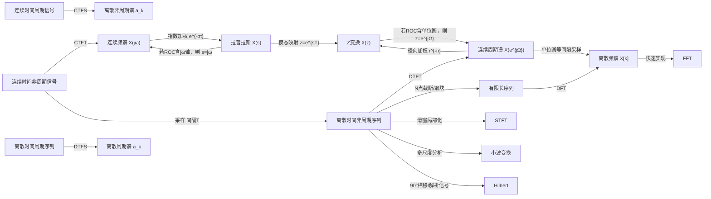
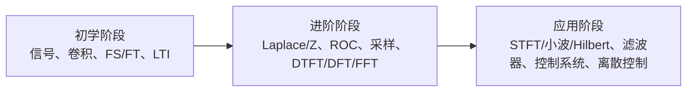

# 从信号与系统、数字信号处理与自动控制三条主线系统梳理常见变换的数学关系与工程意义

## 执行摘要

信号与系统、数字信号处理、自动控制这三条主线，表面上分别强调“信号表示”“可计算实现”“系统分析与设计”，但它们共享同一个核心骨架：**复指数是线性时不变系统的特征函数，卷积在合适变换域里会化成乘法**。围绕这一骨架，傅里叶级数与傅里叶变换负责“频率分解”，拉普拉斯与 Z 变换负责“把增长/衰减也纳入复域分析”，DFT/FFT 负责“把无限或连续问题变成有限、可算的问题”，STFT/小波/希尔伯特则分别面向“局部时频分析”“多尺度分析”“解析信号与瞬时特征提取”。

最重要的映射关系可以浓缩成四句话。其一，**拉普拉斯变换是对连续时间傅里叶变换加上指数加权后的推广**，当 ROC 包含虚轴时，$X(j\omega)=X(s)\vert_{s=j\omega}$。其二，**Z 变换是对离散时间傅里叶变换加上径向加权后的推广**，当 ROC 包含单位圆时，$X(e^{j\Omega})=X(z)\vert_{z=e^{j\Omega}}$。其三，**采样把连续时间映到离散时间，连续模态 $e^{st}$ 采样后对应离散模态 $z^n$，两者满足 $z=e^{sT}$**。其四，**DFT 不是新的“物理变换”，而是有限长序列的 DTFT 在单位圆上的等间隔采样；FFT 只是高效计算 DFT 的算法**。

从工程视角看，三条主线的分工非常明确。信号与系统课程通常先建立时域、频域、复频域三种观察方式，让学生理解“同一系统的多种面貌”；数字信号处理课程进一步把 DTFT、DFT、FFT、数字滤波、时频分析、小波等工具组织成可编程实现体系；自动控制课程则突出单边拉普拉斯、传递函数、极点零点、稳定性、频域设计和采样系统，把变换直接用于系统性能判定与控制器设计。国内高校公开课程与经典教材也基本沿着这一脉络组织内容。

如果只抓一个学习主线，最值得抓住的是：**先理解四类“基本傅里叶表示”之间的关系，再理解拉普拉斯和 Z 如何通过 ROC 把“是否收敛、是否因果、是否稳定”纳入同一张复平面图里，最后再学习 DFT/FFT、STFT、小波、希尔伯特这些面向计算和应用的工具**。MIT 的讲义明确把 CTFS、CTFT、DTFS、DTFT 视作“一个统一结构的四种外观”；MathWorks 的文档则把 STFT、小波、Hilbert 都放到时频分析与解析信号框架中解释。

## 三条主线下的统一框架

从**信号与系统**的视角，变换的首要作用是“表示”与“化简”。周期连续信号用 CTFS 表示为离散谱系数，非周期连续信号用 CTFT 表示为连续频谱；离散信号进入 DTFS/DTFT 后，时间上的卷积和在频域里变成乘法。再进一步，引入拉普拉斯与 Z 变换后，系统就可以通过极点、零点、ROC 来统一讨论因果性、稳定性与频率响应。国内《信号与系统》课程大纲和 MIT/清华/北交的课程页面都把“傅里叶变换、拉普拉斯变换、Z 变换”列为从时域走向频域、复频域的主干。

从**数字信号处理**的视角，关键不只是在“变换存在”，而是在“变换可算”。DTFT 是理论频谱，DFT 是有限点采样频谱，FFT 是 DFT 的快速算法；采样定理说明何时可以从连续信号无失真地得到离散信号；STFT、小波、Hilbert 又把非平稳分析、局部频率结构、包络与瞬时频率纳入工具箱。北京交通大学、东南大学、西安电子科技大学等国内 DSP 课程都把 DFT/FFT、采样、时频分析、小波分析放在同一课程链条里。

从**自动控制**的视角，最重要的是“系统方程如何变成代数方程”。单边拉普拉斯变换直接把常系数微分方程变成代数方程，并自然带入初始条件；采样控制和离散控制则把这一工作移到 Z 域完成。连续系统极点在左半平面意味着稳定，离散系统极点在单位圆内意味着稳定；频率响应分别通过 $H(j\omega)$ 和 $H(e^{j\omega})$ 从复域切片得到。高教社“自动控制原理”教材与北航 MOOC 课程都把数学模型、时域分析、频域分析、采样系统和状态空间分析作为连贯整体来讲。

下面这张图把这些关系压缩成一张“全景路线图”。图中的箭头既表示数学推广，也表示课程学习时最自然的知识流向；其中 $s=j\omega$、$z=e^{j\Omega}$、$z=e^{sT}$ 是最需要真正吃透的三条连接线。其依据来自 MIT 关于四类傅里叶表示、拉普拉斯—Z 平行推导、采样与 DFT 的讲义。



## 常见变换的定义、逆变换、收敛条件与适用场景

下表把报告涉及的主要变换放到同一张比较表中。表中公式采用工程中最常见的记号与归一化约定，定义、逆变换与关系主要综合自 MIT 的傅里叶表示讲义、MIT/Rowell 的拉普拉斯—Z 推导、MathWorks 的 DFT/STFT/小波/Hilbert 文档，以及 Wolfram 关于单边/双边拉普拉斯与 Z 变换的说明。

| 变换 | 分析式 | 逆变换/重构 | 适用信号类型 | 收敛条件或 ROC | 复域/频域解释 | 是否直接用于因果/稳定判别 | 常见应用 |
|---|---|---|---|---|---|---|---|
| **CTFS** | $a_k=\frac1T\int_T x(t)e^{-jk\omega_0 t}dt,\ \omega_0=\frac{2\pi}{T}$ | $x(t)=\sum_{k=-\infty}^{\infty}a_k e^{jk\omega_0 t}$ | 连续时间、周期 | 周期信号；通常要求平方可积/分段光滑 | 频率是离散谐波 $k\omega_0$ | 否 | 周期信号、谐波分析、交流稳态 |
| **CTFT** | $X(j\omega)=\int_{-\infty}^{\infty}x(t)e^{-j\omega t}dt$ | $x(t)=\frac1{2\pi}\int_{-\infty}^{\infty}X(j\omega)e^{j\omega t}d\omega$ | 连续时间、非周期 | 绝对可积时通常存在；周期/阶跃/正弦常需广义函数解释 | 纯频率轴 $j\omega$ 上的谱 | 间接，可由 $H(j\omega)$ 看频响但不直接编码因果性 | 滤波、频谱分析、通信 |
| **双边拉普拉斯** | $X(s)=\int_{-\infty}^{\infty}x(t)e^{-st}dt,\ s=\sigma+j\omega$ | Bromwich 反演：$x(t)=\frac1{2\pi j}\int_{\gamma-j\infty}^{\gamma+j\infty}X(s)e^{st}\,ds$ | 连续时间、左右双边都可 | 必须同时给出 ROC；有理函数时 ROC 常是竖直条带 | $\sigma$ 表示增长/衰减，$\omega$ 表示振荡 | **是**；因果右边信号 ROC 在最右极点右侧，稳定要求 ROC 含 $j\omega$ 轴 | LTI 系统、极点零点、稳定性 |
| **单边拉普拉斯** | $X_+(s)=\int_0^\infty x(t)e^{-st}dt$ | 常用表、留数、部分分式 | 因果信号/初值问题 | $t\ge 0$；分段连续且指数有界时存在 | 更偏“系统求解工具”而非纯谱表示 | **是**；特别适合微分方程和初始条件 | 自动控制、微分方程求解 |
| **DTFS** | $a_k=\frac1N\sum_{n=0}^{N-1}x[n]e^{-j2\pi kn/N}$ | $x[n]=\sum_{k=0}^{N-1}a_k e^{j2\pi kn/N}$ | 离散时间、周期 | 周期序列 | 频域也离散且以 $N$ 为周期 | 否 | 周期序列、循环序列分析 |
| **DTFT** | $X(e^{j\Omega})=\sum_{n=-\infty}^{\infty}x[n]e^{-j\Omega n}$ | $x[n]=\frac1{2\pi}\int_{-\pi}^{\pi}X(e^{j\Omega})e^{j\Omega n}d\Omega$ | 离散时间、非周期 | 绝对可和时通常存在 | 频谱是连续的，但以 $2\pi$ 为周期 | 间接；若 $H(e^{j\Omega})$ 存在可看频响 | 数字滤波、采样信号频谱 |
| **双边 Z 变换** | $X(z)=\sum_{n=-\infty}^{\infty}x[n]z^{-n},\ z=re^{j\Omega}$ | $x[n]=\frac1{2\pi j}\oint_C X(z)z^{n-1}dz$ | 离散时间、双边序列 | 必须给出 ROC；有理函数时 ROC 是以原点为中心的环域 | 半径 $r$ 表示增长/衰减，角度 $\Omega$ 表示数字频率 | **是**；ROC 外侧/内侧与因果性相关，稳定要求含单位圆 | 差分方程、数字系统极点零点 |
| **单边 Z 变换** | $X_+(z)=\sum_{n=0}^{\infty}x[n]z^{-n}$ | 常用表、部分分式 | 因果序列/初值问题 | $n\ge 0$ | 离散系统的“单边求解版本” | **是** | 离散控制、差分方程及初值问题 |
| **DFT** | $X[k]=\sum_{n=0}^{N-1}x[n]e^{-j2\pi kn/N}$ | $x[n]=\frac1N\sum_{k=0}^{N-1}X[k]e^{j2\pi kn/N}$ | 有限长块数据 | 有限和，总能收敛 | 是 DTFT 在单位圆上 $N$ 个等间隔采样 | 否 | 频谱估计、快速卷积、数值实现 |
| **FFT** | 不是新定义；是计算 DFT 的算法 | 与 DFT 相同 | 与 DFT 相同 | 与 DFT 相同 | 不改变数学对象，只改变计算复杂度 | 否 | 实时频谱分析、大规模卷积 |
| **STFT** | $X(\tau,\omega)=\int x(t)w(t-\tau)e^{-j\omega t}dt$；离散情形为每帧做 DFT | 通过 IFFT + overlap-add；需满足 COLA 等条件 | 非平稳信号 | 与窗函数、帧移、重构条件有关 | 固定窗口下的局部时频表示 | 否 | 语音、音乐、机械故障、时变谱 |
| **小波变换** | CWT 用平移+伸缩小波与信号内积；DWT 用二进尺度与滤波器组实现 | CWT 需满足 admissibility；DWT 可完美重构 | 瞬态、突变、多尺度结构 | CWT 需有限能量及可容许条件；DWT 由滤波器组条件保障 | 频率-尺度联合表示，时间分辨率随尺度变化 | 否 | 去噪、压缩、边缘/瞬态检测 |
| **Hilbert 变换** | $\hat x(t)=\frac1\pi\text{p.v.}\int \frac{x(\tau)}{t-\tau}d\tau$ | 在合适条件下，逆 Hilbert 变换为其负号版本 | 实信号解析化、包络/相位提取 | 需按主值积分理解 | 对正频率施加 $-90^\circ$ 相移，构造解析信号 | 否 | 包络检测、瞬时频率、通信基带化 |

这张表有两个最值得记住的“方向感”。第一，**傅里叶家族更强调“频率表示”**：FS 是周期信号的谱线表示，FT 是非周期信号的连续频谱，DTFT 是离散信号的连续周期频谱，DFT 则是这个周期频谱的有限采样。第二，**拉普拉斯/Z 家族更强调“复域系统分析”**：它们并不只是把频率换个写法，而是把“幅度是否随时间增长/衰减”编码进 $\sigma$ 或 $r$ 里，因此能处理仅靠傅里叶变换无法收敛的对象。

如果把“常见性质”也压缩成一句话，那么可记为：**线性总是成立；时移对应相位因子或延时因子；卷积优先被化成乘积；乘积通常对应卷积；微分/差分在 Laplace/Z 域里变成乘以 $s$ 或 $1-z^{-1}$ 类型的代数因子；DFT 中卷积要改成循环卷积；单边 Laplace/Z 在导数和时移性质里会额外带出初始条件项**。MIT 的拉普拉斯讲义、Z 讲义、DTFT 讲义以及 DFT 讲义都沿着这个结构组织公式。

下面给出一个更偏“做题和工程使用”的性质对照表。为突出主干，表中主要列 CTFT、Laplace、DTFT、Z 与 DFT；FS 与 DTFS 的对应性质可分别看作周期情形下这些公式的离散化或采样化版本。

| 变换 | 时移 | 卷积/系统响应 | 乘积 | 导数/差分 | 备注 |
|---|---|---|---|---|---|
| **CTFT** | $x(t-t_0)\leftrightarrow e^{-j\omega t_0}X(j\omega)$ | $x*h \leftrightarrow XH$ | $x(t)y(t)\leftrightarrow \frac1{2\pi}X*Y$ | $\frac{dx}{dt}\leftrightarrow j\omega X$ | 适合频响与滤波 |
| **双边 Laplace** | $x(t-t_0)\leftrightarrow e^{-st_0}X(s)$（适用时需注意支撑） | $x*h\leftrightarrow XH$ | 乘积对应复域卷积 | $\frac{dx}{dt}\leftrightarrow sX(s)$（边界项需满足收敛前提） | 适合极点/零点/ROC |
| **单边 Laplace** | 延时公式通常带 $u(t-t_0)$ | $x*h\leftrightarrow XH$ | 同上 | $\mathcal L\{x^{(n)}\}=s^nX-s^{n-1}x(0)-\cdots$ | 适合初值问题 |
| **DTFT** | $x[n-n_0]\leftrightarrow e^{-j\Omega n_0}X(e^{j\Omega})$ | $x*h\leftrightarrow XH$ | 乘积对应**周期卷积** | 一阶差分对应 $(1-e^{-j\Omega})X$ | 频谱对 $\Omega$ 周期 $2\pi$ |
| **双边 Z** | $x[n-n_0]\leftrightarrow z^{-n_0}X(z)$ | $x*h\leftrightarrow XH$ | 乘积对应 Z 域卷积 | 差分方程变代数方程 | ROC 与单位圆是关键 |
| **DFT** | 循环移位 $\leftrightarrow e^{-j2\pi kn_0/N}X[k]$ | **循环卷积** $\leftrightarrow$ 点乘 | 点乘对应循环卷积 | 常配合 FFT 实现 | 有限块处理、边界效应显著 |

## 拉普拉斯、Z 与傅里叶之间的映射、限制与工程解释

从数学结构上看，**拉普拉斯变换就是“指数加权后的傅里叶变换”**。Rowell 的平行推导非常清楚：对因果函数 $f(t)$，先把它乘上 $e^{-\sigma t}$ 形成 $w(t)=f(t)e^{-\sigma t}$，再做傅里叶变换，就得到以 $s=\sigma+j\Omega$ 为变量的 $F(s)$。这就是为什么 $s$ 平面既包含虚轴频率，也包含实轴衰减/增长信息；也正因此，原本不满足傅里叶收敛条件的阶跃或增长指数，在合适的 $\sigma$ 下仍可拥有拉普拉斯变换。若 ROC 含虚轴，则在虚轴上的切片 $F(s)\vert_{s=j\Omega}$ 就退化为普通傅里叶变换。

**Z 变换是“径向加权后的 DTFT”**。对于序列 $\{f_n\}$，先把它乘上 $r^{-n}$，再做 DTFT，就得到以 $z=re^{j\Omega}$ 为变量的 $F(z)$。这里 $z$ 用极坐标表达而不是像 $s$ 那样用直角坐标表达：角度 $\Omega$ 对应数字频率，半径 $r$ 对应随 $n$ 增长或衰减的速度。若 ROC 包含单位圆，则在单位圆上的切片 $F(z)\vert_{z=e^{j\Omega}}$ 就退化为 DTFT。MIT 的 Z 变换讲义进一步指出：对有理 Z 变换，ROC 的形状是**以原点为中心的环域**；右边序列的 ROC 在最外极点之外，左边序列在最内极点之内，两边序列则是夹在两圈之间的环带。

这两类推广直接带来系统理论中最关键的判别规则。对连续时间有理 LTI 系统，若系统因果，则 ROC 在最右极点右侧；若还要稳定，则 ROC 必须包含 $j\omega$ 轴，因此所有极点都必须位于左半平面。对离散时间有理 LTI 系统，若系统因果，则 ROC 在最外极点之外；若还要稳定，则 ROC 必须包含单位圆，因此所有极点都必须在单位圆内。这正是控制课程中“连续稳定看左半平面、离散稳定看单位圆内”的来源，而不是单纯的经验口号。

**采样把连续域和离散域联结起来，但这个联结不是无条件无损的。** 采样定理说明：若连续信号带宽受限，且采样角频率大于最高频率的两倍，就可以由等间隔样本精确重构；若违反条件，高于半采样频率的成分会折叠到低频，形成混叠。MIT 的采样讲义明确把“可重构”与“别名（aliasing）”作为采样的两面。

采样后，连续指数模态 $e^{st}$ 在时刻 $t=nT$ 上变成 $e^{s nT}=(e^{sT})^n$，因此得到著名映射  
$$
z=e^{sT}.
$$
这条公式有三个工程后果。第一，连续极点 $s_p$ 会映到离散极点 $z_p=e^{s_pT}$；因此 $\Re(s_p)<0$ 必然映成 $|z_p|<1$。第二，虚轴 $s=j\Omega$ 会映到单位圆 $z=e^{j\Omega T}$。第三，这个映射在频率上是**周期性的**：$\Omega$ 与 $\Omega+2\pi k/T$ 会映到同一个数字频率点，所以连续频率轴到单位圆的映射是多对一的，这正是混叠的复平面版本。需要特别提醒的是：**虽然极点映射 $z=e^{sT}$ 对连续模态本身是精确的，但把一个连续系统“离散化成什么样的数字系统”还取决于所用离散化方法**，例如脉冲响应不变、阶跃响应不变、零阶保持、双线性变换等方法会得到不同的离散传递函数。

**DFT 与 DTFT 的关系**则是数字信号处理中最常见、也最容易被误解的关系。MIT 的 Sampling and DFT 讲义给出明确定义：长度 $N$ 的 DFT 是把一段长度为 $N$ 的数据映射到 $N$ 个离散频率点上，它的数学式正是  
$$
X[k]=\sum_{n=0}^{N-1}x[n]e^{-j2\pi kn/N},
$$
反变换为  
$$
x[n]=\frac1N\sum_{k=0}^{N-1}X[k]e^{j2\pi kn/N}.
$$
这意味着 DFT 既可以看作**对有限长序列的频域表示**，也可以看作**DTFT 在单位圆上的等间隔采样**；它同时隐含了时间域和频域的周期延拓，因此卷积自然变成循环卷积。FFT 并不改变这些数学意义，只是把复杂度从朴素实现的 $O(N^2)$ 降到 $O(N\log N)$，从而使大规模频谱分析与快速卷积成为现实。

把四类基本傅里叶表示放在一起看，会得到一个非常高效的认知框架：**时间域“周期化”会导致频域“采样化”，时间域“离散化”会导致频域“周期化”**。MIT 的“四种傅里叶表示”讲义正是用这个框架把 CTFS、CTFT、DTFS、DTFT 连接起来：连续时间周期信号对应离散非周期谱线；连续时间非周期信号对应连续非周期谱；离散时间周期序列对应离散周期谱；离散时间非周期序列对应连续周期谱。

相对于这些“全局变换”，**STFT、小波、Hilbert 解决的是“傅里叶不够局部”的问题**。STFT 通过固定窗口做局部频谱分析，适合非平稳信号，但存在固定窗长带来的时间—频率分辨率折中；窗口越长，频率分辨率越好，时间分辨率越差。小波则让分析窗随尺度变化，高频用短窗、低频用长窗，因此更适合瞬态与多尺度结构。Hilbert 变换本质上不是做“频谱分解”，而是在频域对正负频施加不同相移，构造解析信号，从而提取包络、瞬时相位与瞬时频率。

## 典型例子、计算步骤与跨域表示

下面选取六个最常见的例子：冲激、阶跃、指数、采样指数、正弦、有限长序列。重点不是背表，而是看清楚**同一信号在不同变换域中“长成什么样”**。公式结果主要依据 MIT/Stanford/MathWorks/Wolfram 的标准变换对，再辅以直接代入计算。

先看最简单的**冲激**。  
对连续时间 $\delta(t)$，
$$
\mathcal F\{\delta(t)\}=1,\qquad \mathcal L\{\delta(t)\}=1.
$$
对离散时间 $\delta[n]$，
$$
\text{DTFT}\{\delta[n]\}=1,\qquad Z\{\delta[n]\}=1.
$$
这说明冲激在各种变换域里都相当于“全频平坦”的基准信号，也是 LTI 系统单位脉冲响应分析的起点。MIT 的拉普拉斯讲义直接用冲激示例说明了 $\mathcal L\{\delta(t)\}=1$；Z 变换讲义则给出 $\delta[n]\mapsto 1$。

再看**连续时间指数衰减** $x(t)=e^{-at}u(t)$，其中 $a>0$。  
按照单边拉普拉斯定义，
$$
X(s)=\int_0^\infty e^{-at}e^{-st}dt
=\int_0^\infty e^{-(s+a)t}dt
=\left[-\frac{e^{-(s+a)t}}{s+a}\right]_0^\infty
=\frac1{s+a},
$$
收敛条件是 $\Re(s)>-a$。因为当 $a>0$ 时，虚轴 $\Re(s)=0$ 位于 ROC 内，所以傅里叶变换存在，并且可由 $s=j\omega$ 代入得到  
$$
X(j\omega)=\frac1{a+j\omega}.
$$
这一例子非常重要，因为它同时说明了三件事：拉普拉斯比傅里叶更宽、ROC 决定能否沿虚轴取值、同一有理表达式必须配合 ROC 才能唯一代表信号。

对上面的连续指数进行采样，令 $x[n]=x(nT)=e^{-aTn}u[n]$。则
$$
X(z)=\sum_{n=0}^\infty e^{-aTn}z^{-n}
=\sum_{n=0}^\infty (e^{-aT}z^{-1})^n
=\frac1{1-e^{-aT}z^{-1}},
$$
其 ROC 为 $|z|>e^{-aT}$。若再把 $z$ 限制在单位圆上，就得到 DTFT
$$
X(e^{j\Omega})=\frac1{1-e^{-aT}e^{-j\Omega}}.
$$
这正是 “$s=-a$ 的连续极点映到 $z=e^{-aT}$ 的离散极点” 的最直观例子：连续衰减速度越大，离散极点离原点越近；采样周期越短，$e^{-aT}$ 越靠近 1。

**阶跃信号**是拉普拉斯与傅里叶区别最好的教具。对 $u(t)$，
$$
\mathcal L\{u(t)\}=\int_0^\infty e^{-st}dt=\frac1s,\qquad \Re(s)>0.
$$
但它不是绝对可积函数，所以普通意义下的 CTFT 不收敛；在广义函数意义下，其傅里叶变换可写成  
$$
\mathcal F\{u(t)\}=\pi\delta(\omega)+\mathrm{p.v.}\frac1{j\omega}.
$$
离散阶跃 $u[n]$ 也类似：Z 变换存在，
$$
Z\{u[n]\}=\sum_{n=0}^\infty z^{-n}=\frac1{1-z^{-1}},\qquad |z|>1,
$$
但 DTFT 需要按分布或极限方式理解。学生一旦在这个例子上真正理解“傅里叶不收敛、拉普拉斯/Z 仍可收敛”，后面很多 ROC 问题就会自然起来。

**正弦/余弦**则是“频谱线”概念的核心。对连续余弦 $x(t)=\cos\omega_0 t$，其 CTFT 在工程约定下为
$$
X(j\omega)=\pi\big[\delta(\omega-\omega_0)+\delta(\omega+\omega_0)\big].
$$
如果改成因果信号 $u(t)\cos\omega_0 t$，则单边拉普拉斯变换为
$$
\mathcal L\{u(t)\cos\omega_0 t\}=\frac{s}{s^2+\omega_0^2},\qquad \Re(s)>0.
$$
这说明“纯正弦的傅里叶谱是两根冲激谱线”，而“因果截断后”的单边拉普拉斯则变成有理函数。对离散余弦 $x[n]=\cos\Omega_0 n$，DTFT 也表现为单位圆上成对冲激的周期延拓。

最后看最能体现 DFT/FFT 直观差异的**有限长序列**。取
$$
x[n]=1,\quad n=0,1,2,3.
$$
其 DTFT 为
$$
X(e^{j\Omega})=\sum_{n=0}^{3}e^{-j\Omega n}
=1+e^{-j\Omega}+e^{-j2\Omega}+e^{-j3\Omega}
=e^{-j3\Omega/2}\frac{\sin(2\Omega)}{\sin(\Omega/2)}.
$$
对 $N=4$ 点 DFT，
$$
X[k]=\sum_{n=0}^{3}e^{-j2\pi kn/4}.
$$
直接代入可得：
- $k=0$：$X[0]=1+1+1+1=4$
- $k=1$：$X[1]=1-j-1+j=0$
- $k=2$：$X[2]=1-1+1-1=0$
- $k=3$：$X[3]=1+j-1-j=0$

因此
$$
X=[4,0,0,0].
$$
这里最关键的认知不是结果本身，而是：**DFT 只是把 DTFT 在四个等间隔频点上取样；FFT 计算出来的仍然是这个向量，不会改变结果，只会更快地得到结果。**

为了便于横向复习，可以把上述结果压缩成一张结果表。表中“存在/限制”一列，往往比结果公式本身更值得背，因为大量真题与工程错误都发生在“忘了 ROC、忘了单位圆、忘了广义函数、忘了循环卷积”这些地方。

| 信号 | 变换域 | 结果 | 存在/限制 |
|---|---|---|---|
| $\delta(t)$ | CTFT / Laplace | $1$ | ROC 为全平面 |
| $\delta[n]$ | DTFT / Z / DFT(单位脉冲块) | $1$ | Z 变换全平面 |
| $u(t)$ | 单边 Laplace | $1/s$ | $\Re(s)>0$ |
| $u(t)$ | CTFT | $\pi\delta(\omega)+\mathrm{p.v.}\frac1{j\omega}$ | 需广义函数理解 |
| $e^{-at}u(t)$ | Laplace | $1/(s+a)$ | $\Re(s)>-a$ |
| $e^{-at}u(t)$ | CTFT | $1/(a+j\omega)$ | 仅 $a>0$ 时虚轴在 ROC 内 |
| $e^{-aTn}u[n]$ | Z | $1/(1-e^{-aT}z^{-1})$ | $\vertz\vert>e^{-aT}$ |
| $e^{-aTn}u[n]$ | DTFT | $1/(1-e^{-aT}e^{-j\Omega})$ | 需单位圆在 ROC 内 |
| $\cos\omega_0 t$ | CTFT | $\pi[\delta(\omega-\omega_0)+\delta(\omega+\omega_0)]$ | 广义函数 |
| $u(t)\cos\omega_0 t$ | 单边 Laplace | $s/(s^2+\omega_0^2)$ | $\Re(s)>0$ |
| $x[n]=1,\ n=0..3$ | DTFT | $1+e^{-j\Omega}+e^{-j2\Omega}+e^{-j3\Omega}$ | 连续周期谱 |
| $x[n]=1,\ n=0..3$ | 4 点 DFT | $[4,0,0,0]$ | FFT 得到同样结果 |

还有两个容易被忽略但非常实用的小结。第一，**单边拉普拉斯/单边 Z 与双边版本不是一回事**：单边版本更适合解初值问题，双边版本更适合理解 ROC 与左/右边序列。第二，**Hilbert 和 STFT/小波的出发点也不同**：Hilbert 是“把实信号变成解析信号”，STFT/小波是“把频率局部化到时间或尺度上”。把这两点搞清楚，可以避免把所有变换都混成“只是把信号换个域”。

## 学习路径、教材课程与实验建议

如果按“初学 → 进阶 → 应用”三阶段来设计学习路线，最有效的方式不是按教材目录死啃，而是按“**对象—表示—系统—计算—应用**”逐层推进。下面给出一个适合大多数工科读者的路线。教材与课程优先选择中文、官方教材、国家精品或经典教材，再配少量英文经典作为高阶参考。相关课程定位、教材内容范围和国家级课程属性见北交、清华、哈工大、东南大学、北航以及高教社官方页面。



**初学阶段**的目标，是建立“同一信号可有多种表示，同一系统可在时域/频域/复域观察”的意识。必学概念包括：基本信号（冲激、阶跃、指数、正弦）、卷积、LTI 系统、CTFS、CTFT、频率响应。最推荐的中文基础教材是高教社《信号与系统（第四版）》以及《信号与线性系统分析（第 5 版）》；在线课程可优先看北京交通大学、清华大学、哈尔滨工业大学或湖南大学的《信号与系统》MOOC。练习题类型以“手算卷积、求 FS/FT、判断系统 LTI/因果/稳定、由微分/差分方程求响应”为主。实验上建议先做三类：冲激/阶跃响应对比实验、傅里叶级数逼近实验、抽样与混叠演示实验。

**进阶阶段**的目标，是把“频率分析”升级为“复域分析 + 可计算实现”。必学概念包括：双边/单边拉普拉斯、双边/单边 Z、ROC、极点零点、采样定理、DTFT、DFT、FFT、窗口、谱泄漏、线性卷积与循环卷积。中文教材可优先选高教社《数字信号处理（第三版）》、北京交通大学课程配套教材，以及高教社官方推荐的相关学习指导书；英文经典可选 Oppenheim 与 Schafer 的 *Discrete-Time Signal Processing*，它在 Pearson 官方目录中也明确以 Z 变换、采样、LTI 变换分析、DFT、DFT 计算为主线。课程可选北京交通大学、东南大学、西安电子科技大学的《数字信号处理》。练习题类型以“求 ROC、极点零点图、DTFT/DFT 关系、FFT 分析频谱泄漏、差分方程解与系统函数”为主。实验上最值得做的是：加窗与谱泄漏对比、零填充与频谱插值、FIR/IIR 设计、FFT 版快速卷积。

**应用阶段**的目标，是把这些变换真正用在系统建模、时频分析与控制设计里。必学概念包括：单边拉普拉斯与初值问题、传递函数、Bode/频率法、采样系统与脉冲传递函数、STFT、CWT/DWT、Hilbert 解析信号、包络与瞬时频率。中文控制教材可优先选高教社《自动控制原理（第 2 版）》或《自动控制原理（第 3 版）》；课程可选北航《自动控制原理（I）（II）》或其他国家级精品课程。练习题类型以“由系统框图或微分方程写 $H(s)$、由极点零点判断稳定与时域响应、连续—离散系统映射、STFT/小波图分析瞬态事件、Hilbert 包络提取”为主。实验方面可做：阶跃响应与极点位置对比、连续系统离散化后极点映射、语音/机械故障 STFT 频谱图、冲击信号的小波瞬态检测、AM 信号的包络恢复。

若使用 **MATLAB/Octave**，建议先熟练掌握 `fft/ifft`、`filter`、`conv`、`freqz`，随后进入 `stft/istft`、`hilbert`、`cwt` 等函数；MathWorks 文档明确说明了 DFT/FFT、STFT 及其逆变换、Hilbert 解析信号、小波 CWT/DWT 的典型使用方式与重构条件。下面是一段最小实验骨架，适合把“全局频谱、局部时频、解析信号、连续小波”放在同一段脚本里观察。

```matlab
fs = 1000;
t = 0:1/fs:2-1/fs;
x = cos(2*pi*50*t) + 0.6*cos(2*pi*120*t).*(t>0.7) + 0.2*randn(size(t));

% DFT / FFT
X = fft(x);
f = (0:length(X)-1)*fs/length(X);

% STFT
stft(x, fs, Window=hann(256, "periodic"), OverlapLength=192);

% Hilbert 解析信号
xa = hilbert(x);
env = abs(xa);

% 小波时频图
cwt(x, fs);
```

若使用 **Python**，`numpy.fft` 负责 FFT，`scipy.signal` 提供 `stft`、`istft`、`hilbert`，`PyWavelets` 提供 `cwt`。SciPy 官方教程明确说明 `hilbert` 通过频域抑制负频构造解析信号；PyWavelets 官方文档则给出 CWT 的标准接口。下面这段代码与上面的 MATLAB 骨架一一对应。

```python
import numpy as np
from scipy.signal import stft, istft, hilbert
import pywt

fs = 1000
t = np.arange(0, 2, 1/fs)
x = np.cos(2*np.pi*50*t) + 0.6*np.cos(2*np.pi*120*t)*(t > 0.7) + 0.2*np.random.randn(t.size)

# FFT
X = np.fft.fft(x)
f = np.fft.fftfreq(x.size, d=1/fs)

# STFT
f_stft, t_stft, Zxx = stft(x, fs=fs, nperseg=256, noverlap=192)

# Hilbert analytic signal
xa = hilbert(x)
env = np.abs(xa)

# CWT
scales = np.arange(1, 128)
coef, freqs = pywt.cwt(x, scales, 'morl', sampling_period=1/fs)
```

如果要把复习顺序进一步压缩成“考试友好”版本，我会建议这样安排：先用一周吃透 CTFS/CTFT/DTFT/DTFS 四种表示之间的图景，再用一周集中攻克 Laplace/Z 的 ROC、因果与稳定，再用一周把 DFT/FFT、采样、窗函数、循环卷积串起来，最后再把 STFT/小波/Hilbert 当作“专题工具箱”处理。这样做的好处是，你不是在背十二种彼此无关的公式，而是在背“一个统一结构的不同切片”。

## 结论

从这份梳理中，最核心的结论其实只有三条。

第一，**傅里叶、拉普拉斯、Z 不是互相竞争的工具，而是同一条分析链上的不同层级**。傅里叶回答“有哪些频率”，拉普拉斯和 Z 回答“这些频率是否伴随增长/衰减，以及系统是否因果/稳定”，DFT/FFT 回答“如何在有限数据和有限算力下把这些问题算出来”。

第二，**真正把这些变换串起来的不是公式记忆，而是 ROC 与采样映射**。一旦理解了“FT 是 Laplace 在 $j\omega$ 轴上的切片”“DTFT 是 Z 在单位圆上的切片”“$z=e^{sT}$ 把连续模态映到离散模态”，你就会自然理解为什么连续系统稳定看左半平面、离散系统稳定看单位圆内，也会自然理解为什么 DFT 会出现周期化、循环卷积和混叠。

第三，**学习时最有效的路径，是从“全局频率表示”走向“复域系统分析”，再走向“有限实现与局部分析”**。具体地说，就是：先学 FS/FT 与卷积，再学 Laplace/Z 与 ROC，再学采样、DTFT、DFT、FFT，最后学 STFT、小波、Hilbert 作为面向复杂非平稳信号的专题工具。按照这个顺序，三门课——信号与系统、DSP、自动控制——会从三条线汇成一条线。教材和课程的组织方式本身也证明了这是最稳妥的主线。

如果把“结论性学习建议”再压缩成一句话，那就是：**把每个变换都问成四个问题——它把什么对象变到什么域、为什么会收敛、它让哪类方程变简单、它与前后变换如何衔接。** 只要持续这样学，公式会自然沉淀成结构，而不是碎片。